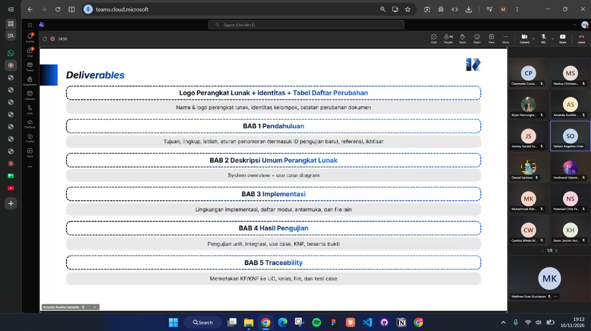

# Form Asistensi

## Tugas Besar IF2150 - Rekayasa Perangkat Lunak

| Informasi | Keterangan |
| --- | --- |
| **Hari** | Senin |
| **Tanggal** | 16 November 2026  |
| **Kelas** | K01 |
| **Nomor Kelompok** | G07  |
| **Nama Kelompok** | #PenjagaNilai  |
| **Nama Perangkat Lunak** | PahamHukum  |
| **Dokumen** | K01_G07_HIUPL.md |

### Anggota Kelompok

| NIM | Nama |
| --- | --- |
| 13525007 | Rivan Cahyadi |
| 13525019 | Raditya Wibian Sastaka |
| 13525064 | Matthew Evan Kurniawan |
| 13525100 | Wesley Lianto |
| 13525109 | Christopherus Michael Jafeth Tobing |

### Catatan

| Catatan |
| --- |
| 1. **Pendahuluan, Gambaran Umum, dan Rincian Implementasi:** Pada Bab 1 dan Bab 2, pastikan aturan penomoran telah menambahkan pola ID pengujian baru serta setiap diagram (*system overview* dan *use case*) dilengkapi narasi yang memperjelas batas sistem. Selanjutnya pada Bab 3, paparkan lingkungan implementasi beserta seluruh *testing tools* yang digunakan, daftar modul fisik, antarmuka ber-ID sesuai DPPL, serta file pendukung lainnya. |
| 2. **Strategi Kedalaman Pengujian Unit dan Coverage:** Setiap kelas pada Tabel 4.1 DPPL wajib diklasifikasikan tingkat kedalaman pengujiannya menjadi *Mendalam*, *Sedang*, atau *Tidak Perlu* berdasarkan karakteristik logikanya. Kelas berkategori *Mendalam* harus diuji pada setiap operasi *public* dengan minimal tiga *test case* (normal, *boundary*, dan negatif) serta wajib mencapai *line* dan *branch coverage* minimal $70\%$. Sementara itu, kelas *Tidak Perlu* tidak membutuhkan *unit test* khusus selama alasannya dicatat pada Tabel 4.1.1 dan tetap teruji secara tidak langsung melalui pengujian *use case*. |
| 3. **Pengujian Integrasi dan Skenario Use Case:** Pengujian integrasi wajib menggunakan komponen nyata (bukan *mock*) untuk memvalidasi *data flow*, *interface coordination*, dan *communication protocol* pada setiap antarmuka arsitektur DPPL. Di sisi lain, pengujian *use case* dilakukan secara manual untuk memverifikasi seluruh skenario normal maupun alternatif sesuai Subbab 4.4 SKPL dengan minimal satu *test case* (`UCXX-TCYY`) per skenario. |
| 4. **Pengujian Kebutuhan Non-Fungsional (KNF):** Setiap parameter KNF pada Tabel 3.2 SKPL harus diuji menggunakan satu metode dan alat ukur yang sesuai dengan target batas kelulusan yang terukur. Hasil aktual wajib dicatat secara objektif dalam bentuk angka atau status nyata pada setiap kasus uji (`KNFxx-TCyy`), di mana satu saja *test case* yang berstatus *Fail* berarti KNF tersebut belum terpenuhi. |
| 5. **Bukti Hasil Pengujian dan Matriks Traceability:** Seluruh kasus uji wajib dilengkapi bukti hasil aktual yang terbaca jelas pada Subbab 4.6, meliputi tangkapan layar aplikasi, keluaran *test runner*, laporan *coverage*, log basis data, serta tangkapan layar alat ukur KNF. Terakhir pada Bab 5, susun pemetaan *traceability* dari setiap kebutuhan hingga ke *test case* terkait, termasuk mencatat alasan apabila terdapat kebutuhan fungsional yang tidak diimplementasikan. |

## Dokumentasi

  

  <i>Gambar 1. Dokumentasi kegiatan asistensi.</i>

