<h1>
IF2150 REKAYASA PERANGKAT LUNAK
 
TUGAS 7
 
DESKRIPSI PERANCANGAN PERANGKAT LUNAK (DPPL)
</h1>
 

## PahamHukum
### *[Logo Perangkat Lunak]*

### Untuk: Mikhael Andrian Yonatan

Dipersiapkan oleh: #PenjagaNilai

| Informasi | Keterangan |
| --- | --- |
| Kelas | K01 |
| Kelompok | G07  |

| NIM | Nama |
|---|---|
| 13525007 | Rivan Cahyadi |
| 13525019 | Raditya Wibian Sastaka |
| 13525064 | Matthew Evan Kurniawan |
| 13525100 | Wesley Lianto |
| 13525109 | Christopherus Michael Jafeth Tobing |

---

## Daftar Perubahan

| Revisi | Deskripsi |
| :--- | :--- |
| *A* | Penambahan dan penyesuaian atribut serta metode kelas pada use case UC06 (C06, C07, C08, C09, C10, C17, C26) agar realisasi skenario normal dan alternatif dapat digambarkan pada sequence diagram. Tidak ada kelas baru. |
| *B* | Penyesuaian kelas pada use case UC07 dan UC08: penambahan metode `ambilDaftarKonten()` pada C02 `Kurator` untuk mengambil konten milik Kurator, penambahan metode `ambilAntreanPeninjauan()` pada C03 `Administrator` untuk mengambil konten berstatus Diajukan terurut dari yang paling lama menunggu, serta perubahan tipe kembalian `kembalikanKonten(...)` pada C28 `KontrolModerasiKonten` dari `void` menjadi `bool` agar halaman dapat menampilkan pesan wajib isi ketika alasan revisi kosong. Tidak ada kelas baru. |
| *C* | Penyesuaian kelas pada use case UC01 dan UC02: penambahan atribut `- idKelompokTerpilih: int` dan `- teksDisclaimer: Text` serta operasi `+ tampilkanPeringatanDarurat(): void` pada C13 `HalamanJelajahKasus`, penambahan operasi `+ cekDarurat(idKelompok: int): bool` pada C21 `KontrolJelajahKasus`, penambahan atribut `- teksDisclaimer: Text` serta operasi `+ tampilkanHasil(daftarHasil: KelompokKasus [0..*]): void` dan `+ tampilkanTidakDitemukan(saranBidang: BidangHukum [1..*]): void` pada C15 `HalamanPencarianKataKunci`, penyertaan operasi `+ ambilDaftarLangkah(): LangkahPenyelesaian [1..*]` dan `+ ambilDaftarArtikel(): Artikel [1..*]` pada C06 `RangkumanKasus` ke dalam diagram kelas UC01 agar sesuai dengan pemanggilan pada sequence diagram, serta penyertaan C14 `HalamanRangkumanKasus` ke dalam diagram kelas use case UC02 karena halaman rangkuman kasus ikut terlibat pada alur membuka hasil pencarian. Tidak ada kelas baru. |
| ... |  |

---

 

> **Petunjuk pengerjaan:** *[Silahkan hapus bagian ini setelah selesai mengerjakan]*
>
> Dokumen ini melanjutkan **Spesifikasi Kebutuhan Perangkat Lunak (SKPL)** dan **Arsitektur Perangkat Lunak (APL)**. Gunakan nama, ID, kebutuhan, dan use case yang konsisten dengan kedua dokumen tersebut. Contoh pola ID baru di bawah dapat disesuaikan dengan kesepakatan kelompok, ID yang sudah ada tetap dipertahankan.

 

---

# BAB 1: Pendahuluan

## 1.1 Tujuan Penulisan Dokumen
Deskripsi Perancangan Perangkat Lunak (DPPL) disusun untuk menjelaskan rancangan perangkat lunak PahamHukum yang akan diimplementasikan. Dokumen ini merupakan kelanjutan dari Spesifikasi Kebutuhan Perangkat ;unak (SKPL) dan Arsitektur Perangkat Lunak (APL) dengan mengolah kebutuhan dan arsitektur menjadi rancangan yang lebih rinci. Perincian itu merealisasikan tiap use case ke dalam sequence diagram yang merinci alur tiap proses yang dilakukan oleh user pada use case terkait. Dokumen ini penting bagi pengembang sebagai referensi alur saat menuliskan kode, bagi desainer sebagai landasan fitur dan tampilan yang dibutuhkan, dan bagi penguji sebagai dasar penyusunan skenario pengujian (*testing*).

## 1.2 Lingkup Masalah
PahamHukum adalah platform literasi hukum berbasis web yang menjembatani masyarakat awam dengan informasi hukum. Informasi pada sistem disusun berdasarkan situasi sehari-hari dalam bentuk rangkuman kasus. Rangkuman kasus memuat inti masalah, hak, langkah penyelesaian, poin pertimbangan, checklist dokumen, templat surat yang dapat diunduh, dan artikel pendukung. Pencari Informasi dapat menggunakan seluruh fitur publik tanpa akun, sedangkan Kurator menyusun konten dan Administrator meninjau konten sebelum ditayangkan sekaligus mengelola akun Kurator. PahamHukum tidak bertindak sebagai penasihat hukum resmi, melainkan sebagai penuntun langkah awal sebelum masyarakat berinteraksi dengan lembaga hukum formal.

## 1.3 Definisi, Istilah, dan Singkatan
Semua definisi dan singkatan yang digunakan dalam dokumen ini beserta penjelasannya.

Tabel 1.3. Definisi Istilah dan Singkatan

| Singkatan, Akronim, atau Istilah | Penjelasan |
| :--- | :--- |
| **P/L** | Singkatan dari Perangkat Lunak, yaitu aplikasi yang memberikan perintah kepada komputer untuk menjalankan tugas tertentu |
| **SKPL** | Singkatan dari Spesifikasi Kebutuhan Perangkat Lunak, yaitu dokumen yang merangkum kebutuhan fungsional dan non-fungsional serta memetakan dalam Class Diagram (CD) untuk Perangkat Lunak terkait |
| **DPPL** | Singkatan dari Deskripsi Perancangan Perangkat Lunak, yaitu dokumen yang merinci rancangan dari SKPL dalam bentuk sequence diagram sebagai referensi saat implementasi Perangkat Lunak terkait |
| **APL** | Singkatan dari Arsitektur Perangkat Lunak, yaitu dokumen yang merinci pola arsitektur, komponen, dan model arsitektur Perangkat Lunak terkait |
| **KF** | Singkatan dari Kebutuhan Fungsional |
| **KNF** | Singkatan dari Kebutuhan Non-Fungsional |
| **UC**| Singkatan dari *Use Case*, yaitu rangkaian interaksi antara aktor dan sistem untuk mencapai suatu target |
| **MVC** | Singkatan dari *Model-View-Controller*, yaitu pola arsitektur yang memisahkan data (*Model*), tampilan (*View*), dan alur pengendali (*Controller*). |
|**Boundary**, **Control**, **Entity** | Stereotipe kelas pada tahap analisis yang masing-masing berperan sebagai antarmuka, pengendali alur, dan data. Pada rancangan MVC PahamHukum, ketiganya dipetakan ke *View*, *Controller*, dan *Model*. |
| **Kelas** | Kelas yang siap diimplementasikan, lengkap dengan atribut, metode, tipe data, dan visibilitasnya. Beberapa kelas membentuk suatu Class Diagram (CD). |
| **Sequence Diagram** | Diagram UML yang menggambarkan urutan pesan antarobjek untuk menjalankan satu skenario *use case*. |
| **Pencari Informasi** | Masyarakat awam yang menelusuri, mencari, dan membaca rangkuman kasus tanpa akun |
| **Kurator** | Pengelola sistem yang menyusun, menyunting, dan mengajukan konten untuk rangkuman kasus |
| **Administrator** | Pengelola sistem yang meninjau dan memutuskan kelayakan konten serta mengelola akun Kurator |

## 1.4 Aturan Penomoran
Tuliskan aturan penomoran (ID) yang digunakan dalam dokumen ini. Gunakan pola ID yang **sama** dengan yang sudah dipakai pada dokumen-dokumen sebelumnya, jangan membuat pola baru di dokumen ini.

Tabel 1.4. Aturan Penomoran

| Hal/Bagian | Penomoran | Keterangan |
| :--- | :--- | :--- |
| Kebutuhan Fungsional | KFXX | XX adalah nomor urut dari 01 hingga 44, mengikuti SKPL |
| Kebutuhan Non-Fungsional | KNFXX | XX adalah nomor urut dari 01 hingga 14, mengikuti SKPL |
| Aktor | AKTXX | XX adalah nomor urut dari 01 hingga 03, mengikuti SKPL |
| Use Case | UCXX | XX adalah nomor urut dari 01 hingga 09, mengikuti SKPL |
| Kelas | CXX | XX adalah nomor urut dari 01 hingga 29, mengikuti SKPL |

## 1.5 Referensi
1. K01_G07_SKPL, Spesifikasi Kebutuhan Perangkat Lunak (SKPL) PahamHukum, IF2150 Rekayasa Perangkat Lunak, Institut Teknologi Bandung, 2026
2. K01_G07_APL, Arsitektur Perangkat Lunak (APL) PahamHukum, IF2150 Rekayasa Perangkat Lunak, Institut Teknologi Bandung, 2026
3. PlantUML, “Sequence Diagram syntax and features,” PlantUML.com. Tersedia: https://plantuml.com/sequence-diagram
4. Object Management Group, “Unified Modeling Language (UML), Version 2.5.1,” OMG Document formal/2017-12-05, Des. 2017. Tersedia: https://www.omg.org/spec/UML/2.5.1/

## 1.6 Deskripsi Umum Dokumen (Ikhtisar)
Dokumen DPPL ini terdiri atas lima bab. BAB 1 menjelaskan tujuan penulisan, lingkup masalah, definisi istilah, aturan penomoran, dan referensi. BAB 2 memaparkan perancangan arsitektur, yaitu lingkungan implementasi, pola arsitektur MVC, identifikasi komponen, dan model arsitektur dari dokumen APL. BAB 3 menjabarkan realisasi setiap *use case* melalui identifikasi kelas, sequence diagram untuk skenario normal dan alternatif, serta diagram kelas per *use case*. BAB 4 menyajikan diagram kelas keseluruhan beserta daftar atribut dan metodenya. Terakhir, BAB 5 memuat tabel *traceability* yang memetakan kelas terhadap *use case* terkait.

 

---

# BAB 2: Perancangan Arsitektur

## 2.1 Rancangan Lingkungan Implementasi

Rancangan lingkungan implementasi perangkat lunak **PahamHukum** diturunkan dari spesifikasi lingkungan operasi pada subbab 2.5 dokumen SKPL serta Tabel 1.1 dokumen APL. Spesifikasi lingkungan operasi dan rincian lingkungan implementasi sistem disajikan pada Tabel 2.1.1 dan Tabel 2.1.2.

Tabel 2.1.1. Lingkungan Operasi Perangkat Lunak

| Komponen | Spesifikasi |
| :--- | :--- |
| Server | Web server pada layanan *cloud hosting* gratis atau berbiaya rendah dengan dukungan HTTPS |
| Client | Peramban Chrome, Firefox, Edge, atau Safari (versi rilis dua tahun terakhir) di komputer maupun ponsel |
| DBMS | Basis data relasional (PostgreSQL atau MySQL) untuk data akun, bidang hukum, kelompok kasus, konten, dan riwayat perubahan status |
| Penyimpanan Berkas | Penyimpanan di sisi server untuk templat PDF dan DOCX |
| OS | Tidak bergantung pada sistem operasi tertentu selama tersedia peramban yang didukung |
| Jaringan | Koneksi internet minimal 1 Mbps agar beranda termuat paling lama 3 detik |

Tabel 2.1.2. Spesifikasi Rancangan Lingkungan Implementasi

| Aspek Lingkungan | Spesifikasi Implementasi | Keterangan |
| :--- | :--- | :--- |
| ***Operating System*** | **Sisi Server:** Linux (Ubuntu Server / Debian pada layanan *cloud hosting*) **Sisi Klien:** Lintas sistem operasi (*cross-platform*: Windows, macOS, Linux, Android, iOS) **Sisi Pengembangan:** Windows, macOS, atau Linux | Pengguna tidak bergantung pada sistem operasi tertentu selama menggunakan peramban web rilis dua tahun terakhir (Chrome, Firefox, Edge, atau Safari) dengan lebar layar minimal 360 piksel (KNF03). |
| **DBMS** | PostgreSQL atau MySQL (Basis Data Relasional) | Menyimpan seluruh entitas *Model* secara persisten, meliputi data otorisasi (`Akun`, `Kurator`, `Administrator`), struktur katalog (`BidangHukum`, `KelompokKasus`), konten hukum (`RangkumanKasus`, `LangkahPenyelesaian`, `Checklist`, `TemplatDokumen`, `Artikel`, `LembagaBantuanHukum`), serta log permanen (`RiwayatStatus` sesuai KNF09). |
| ***Development Tools*** | - **IDE / Code Editor:** Visual Studio Code - **Version Control:** Git dan GitHub - **Pemodelan UML & Desain:** PlantUML, Draw.io, dan StarUML - **Pengujian & Inspeksi:** Browser Developer Tools (Chrome/Firefox DevTools) | Digunakan untuk penulisan kode sumber, kolaborasi repositori kelompok, penyusunan diagram arsitektur dan *sequence/class diagram*, serta pengujian responsivitas antarmuka dan efisiensi ukuran halaman ($\le$ 350 KB pada KNF02). |
| ***Filing System*** | - **Sisi Server:** Sistem berkas direktori server (*Server-side File System*) - **Sisi Klien:** *Browser Local Storage* (*Web Storage API*) | Sistem berkas server menyimpan berkas fisik templat dokumen berformat `.pdf` dan `.docx` (maksimal 5 MB sesuai KF26) dengan dukungan *rollback* versi (KNF08). *Local Storage* peramban menyimpan status centang *checklist* secara lokal di perangkat pengguna tanpa pernah dikirim ke server (KF14, KNF06). |
| **Bahasa Pemrograman** | - **Sisi Klien (*Front-End / View*):** HTML5, CSS3, dan JavaScript / TypeScript - **Sisi Server (*Back-End / Controller & Model*):** Python / Node.js (TypeScript/JavaScript) dengan *hash* *bcrypt* (*cost factor* $\ge$ 10 sesuai KNF10) - **Basis Data:** SQL (*Structured Query Language*) | HTML5, CSS3, dan JavaScript merender antarmuka publik dan panel pengelola (termasuk *single-page form* KNF12, peninjauan satu layar KNF13, dan manipulasi `localStorage`). Bahasa sisi server menjalankan logika *Controller* dan *Model* dalam satu proses aplikasi, sedangkan SQL mengelola kueri pada DBMS relasional. |

PahamHukum berjalan sebagai aplikasi web yang dilayani dari satu web server pada *cloud hosting* gratis atau berbiaya rendah. Kondisi ini selaras dengan pola arsitektur MVC karena *Model*, *View*, dan *Controller* dapat dipasang dalam satu proses aplikasi tanpa layanan tambahan. Klien yang beragam (berbeda perangkat, peramban, dan sistem operasi) hanya menerima *View* yang dirender oleh server, sehingga perbedaan perangkat cukup ditangani di lapisan *View*. DBMS relasional dan penyimpanan berkas di sisi server hanya diakses melalui *Model*, sehingga *View* tidak pernah menyentuh data secara langsung dan pergantian antara PostgreSQL atau MySQL tidak memengaruhi *Controller* maupun *View*. Selain itu, batas koneksi minimal 1 Mbps dengan target pemuatan beranda paling lama 3 detik (KNF01) menuntut halaman yang ringan; pemisahan *View* dari logika bisnis memudahkan ukuran halaman dijaga tetap kecil karena *Controller* hanya mengambil data yang diperlukan.

---

## 2.2 Style/Pattern Arsitektur Acuan

Untuk **PahamHukum**, *pattern* arsitektur yang dipilih sebagai acuan adalah **Model-View-Controller (MVC)**. *Pattern* ini memisahkan sistem menjadi tiga bagian dengan tanggung jawab yang berbeda, yaitu *Model*, *View*, dan *Controller*. Pemisahan tersebut bertujuan agar perubahan di satu bagian tidak menuntut perombakan menyeluruh pada bagian lainnya. Adapun pembagian tanggung jawabnya adalah sebagai berikut:

1. **Model**  
   Komponen **Model** adalah bagian yang merepresentasikan data dan cara data tersebut dikelola. *Model* memiliki aturan untuk menjaga data, cara data disimpan, dan cara data diambil oleh komponen lain. Pada PahamHukum, **Model** merepresentasikan struktur data konten dan pengelola sistem yang terdiri atas 12 *entity*, yaitu data konten (`BidangHukum`, `KelompokKasus`, `RangkumanKasus`, `LangkahPenyelesaian`, `Checklist`, `TemplatDokumen`, `Artikel`, `LembagaBantuanHukum`), data otorisasi pengguna (`Akun`, `Kurator`, `Administrator`), serta riwayat perubahan status (`RiwayatStatus`).

2. **View**  
   Komponen **View** bertanggung jawab menampilkan antarmuka sistem yang dapat langsung dilihat oleh pengguna sekaligus menerima masukan dari interaksi pengguna. Namun, **View** tidak mengambil data langsung dari *database* atau memutuskan kelayakan konten. **View** hanya menerima data yang diberikan *Controller* dan meneruskan interaksi pengguna kembali ke *Controller*. Pada PahamHukum, **View** terbagi menjadi dua kelompok antarmuka utama:
   - **Antarmuka Publik**: Menampilkan beranda penelusuran bidang hukum, hasil pencarian pengguna, serta halaman rangkuman kasus yang memuat penjelasan, hak, langkah-langkah, *checklist* dokumen, dan tombol unduh templat surat.
   - **Antarmuka Pengelola**: Menyediakan halaman *login*, formulir penyusunan konten bagi Kurator, antrean peninjauan konten bagi Administrator, serta halaman pengelolaan akun Kurator.

   Seluruh komponen **View** diturunkan dari kelas-kelas *Boundary* pada dokumen SKPL (BAB 5).

3. **Controller**  
   Komponen **Controller** adalah penghubung antara *View* dan *Model*. Komponen ini menerima permintaan dari *View*, memvalidasi masukan, lalu memanggil *Model* untuk mengambil atau mengubah data. Setelah itu, *Controller* memilih *View* yang harus ditampilkan atau menentukan pesan spesifik yang perlu diberikan. Contoh dalam skenario *login* akun: *View* mengirimkan permintaan ke **Controller** untuk memeriksa kombinasi email dan kata sandi. **Controller** kemudian meminta *Model* memverifikasi data tersebut. Jika benar, **Controller** mengarahkan pengguna ke *View* halaman sesuai perannya; jika salah, **Controller** menampilkan kembali *View* halaman *login* dengan pesan kesalahan. Pada PahamHukum, **Controller** menangani alur penelusuran, pencarian, pengelolaan sesi *login* dan *logout*, interaksi pengguna dengan *checklist*, pengunduhan templat dokumen, hingga alur peninjauan dan perubahan status konten.

### Alasan Pemilihan Arsitektur MVC

1. **Keterlacakan dengan pemodelan kelas *Entity, Control, Boundary* pada SKPL**  
   Pada BAB 5 SKPL, PahamHukum telah dimodelkan menjadi 29 kelas yang terbagi menjadi *Entity*, *Control*, dan *Boundary*. Struktur tersebut berpadanan langsung dengan MVC:
   - 8 kelas *Boundary* dipetakan menjadi komponen *View*.
   - 9 kelas *Control* dipetakan menjadi komponen *Controller*.
   - 12 kelas *Entity* dipetakan menjadi komponen *Model*.  
   Dengan memilih MVC, rantai keterlacakan dari kebutuhan awal, *use case*, hingga rancangan kelas tetap terjaga tanpa perombakan ulang.

2. **Dukungan terhadap dua kelompok antarmuka berbeda**  
   Sistem PahamHukum melayani tiga aktor dengan kebutuhan yang kontras. Pencari Informasi mengakses antarmuka publik tanpa akun, sedangkan Kurator dan Administrator mengakses panel pengelola yang membutuhkan autentikasi dan manipulasi data. Pola MVC memungkinkan entitas data yang sama (misalnya `RangkumanKasus` dan `RiwayatStatus`) disajikan ke dalam antarmuka publik maupun antarmuka pengelola melalui *View* yang terpisah, tanpa duplikasi atau perubahan logika bisnis pada *Model*.

3. **Penegakan alur status konten yang terkendali**  
   Konten melewati siklus `Draft` $\rightarrow$ `Diajukan` $\rightarrow$ `Disetujui` atau `Perlu Revisi`, dan publik hanya dapat melihat konten berstatus `Disetujui`. *Controller* yang mengatur penyusunan dan moderasi konten bertugas memvalidasi hak akses dan status konten sebelum mengubah data di *Model*, lalu mencatat perubahannya secara permanen di `RiwayatStatus` sesuai KNF09.

4. **Menjaga pemisahan antara aturan domain dan tampilan**  
   Perubahan di sisi antarmuka atau *View* tidak boleh melangkahi aturan seperti urutan status pengajuan konten dan pencatatan riwayat. Konten yang belum disetujui tidak boleh muncul ke halaman utama. Dengan MVC, aturan-aturan ini berada pada *Model* dan dikawal oleh *Controller*, sementara *View* hanya menampilkan data sehingga risiko rusaknya aturan bisnis saat tampilan berubah dapat diminimalkan.

5. **Mendukung penggunaan ulang komponen tampilan di antarmuka**  
   Halaman Jelajah, Rangkuman, dan Pencarian memakai komponen tampilan yang serupa untuk menampilkan konten dengan sumber data dan aksi yang berbeda. *View* yang sama dapat dipakai oleh beberapa *Controller* dan *Model* tanpa duplikasi. Sebaliknya, satu *Model* seperti `RangkumanKasus` dapat ditampilkan melalui beberapa *View* tanpa mengubah *Model*-nya.

6. **Mendukung pemenuhan Kebutuhan Non-Fungsional (KNF) PahamHukum**  
   - **KNF09** menetapkan bahwa riwayat perubahan status konten bersifat permanen dan tidak dapat diubah; aturan ini ditempatkan di bagian *Model* tepatnya pada entitas `RiwayatStatus`.
   - **KNF14** menetapkan bahwa sesi pengelola harus berakhir otomatis setelah 30 menit tanpa aktivitas; aturan pengelolaan sesi tersebut ditempatkan pada *Controller* (`KontrolAutentikasi`).
   - **KNF12** dan **KNF13** menuntut formulir penyusunan konten berada dalam satu halaman dan peninjauan konten berada dalam satu layar; keduanya diselesaikan di lapisan *View* tanpa mengganggu komponen lain.

<i>Gambar 2.2.1 Arsitektur MVC pada Sistem PahamHukum</i>

---

## 2.3 Identifikasi Komponen / Modul / Subsistem

Komponen pada PahamHukum diidentifikasi berdasarkan pola *Model-View-Controller* (MVC) yang telah ditetapkan pada subbab 2.2. Setiap komponen dikelompokkan menurut lapisan arsitektur, yaitu *View*, *Controller*, dan *Model*, ditambah komponen *Penyimpanan Data*. Komponen `Database` dan `Penyimpanan Berkas` berasal dari lingkungan operasi pada Tabel 2.1.1, sedangkan `Penyimpanan Lokal Peramban` berasal dari KF14 dan KNF06 pada dokumen SKPL. Kelas *Boundary* pada dokumen SKPL menjadi komponen *View*, kelas *Control* menjadi komponen *Controller*, dan kelas *Entity* menjadi komponen *Model*. Dengan demikian, seluruh 29 kelas pada SKPL tercakup oleh komponen pada Tabel 2.3, dan seluruh *use case* UC01 sampai UC09 dapat dijalankan oleh komponen-komponen tersebut.

Tabel 2.3. Identifikasi Komponen/Modul/Subsistem

| Nama Komponen/Modul/Subsistem | Jenis | Penjelasan |
| :--- | :--- | :--- |
| `HalamanJelajahKasus` | *View* | Menampilkan beranda berisi bidang hukum dan kelompok kasus, serta peringatan prioritas untuk kasus darurat, lalu meneruskan pilihan pengguna ke `KontrolJelajahKasus`. |
| `HalamanRangkumanKasus` | *View* | Menampilkan satu rangkuman kasus lengkap (langkah, *checklist*, templat, artikel, direktori LBH) beserta status centang *checklist*, meneruskan permintaan centang *checklist* ke `KontrolChecklist`, serta meneruskan aksi unduh templat ke `KontrolUnduhTemplat`. |
| `HalamanPencarianKataKunci` | *View* | Menampilkan kolom pencarian, daftar hasil, dan pesan serta saran jika kasus tidak ditemukan, lalu meneruskan kata kunci ke `KontrolPencarianKataKunci`. |
| `HalamanLogin` | *View* | Menampilkan formulir *login* pengelola beserta pesan galat dan meneruskan kredensial ke `KontrolAutentikasi`. |
| `HalamanPenyusunanKonten` | *View* | Menampilkan formulir penyusunan konten satu halaman bagi Kurator dan meneruskan aksi simpan draf, unggah templat, dan ajukan ke `KontrolPenyusunanKonten`. |
| `HalamanDaftarKontenKurator` | *View* | Menampilkan daftar konten milik Kurator beserta status dan catatan revisinya, lalu meneruskan pilihan konten ke `KontrolPelacakanKonten`. |
| `HalamanModerasiKonten` | *View* | Menampilkan antrean dan isi konten untuk Administrator beserta tombol Setujui dan Kembalikan pada layar yang sama, lalu meneruskan keputusan ke `KontrolModerasiKonten`. |
| `HalamanPengelolaanAkun` | *View* | Menampilkan daftar Kurator dan formulir pendaftaran, pembaruan, serta penonaktifan akun bagi Administrator, lalu meneruskan aksinya ke `KontrolPengelolaanAkun`. |
| `KontrolJelajahKasus` | *Controller* | Mengatur alur penampilan bidang hukum, kelompok kasus, rangkuman kasus, dan direktori LBH. |
| `KontrolPencarianKataKunci` | *Controller* | Memproses kata kunci, mengambil hasil yang relevan, dan menyarankan bidang lain jika kasus tidak ditemukan. |
| `KontrolChecklist` | *Controller* | Mengambil *checklist* rangkuman, menghitung kelengkapan dokumen yang dicentang, serta menyimpan dan memuat status centang pada `Penyimpanan Lokal Peramban`. |
| `KontrolUnduhTemplat` | *Controller* | Menyediakan daftar dan berkas templat versi terbaru untuk diunduh. |
| `KontrolAutentikasi` | *Controller* | Memeriksa kredensial akun, mengarahkan pengguna sesuai perannya, serta mengakhiri sesi saat keluar atau kedaluwarsa (30 menit tanpa aktivitas). |
| `KontrolPenyusunanKonten` | *Controller* | Mengatur pembuatan draf, pelampiran templat, validasi isian, dan pengajuan konten (`Draft` menjadi `Diajukan`), serta mencatat riwayat statusnya. |
| `KontrolPelacakanKonten` | *Controller* | Mengambil daftar konten milik Kurator dan catatan revisinya. |
| `KontrolModerasiKonten` | *Controller* | Mengatur persetujuan dan pengembalian konten oleh Administrator, mewajibkan alasan revisi, dan mencatat riwayat status ke `RiwayatStatus`. |
| `KontrolPengelolaanAkun` | *Controller* | Mengatur pendaftaran, pembaruan, dan penonaktifan akun Kurator. |
| `Akun` | *Model* | Merepresentasikan data akun pengelola (email, kata sandi ter-*hash*, peran) serta metode untuk memverifikasi dan mengubahnya. |
| `Kurator` | *Model* | Merepresentasikan akun Kurator (status aktif dan jumlah konten) serta metode untuk mengakses dan mengubahnya, turunan `Akun`. |
| `Administrator` | *Model* | Merepresentasikan akun Administrator beserta daftar Kurator yang dikelolanya, turunan `Akun`. |
| `BidangHukum` | *Model* | Merepresentasikan bidang hukum beserta status aktif dan kelompok kasus di bawahnya serta metode untuk mengakses dan mengubahnya. |
| `KelompokKasus` | *Model* | Merepresentasikan satu jenis kasus (judul sehari-hari, istilah resmi, penanda darurat) serta metode pencocokan kata kunci. |
| `RangkumanKasus` | *Model* | Merepresentasikan isi rangkuman kasus beserta status, penulis, tanggal peninjauan, dan catatan revisi serta metode untuk mengakses dan mengubahnya. |
| `LangkahPenyelesaian` | *Model* | Merepresentasikan langkah bernomor beserta tujuan, dokumen yang diperlukan, dan tenggat. |
| `Checklist` | *Model* | Merepresentasikan daftar dokumen yang perlu disiapkan untuk suatu kasus. |
| `TemplatDokumen` | *Model* | Merepresentasikan berkas templat (format, ukuran, versi, tanggal pembaruan) serta validasi unggahan PDF/DOCX maksimal 5 MB. |
| `Artikel` | *Model* | Merepresentasikan artikel pendukung beserta tautan ke sumber hukum resmi. |
| `LembagaBantuanHukum` | *Model* | Merepresentasikan direktori LBH beserta wilayah layanannya. |
| `RiwayatStatus` | *Model* | Merepresentasikan catatan perubahan status konten (konten, pelaku, status, waktu) yang bersifat permanen dan tidak dapat diubah (KNF09). |
| `Database` | *Penyimpanan Data* | Menyimpan seluruh data *Model* secara persisten pada DBMS relasional (PostgreSQL atau MySQL). |
| `Penyimpanan Berkas` | *Penyimpanan Data* | Menyimpan berkas templat PDF dan DOCX di sisi server. |
| `Penyimpanan Lokal Peramban` | *Penyimpanan Data* | Menyimpan status centang *checklist* di perangkat pengguna dan tidak pernah dikirim ke server (KNF06). |

---

## 2.4 Model Arsitektur Perangkat Lunak

Model arsitektur perangkat lunak PahamHukum disajikan dalam dua *view* yang saling melengkapi, yaitu ***Logical View*** untuk menggambarkan struktur logis dan kolaborasi antarkomponen berdasarkan pola MVC, serta ***Physical View*** untuk menggambarkan penempatan (*deployment*) komponen pada node perangkat keras dan lingkungan eksekusinya.

### 2.4.1 Logical View

Model arsitektur perangkat lunak yang dipilih untuk PahamHukum adalah **Model-View-Controller (MVC)** yang divisualisasikan melalui ***Logical View***. *Logical View* mendeskripsikan abstraksi komponen utama sistem dan hubungannya secara statis untuk mendukung pemenuhan kebutuhan fungsional bisnis. Model arsitektur ini cocok untuk aplikasi PahamHukum karena PahamHukum memiliki antarmuka yang berbeda antara pengguna publik dan panel pengelola. MVC memungkinkan tampilan (*View*) dipisah dari alur dan validasi (*Controller*) serta aturan dan data (*Model*) sehingga perubahan tampilan di masa depan tidak merusak aturan atau status konten. *Logical View* dipilih karena memperlihatkan pembagian tanggung jawab *View*, *Controller*, dan *Model* serta arah panggilan antarkomponen secara menyeluruh.

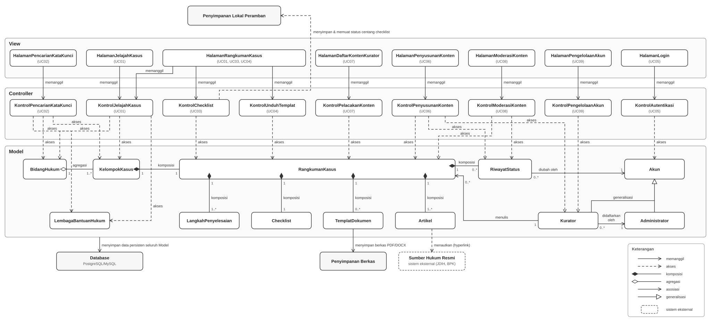

<i>Gambar 2.4.1 Logical View pada Sistem PahamHukum berbasis Pola MVC</i>

#### Penjelasan Komponen dan Label Relasi

Diagram pada Gambar 2.4.1 memetakan ke-32 komponen yang terdaftar pada Tabel 2.3 ke dalam tiga lapisan utama MVC beserta subsistem penyimpanannya:

1. **View**  
   Terdiri atas 8 komponen antarmuka yang melayani interaksi langsung dengan pengguna (mulai dari `HalamanJelajahKasus`, `HalamanRangkumanKasus`, `HalamanPencarianKataKunci` untuk pengguna publik anonim, hingga antarmuka pengelolaan konten dan akun untuk Administrator dan Kurator).

2. **Controller**  
   Terdiri atas 9 komponen pengendali yang mengoordinasikan interaksi antara *View* dan *Model*. *Controller* bertanggung jawab memvalidasi setiap *event* dari pengguna (misalnya verifikasi otorisasi pada `KontrolAutentikasi` atau penyetujuan pada `KontrolModerasiKonten`) sebelum mengizinkan pemanggilan operasi ke *Model*.

3. **Model**  
   Terdiri atas 12 komponen entitas yang menyimpan struktur data hukum dan pengguna sistem. Komponen `RiwayatStatus` diisolasi guna memenuhi perlindungan KNF09 di mana riwayat perubahan status tidak boleh dimanipulasi atau diubah setelah dibuat.

4. **Penyimpanan Data**  
   Terdiri atas `Database` dan `Penyimpanan Berkas` yang berada di server, serta komponen khusus `Penyimpanan Lokal Peramban` (di sisi klien). `Penyimpanan Lokal Peramban` digunakan oleh `KontrolChecklist` dan `HalamanRangkumanKasus` untuk mempertahankan daftar persiapan dokumen pengguna secara anonim. `Sumber Hukum Resmi` digambar sebagai sistem eksternal di luar ruang lingkup komponen Tabel 2.3.

**Keterangan Relasi (Label Panah):**
- **memanggil:** Aksi dari *View* yang meneruskan interaksi pengguna ke *Controller* terkait.
- **akses:** Aksi dari *Controller* untuk menerapkan logika bisnis terhadap *Model* (mengambil, mengubah, atau menghapus data).
- **komposisi / agregasi:** Relasi kepemilikan struktural antar-*Model* di mana komponen bagian (misalnya `Checklist`) terikat kuat (komposisi) atau terkait lepas (agregasi) dengan entitas induknya (misalnya `RangkumanKasus`).
- **asosiasi:** Keterkaitan operasional spesifik berarah, di mana peranannya dituliskan langsung di atas garis (contoh: "menulis", "diubah oleh").
- **generalisasi:** Pewarisan atribut dan metode dari *Model* spesifik (`Kurator`, `Administrator`) ke *Model* umum (`Akun`).
- **sistem eksternal:** Entitas di luar ruang lingkup PahamHukum (seperti JDIH/BPK) yang ditautkan melalui URL.

### 2.4.2 Physical View

Selain *Logical View* pada subbab 2.4.1, PahamHukum juga dimodelkan melalui ***Physical View*** (*deployment view*) agar lingkungan eksekusi perangkat lunak terlihat jelas. *Physical View* mendeskripsikan node tempat komponen berjalan atau tersimpan, *artifact* yang dipasang pada node tersebut, serta jalur jaringan antarnode. *View* ini dipilih sebagai pelengkap *Logical View* karena PahamHukum melayani klien yang beragam (lintas perangkat, peramban, dan sistem operasi, dengan koneksi yang bervariasi sesuai batasan pada subbab 2.4 SKPL), sehingga penting menunjukkan secara eksplisit di mana data disimpan: di peramban klien (sementara dan anonim untuk *checklist*) atau di server (persisten untuk seluruh data lain).

Diagram digambar dengan notasi *UML Deployment Diagram*: node berstereotip `«Device»` dengan nama instans `:NamaNode`, lingkungan eksekusi di dalam node (`«Execution Environment»`, `«Database System»`, `«File System»`) digambar abu-abu sebagai perangkat lunak pihak ketiga, sedangkan setiap komponen pada Tabel 2.3 digambar sebagai `«artifact»` putih bergambar ikon komponen di luar node dan dihubungkan dengan panah putus-putus `«deploy»` ke lingkungan eksekusi tujuannya. Pemetaan ini langsung menggunakan lingkungan operasi pada Tabel 2.1.1, sehingga hubungan antara pilihan teknologi dan tempat dijalankannya pola MVC terlihat secara konkret.

<i>Gambar 2.4.2 Physical View pada Sistem PahamHukum</i>

#### Pemetaan Node dan Artifact ke Lingkungan Operasi dan Komponen

Tabel 2.4.1. Pemetaan Node dan Artifact pada Physical View

| Node | Lingkungan Eksekusi (Pihak Ketiga) | Komponen Lingkungan (Tabel 2.1.1) | Artifact yang Dipasang (Tabel 2.3) |
| :--- | :--- | :--- | :--- |
| `:Perangkat Klien` `«Device»` | `:Peramban Web` `«Execution Environment»` | Client, OS | `:Penyimpanan Lokal Peramban` (status centang *checklist*, tidak dikirim ke server sesuai KNF06), serta instans sisi klien dari `:HalamanRangkumanKasus` dan `:KontrolChecklist` |
| `:Web Server` `«Device»` | `:Application Server` `«Execution Environment»` | Server | 8 *artifact* *View*, 9 *artifact* *Controller*, dan 12 *artifact* *Model* (total 29), dijalankan dalam satu proses aplikasi |
| | `:Sistem Berkas Server` `«File System»` | Penyimpanan Berkas | `:Penyimpanan Berkas` (templat PDF/DOCX) |
| `:Database Server` `«Device»` | `:PostgreSQL / MySQL` `«Database System»` | DBMS | `:Database` |
| `:Sumber Hukum Resmi` (garis putus-putus) | — | — | Sistem eksternal di luar PahamHukum (JDIH, peraturan.bpk.go.id); bukan komponen Tabel 2.3 |

`:HalamanRangkumanKasus` dan `:KontrolChecklist` dipasang pada **dua node**: instans di `:Web Server` menyusun halaman rangkuman dan mengambil isi *checklist* dari *Model*, sedangkan instans di `:Peramban Web` berjalan pada perangkat pengguna untuk memperbarui tampilan centang, menghitung kelengkapan dokumen, serta menyimpan dan memuat status centang di `:Penyimpanan Lokal Peramban` (UC03, KF13, KF14). Pemasangan ganda ini diperlukan karena KNF06 melarang status centang dikirim ke server.

#### Keterangan Jalur Komunikasi

Tabel 2.4.2. Keterangan Jalur Komunikasi pada Physical View

| Penghubung | Stereotype | Multiplisitas | Keterangan |
| :--- | :--- | :--- | :--- |
| `:Perangkat Klien` — `:Web Server` | `«internet»` `{HTTPS}` | n : 1 | Permintaan halaman dan pengiriman formulir. Terkait baris *Jaringan* Tabel 2.1.1 (minimal 1 Mbps, beranda termuat paling lama 3 detik). |
| `:Web Server` — `:Database Server` | `«intranet»` `{SQL}` | 1 : 1 | Kueri baca/tulis oleh lapisan *Model* ke `:Database`. |
| `:Perangkat Klien` — `:Sumber Hukum Resmi` | `«internet»` `{hyperlink}` | n : 1 | Dibuka langsung oleh peramban pengguna saat mengeklik rujukan pada `Artikel`, bukan panggilan dari Web Server. |

*Catatan:* `:Database Server` digambar sebagai node terpisah dari `:Web Server` karena DBMS pada Tabel 2.1.1 adalah layanan tersendiri. Jika pada implementasi basis data berada pada mesin yang sama dengan aplikasi, kedua node cukup digabung dan jalur `«intranet»` dihilangkan tanpa mengubah pemetaan *artifact*.

 

---

# BAB 3: Realisasi Use Case

## 3.1 Use Case Menelusuri dan Membaca Rangkuman Kasus

**ID Use Case:** UC01  
**Nama Use Case:** Menelusuri dan Membaca Rangkuman Kasus

Use case ini merupakan alur utama yang dipakai **Pencari Informasi** untuk menemukan dan membaca isi satu kelompok kasus pada PahamHukum. Alur dimulai dari halaman beranda yang memuat seluruh bidang hukum aktif, dilanjutkan dengan pemilihan bidang hukum, pemilihan kelompok kasus, dan berakhir pada halaman rangkuman kasus yang tersusun berurutan memuat inti masalah, hak, langkah penyelesaian, poin pertimbangan, *checklist* dokumen, templat, artikel pendukung, serta *disclaimer*. Use case ini juga menangani kelompok kasus yang ditandai sebagai **situasi darurat**, yaitu kelompok kasus yang memerlukan peringatan prioritas agar pengguna segera melapor kepada instansi yang berwenang.

### 3.1.1 Identifikasi Kelas

Tabel 3.1. Identifikasi Kelas Use Case UC01

| No | Nama Kelas Perancangan | Nama Kelas Analisis Terkait |
|:--- | :--- | :--- |
| 1 | `HalamanJelajahKasus` | C13 - `HalamanJelajahKasus` |
| 2 | `HalamanRangkumanKasus` | C14 - `HalamanRangkumanKasus` |
| 3 | `KontrolJelajahKasus` | C21 - `KontrolJelajahKasus` |
| 4 | `BidangHukum` | C04 - `BidangHukum` |
| 5 | `KelompokKasus` | C05 - `KelompokKasus` |
| 6 | `RangkumanKasus` | C06 - `RangkumanKasus` |
| 7 | `LangkahPenyelesaian` | C07 - `LangkahPenyelesaian` |
| 8 | `Checklist` | C08 - `Checklist` |
| 9 | `TemplatDokumen` | C09 - `TemplatDokumen` |
| 10 | `Artikel` | C10 - `Artikel` |
| 11 | `LembagaBantuanHukum` | C11 - `LembagaBantuanHukum` |

Sebelas kelas di atas sudah teridentifikasi pada SKPL Subbab 5.2.1. Perubahan pada tahap perancangan hanya berupa atribut dan metode baru pada kelas yang sudah ada, sehingga tidak ada kelas baru yang diperkenalkan pada use case ini.

### 3.1.2 Sequence Diagram

Sequence diagram di bawah ini merealisasikan kedua skenario yang telah ditetapkan pada SKPL Subbab 4.4.1. Setiap kelas *boundary* meneruskan permintaan pengguna ke *controller*, dan *controller* kemudian meminta data dari kelas *entity* sesuai aturan MVC pada APL. Sesuai catatan asistensi, proses *login* tidak digambar karena merupakan alur bawaan pada awal penggunaan sistem.

- **Skenario Normal**

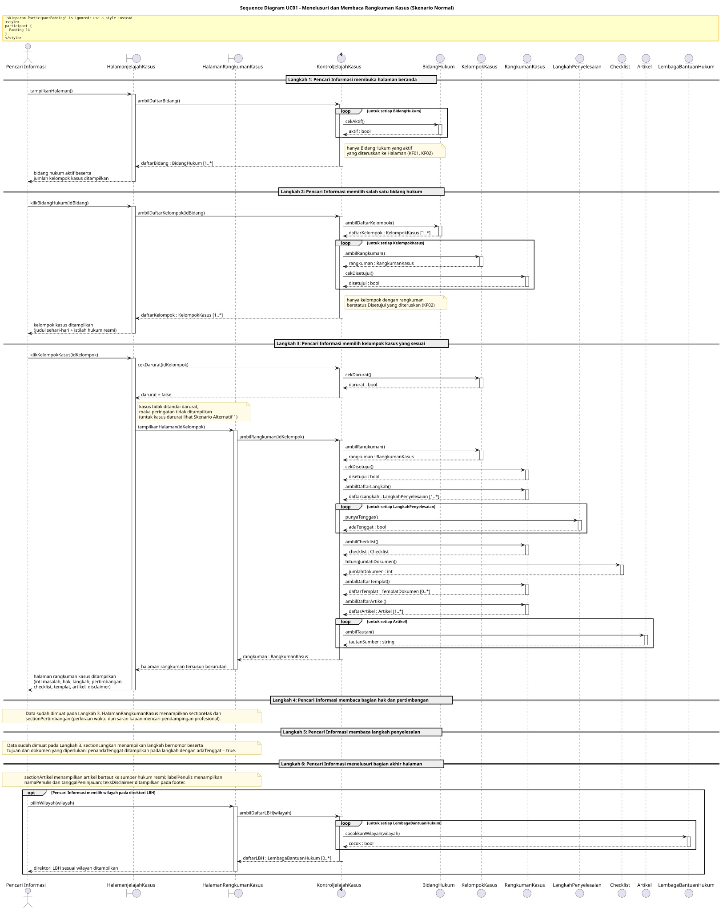

<i>Gambar 3.1.1 Sequence Diagram UC01 - Skenario Normal</i>

- **Skenario Alternatif 1: Kasus Ditandai Situasi Darurat**

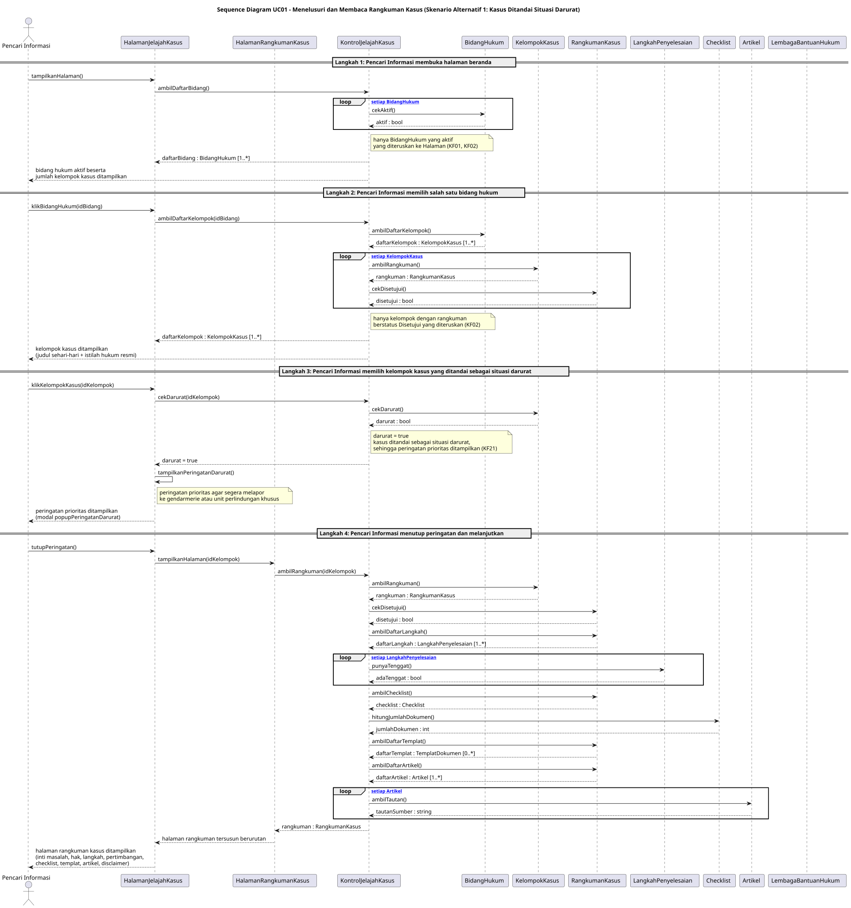

<i>Gambar 3.1.2 Sequence Diagram UC01 - Skenario Alternatif 1: Kasus Ditandai Situasi Darurat</i>

### 3.1.3 Diagram Kelas

Diagram kelas pada subbab ini memuat sebelas kelas yang telah diidentifikasi pada Tabel 3.1. **Setiap kelas pada diagram wajib menampilkan atribut dan metode/operasi langsung di dalam kotak kelasnya**, sehingga tidak perlu membuat tabel daftar atribut dan metode per kelas pada subbab ini. Daftar lengkap atribut dan metode seluruh kelas disajikan pada Tabel 4.1 (Bab 4).

<i>Gambar 3.1.3 Diagram Kelas Menelusuri dan Membaca Rangkuman Kasus (UC01)</i>

Penyesuaian pada tahap perancangan untuk use case ini tercatat pada Daftar Perubahan revisi C, meliputi penambahan atribut `- idKelompokTerpilih: int` dan `- teksDisclaimer: Text` serta operasi `+ tampilkanPeringatanDarurat(): void` pada `HalamanJelajahKasus`, serta penambahan operasi `+ cekDarurat(idKelompok: int): bool` pada `KontrolJelajahKasus`. Kedua operasi tersebut diperlukan untuk dapat menggambar cabang skenario alternatif pada subbab 3.1.2.

## 3.2 Use Case Mencari Kasus

**ID Use Case:** UC02  
**Nama Use Case:** Mencari Kasus

### 3.2.1 Identifikasi Kelas

Tabel 3.2. Identifikasi Kelas Use Case UC02

| No | Nama Kelas Perancangan | Nama Kelas Analisis Terkait |
|:--- | :--- | :--- |
| 1 | `HalamanPencarianKataKunci` | C15 - `HalamanPencarianKataKunci` |
| 2 | `HalamanRangkumanKasus` | C14 - `HalamanRangkumanKasus` |
| 3 | `KontrolPencarianKataKunci` | C22 - `KontrolPencarianKataKunci` |
| 4 | `BidangHukum` | C04 - `BidangHukum` |
| 5 | `KelompokKasus` | C05 - `KelompokKasus` |
| 6 | `RangkumanKasus` | C06 - `RangkumanKasus` |
| 7 | `LembagaBantuanHukum` | C11 - `LembagaBantuanHukum` |

Enam dari tujuh kelas di atas sudah teridentifikasi pada SKPL Subbab 5.2.2. Kelas `HalamanRangkumanKasus` (C14) ditambahkan ke dalam diagram kelas use case ini karena pada Langkah 3 skenario normal pencarian, `Pencari Informasi` diarahkan untuk membuka halaman rangkuman kasus terkait, sehingga kelas tersebut ikut terlibat pada alur use case. Penambahan ini dicatat pada Daftar Perubahan revisi C dan tidak menambahkan kelas baru pada sistem secara keseluruhan.

### 3.2.2 Sequence Diagram

- **Skenario Normal**

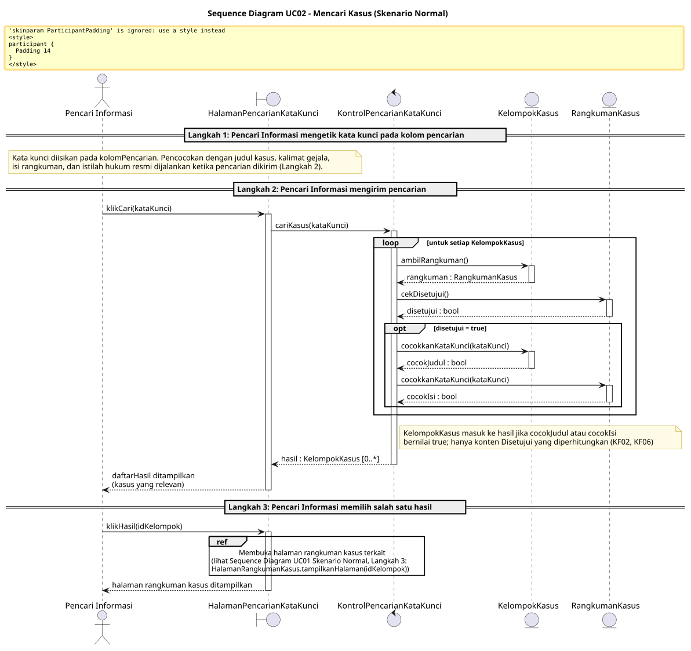

<i>Gambar 3.2.1 Sequence Diagram UC02 - Skenario Normal</i>

- **Skenario Alternatif 1: Pencarian Tidak Menemukan Hasil**

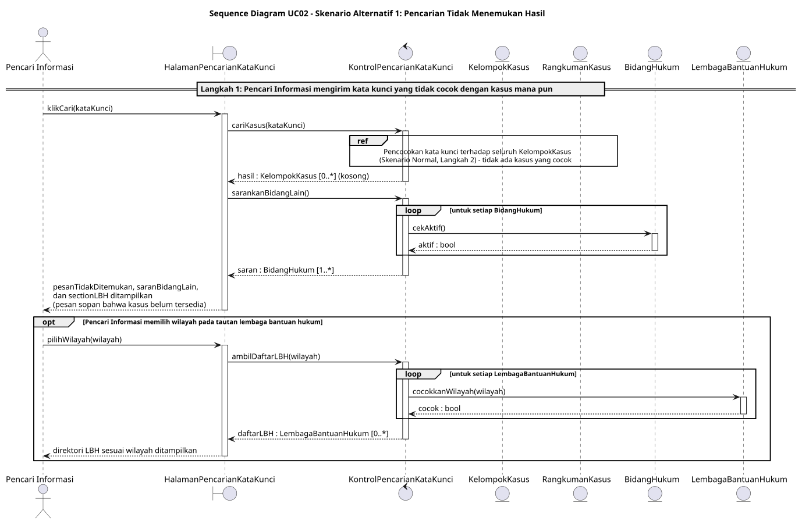

<i>Gambar 3.2.2 Sequence Diagram UC02 - Skenario Alternatif 1: Pencarian Tidak Menemukan Hasil</i>

### 3.2.3 Diagram Kelas

Diagram kelas pada subbab ini memuat tujuh kelas yang telah diidentifikasi pada Tabel 3.2. **Setiap kelas pada diagram wajib menampilkan atribut dan metode/operasi langsung di dalam kotak kelasnya**, sehingga tidak perlu membuat tabel daftar atribut dan metode per kelas pada subbab ini. Daftar lengkap atribut dan metode seluruh kelas disajikan pada Tabel 4.1 (Bab 4).

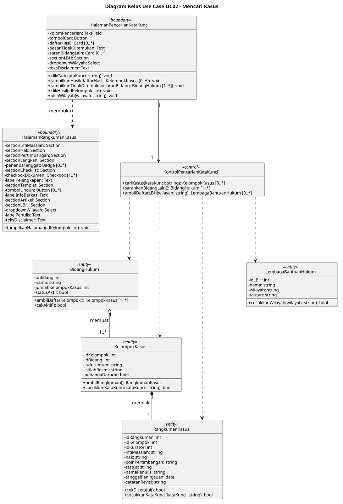

<i>Gambar 3.2.3 Diagram Kelas Mencari Kasus (UC02)</i>

Penyesuaian pada tahap perancangan untuk use case ini tercatat pada Daftar Perubahan revisi C, meliputi penambahan atribut `- teksDisclaimer: Text` serta operasi `+ tampilkanHasil(daftarHasil: KelompokKasus [0..*]): void` dan `+ tampilkanTidakDitemukan(saranBidang: BidangHukum [1..*]): void` pada `HalamanPencarianKataKunci`. Kedua operasi tersebut diperlukan untuk dapat menggambar cabang skenario alternatif pada subbab 3.2.2.

## 3.3 Use Case Menyiapkan Dokumen dengan *Checklist*

**ID Use Case:** UC03  
**Nama Use Case:** Menyiapkan Dokumen dengan *Checklist*

### 3.3.1 Identifikasi Kelas

Tabel 3.3. Identifikasi Kelas Use Case UC03

| No | Nama Kelas Perancangan | Nama Kelas Analisis Terkait |
|:--- | :--- | :--- |
| 1 | `HalamanRangkumanKasus` | C14 - `HalamanRangkumanKasus` |
| 2 | `KontrolChecklist` | C23 - `KontrolChecklist` |
| 3 | `RangkumanKasus` | C06 - `RangkumanKasus` |
| 4 | `Checklist` | C08 - `Checklist` |

### 3.3.2 Sequence Diagram

- **Skenario Normal**

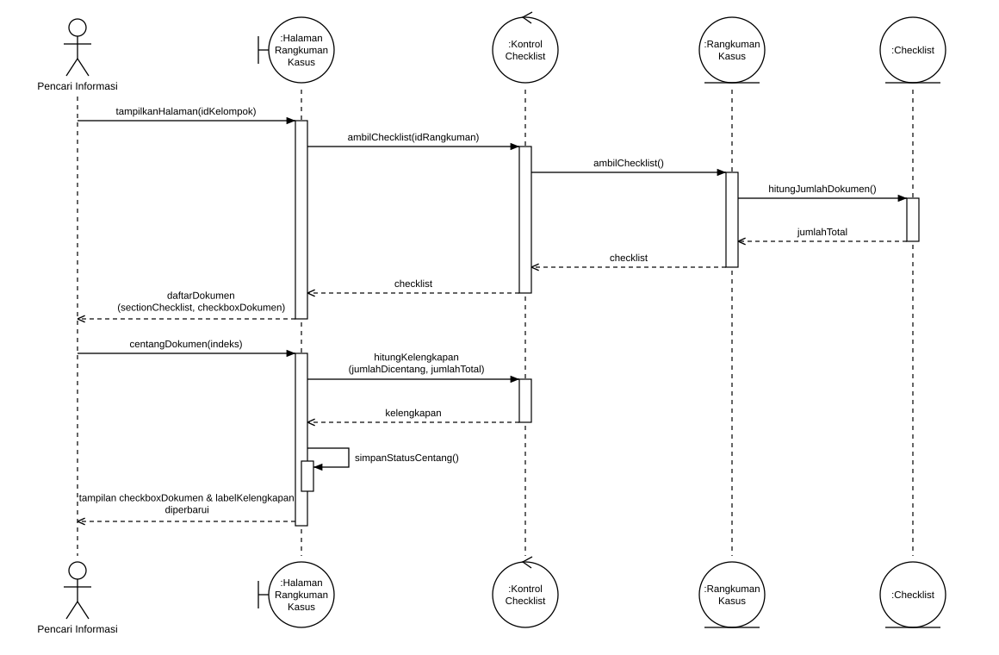

<i>Gambar 3.3.1 Sequence Diagram UC03 - Skenario Normal</i>

- **Skenario Alternatif 1: Pengguna Memuat Ulang atau Membuka Kembali Halaman**

<i>Gambar 3.3.2 Sequence Diagram UC03 - Pengguna Memuat Ulang atau Membuka Kembali Halaman</i>

### 3.3.3 Diagram Kelas

<i>Gambar 3.3.3 Diagram Kelas Menyiapkan Dokumen dengan Checklist (UC03)</i>

 

## 3.4 Use Case Mengunduh Templat Dokumen

**ID Use Case:** UC04  
**Nama Use Case:** Mengunduh Templat Dokumen

### 3.4.1 Identifikasi Kelas

Tabel 3.4. Identifikasi Kelas Use Case UC04

| No | Nama Kelas Perancangan | Nama Kelas Analisis Terkait |
|:--- | :--- | :--- |
| 1 | `HalamanRangkumanKasus` | C14 - `HalamanRangkumanKasus` |
| 2 | `KontrolUnduhTemplat` | C24 - `KontrolUnduhTemplat` |
| 3 | `RangkumanKasus` | C06 - `RangkumanKasus` |
| 4 | `TemplatDokumen` | C09 - `TemplatDokumen` |

### 3.4.2 Sequence Diagram

- **Skenario Normal**

<i>Gambar 3.4.1 Sequence Diagram UC04 - Skenario Normal</i>

- **Skenario Alternatif 1: Kasus Belum Memiliki Templat**

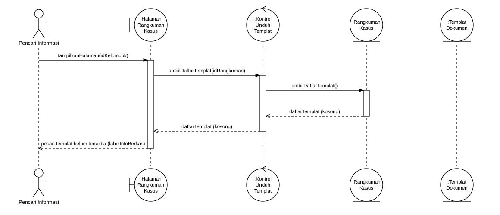

<i>Gambar 3.4.2 Sequence Diagram UC04 - Kasus Belum Memiliki Templat</i>

### 3.4.3 Diagram Kelas

<i>Gambar 3.4.3 Diagram Kelas Mengunduh Templat Dokumen (UC04)</i>

 

## 3.6 Use Case Mengelola Konten Rangkuman Kasus

**ID Use Case:** UC06
**Nama Use Case:** Mengelola Konten Rangkuman Kasus

### 3.6.1 Identifikasi Kelas

Tabel 3.6. Identifikasi Kelas Use Case UC06

| No | Nama Kelas Perancangan | Nama Kelas Analisis Terkait |
|:--- | :--- | :--- |
| 1 | `HalamanPenyusunanKonten` | C17 - `HalamanPenyusunanKonten` |
| 2 | `KontrolPenyusunanKonten` | C26 - `KontrolPenyusunanKonten` |
| 3 | `Akun` | C01 - `Akun` |
| 4 | `Kurator` | C02 - `Kurator` |
| 5 | `RangkumanKasus` | C06 - `RangkumanKasus` |
| 6 | `LangkahPenyelesaian` | C07 - `LangkahPenyelesaian` |
| 7 | `Checklist` | C08 - `Checklist` |
| 8 | `TemplatDokumen` | C09 - `TemplatDokumen` |
| 9 | `Artikel` | C10 - `Artikel` |
| 10 | `RiwayatStatus` | C12 - `RiwayatStatus` |

### 3.6.2 Sequence Diagram

- **Skenario Normal** (termasuk Skenario Alternatif 1: Berkas Templat Tidak Valid dan Skenario Alternatif 2: Isian Wajib Belum Lengkap, yang digambarkan dengan fragmen `alt`)

<i>Gambar 3.6.1 Sequence Diagram UC06 - Skenario Normal, Alternatif 1, dan Alternatif 2</i>

- **Skenario Alternatif 3: Kurator Mencoba Menayangkan Sendiri**

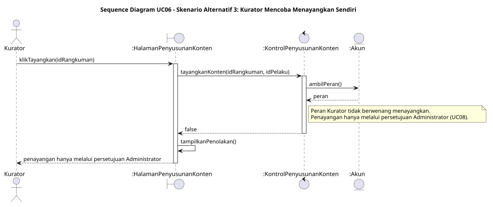

<i>Gambar 3.6.2 Sequence Diagram UC06 - Kurator Mencoba Menayangkan Sendiri</i>

### 3.6.3 Diagram Kelas

<i>Gambar 3.6.3 Diagram Kelas Mengelola Konten Rangkuman Kasus (UC06)</i>

 

## 3.7 Use Case Memantau Status dan Revisi Konten

**ID Use Case:** UC07  
**Nama Use Case:** Memantau Status dan Revisi Konten

### 3.7.1 Identifikasi Kelas

Tabel 3.7. Identifikasi Kelas Use Case UC07

| No | Nama Kelas Perancangan | Nama Kelas Analisis Terkait |
|:--- | :--- | :--- |
| 1 | `HalamanDaftarKontenKurator` | C18 - `HalamanDaftarKontenKurator` |
| 2 | `KontrolPelacakanKonten` | C27 - `KontrolPelacakanKonten` |
| 3 | `Kurator` | C02 - `Kurator` |
| 4 | `RangkumanKasus` | C06 - `RangkumanKasus` |

### 3.7.2 Sequence Diagram

- **Skenario Normal**

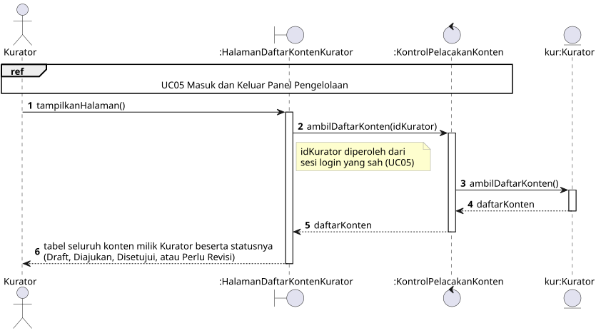

<i>Gambar 3.23. Sequence Diagram UC07 - Skenario Normal</i>

- **Skenario Alternatif 1: Konten Berstatus Perlu Revisi**

<i>Gambar 3.24. Sequence Diagram UC07 - Skenario Alternatif 1: Konten Berstatus Perlu Revisi</i>

### 3.7.3 Diagram Kelas

<i>Gambar 3.25. Diagram Kelas Memantau Status dan Revisi Konten (UC07)</i>

 

## 3.8 Use Case Meninjau dan Memutuskan Konten

**ID Use Case:** UC08  
**Nama Use Case:** Meninjau dan Memutuskan Konten

### 3.8.1 Identifikasi Kelas

Tabel 3.8. Identifikasi Kelas Use Case UC08

| No | Nama Kelas Perancangan | Nama Kelas Analisis Terkait |
|:--- | :--- | :--- |
| 1 | `HalamanModerasiKonten` | C19 - `HalamanModerasiKonten` |
| 2 | `KontrolModerasiKonten` | C28 - `KontrolModerasiKonten` |
| 3 | `Akun` | C01 - `Akun` |
| 4 | `Administrator` | C03 - `Administrator` |
| 5 | `RangkumanKasus` | C06 - `RangkumanKasus` |
| 6 | `RiwayatStatus` | C12 - `RiwayatStatus` |

### 3.8.2 Sequence Diagram

- **Skenario Normal**

<i>Gambar 3.26. Sequence Diagram UC08 - Skenario Normal</i>

- **Skenario Alternatif 1: Konten Dikembalikan dengan Catatan Revisi**

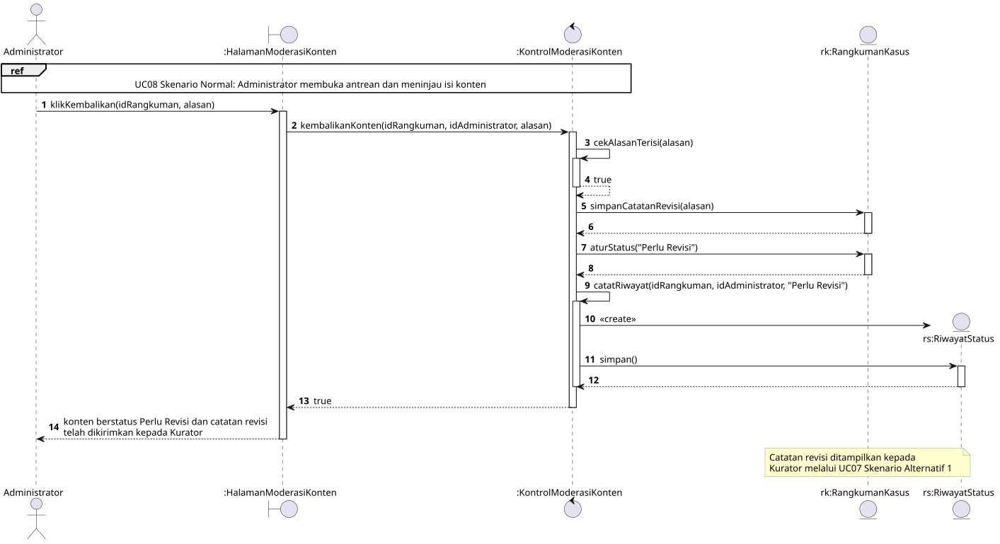

<i>Gambar 3.27. Sequence Diagram UC08 - Skenario Alternatif 1: Konten Dikembalikan dengan Catatan Revisi</i>

- **Skenario Alternatif 2: Alasan Revisi Dikosongkan**

<i>Gambar 3.28. Sequence Diagram UC08 - Skenario Alternatif 2: Alasan Revisi Dikosongkan</i>

### 3.8.3 Diagram Kelas

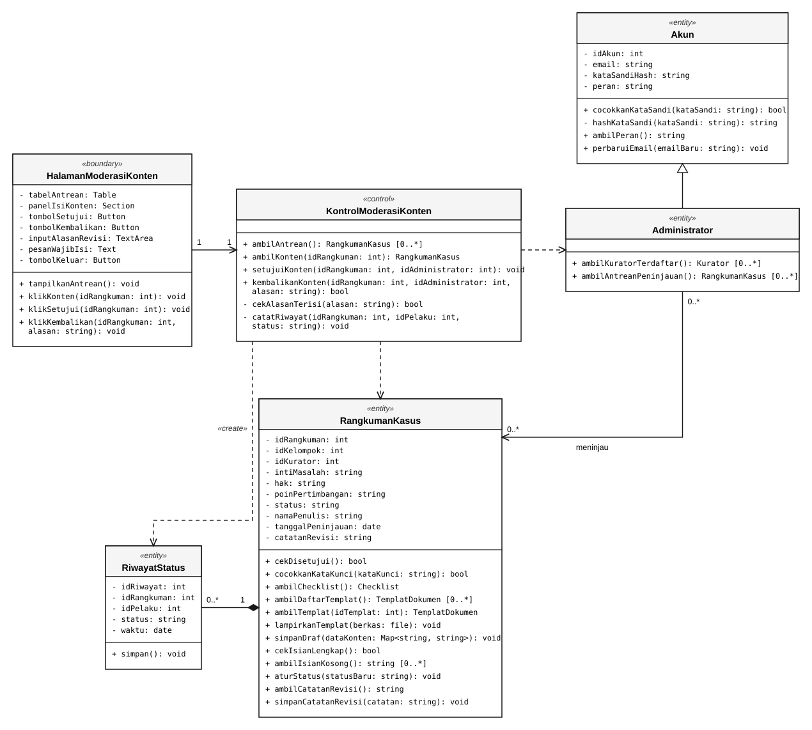

<i>Gambar 3.29. Diagram Kelas Meninjau dan Memutuskan Konten (UC08)</i>

 

---

# BAB 4: Diagram Kelas Keseluruhan

## 4.1 Diagram Kelas

**Bagian ini diisi dengan diagram kelas keseluruhan.**

<i>Gambar 4.1. Diagram Kelas Perancangan Keseluruhan [Nama P/L]</i>

Tabel 4.1. Daftar Kelas Perancangan Keseluruhan

| ID Kelas | Nama Kelas | Atribut | Metode/Operasi |
| :--- | :--- | :--- | :--- |
| *[C01]* | *[Nama kelas]* | *[Daftar atribut]* | *[Daftar metode/operasi]* |
| *[C02]* | *[Nama kelas]* | *[Daftar atribut]* | *[Daftar metode/operasi]* |
| *[C03]* | *[Nama kelas]* | *[Daftar atribut]* | *[Daftar metode/operasi]* |
| *...* | *...* | *...* | *...* |

 

---

# BAB 5: Matriks Kerunutan

Petakan kelas perancangan dengan use case yang terkait. Gunakan **BAB 6 Traceability pada dokumen SKPL** sebagai acuan keterkaitan kelas analisis dan use case, lalu sesuaikan dengan realisasi use case dan kelas perancangan pada BAB 3–BAB 5 DPPL.

Tabel 7.1. Matriks Kerunutan Kelas terhadap Use Case

| Kelas | Use Case Terkait |
| :--- | :--- |
| *[ID kelas - Nama kelas]* | *[ID UC - Nama use case]* |
| *[ID kelas - Nama kelas]* | *[ID UC - Nama use case]* |
| *...* | *...* |
