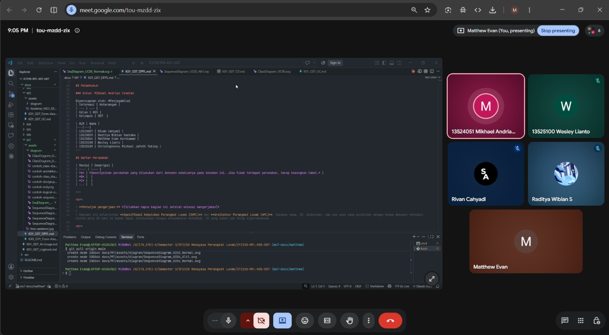

# Form Asistensi

## Tugas Besar IF2150 - Rekayasa Perangkat Lunak

| Informasi | Keterangan |
| --- | --- |
| **Hari** | Selasa |
| **Tanggal** | 20 Oktober 2026 |
| **Kelas** | K01 |
| **Nomor Kelompok** | G07 |
| **Nama Kelompok** | #PenjagaNilai |
| **Nama Perangkat Lunak** | PahamHukum |
| **Dokumen** | K01_G07_DPPL.md |

### Anggota Kelompok

| NIM | Nama |
| --- | --- |
| 13525007 | Rivan Cahyadi |
| 13525019 | Raditya Wibian Sastaka |
| 13525064 | Matthew Evan Kurniawan |
| 13525100 | Wesley Lianto |
| 13525109 | Christopherus Michael Jafeth Tobing |

### Catatan

| Catatan |
| --- |
| 1. SKPL dan APL menjadi acuan utama dalam penyusunan DPPL. Perubahan yang muncul pada tahap penulisan DPPL seperti penambahan kelas atau penyesuaian atribut dan metode harus dicatat pada tabel Daftar Perubahan di DPPL saja|
| 2. Gambar diagram kelas per use case harus diubah, karena sebelumnya hanya berupa nama kelas, hubungan, dan multiplisitas dengan kelas lain. Tetapi, sekarang per kelas perlu atribut lengkap (universal) dengan enkapsulasinya dan metode yang disesuaikan per use case. Setiap metode yang dipanggil pada *sequence diagram* harus ada pada kelas tersebut. |
| 3. Metode pada kelas *entity*, seperti pembuatan atau penghapusan data, dijalankan melalui *Controller*. *Boundary* meneruskan permintaan ke *Controller*, lalu *Controller* meminta data atau perubahan ke *entity* (database yang sebenarnya). Alur ini digambarkan pada *sequence diagram* sehingga metode *Entity* dapat dipakai langsung oleh *Controller* dan diagram kelas tidak perlu diubah. |
| 4. Skenario alternatif yang sederhana dengan alur awal yang sama atau hanya di bagian akhir, digambarkan dengan kotak `alt` pada *sequence diagram* skenario normal. Skenario alternatif baru dipisah menjadi diagram tersendiri jika terlalu panjang atau membuat diagram sulit dibaca |
| 5. Fragmen `opt` dipakai untuk kondisi satu jalur (if saja), `alt` digunakan untuk kondisi dua jalur (if-else), dan `ref` untuk merujuk *sequence diagram* lain. Proses *login* tidak perlu digambar pada setiap *sequence diagram* karena dianggap sebagai alur default di awal. |

**Notes for this section:**  
*Catatan dapat dituliskan dalam bentuk paragraf atau poin-poin, disesuaikan saja.* 

## Dokumentasi

<!--  -->

  

  <i>Gambar 1. Dokumentasi kegiatan asistensi.</i>

