<h1>
IF2150 REKAYASA PERANGKAT LUNAK
<br>
TUGAS 5
<br>
DESKRIPSI PERANCANGAN PERANGKAT LUNAK (DPPL)
</h1>
<br>

## PahamHukum
<p align="left">

</p>

### Untuk: Mikhael Andrian Yonatan

Dipersiapkan oleh:
| Informasi | Keterangan |
| --- | --- |
| Kelas | K01 |
| Kelompok | G07  |

| NIM | Nama |
|---|---|
| 13525007 | Rivan Cahyadi |
| 13525019 | Raditya Wibian Sastaka |
| 13525064 | Matthew Evan Kurniawan |
| 13525100 | Wesley Lianto |
| 13525109 | Christopherus Michael Jafeth Tobing |
---

## Daftar Perubahan

| Revisi | Deskripsi |
| :--- | :--- |
| *A* | *Deskripsikan perubahan yang dilakukan dari dokumen sebelumnya pada dokumen ini. Jika tidak terdapat perubahan, harap kosongkan tabel.* |
| *B* |  |
| *C* |  |
| ... |  |

---

<br>

> **Petunjuk pengerjaan:** *[Silahkan hapus bagian ini setelah selesai mengerjakan]*
>
> Dokumen ini melanjutkan **Deskripsi Perancangan Perangkat Lunak**. Gunakan nama, ID, kebutuhan, dan use case yang konsisten dengan kedua dokumen tersebut. Contoh pola ID baru di bawah dapat disesuaikan dengan kesepakatan kelompok, ID yang sudah ada tetap dipertahankan.

<br>

---


# BAB 1: Pendahuluan

## 1.1 Tujuan Penulisan Dokumen
Deskripsi Perancangan Perangkat Lunak (DPPL) disusun untuk menjelaskan rancangan perangkat lunak PahamHukum yang akan diimplementasikan. Dokumen ini merupakan kelanjutan dari Spesifikasi Kebutuhan Perangkat Lunak (SKPL) dan Arsitektur Perangkat Lunak (APL), dan DPPL pada tahap sebelumnya, dengan mengolah kebutuhan dan arsitektur menjadi rancangan yang lebih rinci. Perincian tersebut mencakup realisasi tiap use case ke dalam sequence diagram dan diagram kelas, perincian tiap kelas beserta operasi, atribut, algoritma, dan query pentingnya, serta rancangan antarmuka tiap layar. Dokumen ini penting. Dokumen ini penting bagi pengembang sebagai referensi alur saat menuliskan kode, bagi desainer sebagai landasan fitur dan tampilan yang dibutuhkan, dan bagi penguji sebagai dasar penyusunan skenario pengujian (*testing*).

## 1.2 Lingkup Masalah
PahamHukum adalah platform literasi hukum berbasis web yang menjembatani masyarakat awam dengan informasi hukum. Informasi pada sistem disusun berdasarkan situasi sehari-hari dalam bentuk rangkuman kasus. Rangkuman kasus memuat inti masalah, hak, langkah penyelesaian, poin pertimbangan, checklist dokumen, templat surat yang dapat diunduh, dan artikel pendukung. Pencari Informasi dapat menggunakan seluruh fitur publik tanpa akun, sedangkan Kurator menyusun konten dan Administrator meninjau konten sebelum ditayangkan sekaligus mengelola akun Kurator. PahamHukum tidak bertindak sebagai penasihat hukum resmi, melainkan sebagai penuntun langkah awal sebelum masyarakat berinteraksi dengan lembaga hukum formal.

## 1.3 Definisi, Istilah, dan Singkatan
Tabel 1.3. Definisi Istilah dan Singkatan

| Singkatan, Akronim, atau Istilah | Penjelasan |
| :--- | :--- |
| **P/L** | Singkatan dari Perangkat Lunak, yaitu aplikasi yang memberikan perintah kepada komputer untuk menjalankan tugas tertentu |
| **SKPL** | Singkatan dari Spesifikasi Kebutuhan Perangkat Lunak, yaitu dokumen yang merangkum kebutuhan fungsional dan non-fungsional serta memetakan dalam Class Diagram (CD) untuk Perangkat Lunak terkait |
| **DPPL** | Singkatan dari Deskripsi Perancangan Perangkat Lunak, yaitu dokumen yang merinci rancangan dari SKPL dan APL menjadi realisasi use case, perancangan rinci kelas, dan perancangan antarmuka sebagai referensi saat implementasi P/L terkait |
| **APL** | Singkatan dari Arsitektur Perangkat Lunak, yaitu dokumen yang merinci pola arsitektur, komponen, dan model arsitektur Perangkat Lunak terkait |
| **KF** | Singkatan dari Kebutuhan Fungsional |
| **KNF** | Singkatan dari Kebutuhan Non-Fungsional |
| **UC**| Singkatan dari *Use Case*, yaitu rangkaian interaksi antara aktor dan sistem untuk mencapai suatu target |
| **MVC** | Singkatan dari *Model-View-Controller*, yaitu pola arsitektur yang memisahkan data (*Model*), tampilan (*View*), dan alur pengendali (*Controller*). |
|**Boundary**, **Control**, **Entity** | Stereotipe kelas pada tahap analisis yang masing-masing berperan sebagai antarmuka, pengendali alur, dan data. Pada rancangan MVC PahamHukum, ketiganya dipetakan ke *View*, *Controller*, dan *Model*. |
| **Kelas** | Kelas yang siap diimplementasikan, lengkap dengan atribut, metode, tipe data, dan visibilitasnya. Beberapa kelas membentuk suatu Class Diagram (CD). |
| **Sequence Diagram** | Diagram UML yang menggambarkan urutan pesan antarobjek untuk menjalankan satu skenario *use case*. |
| **Pencari Informasi** | Masyarakat awam yang menelusuri, mencari, dan membaca rangkuman kasus tanpa akun |
| **Kurator** | Pengelola sistem yang menyusun, menyunting, dan mengajukan konten untuk rangkuman kasus |
| **Administrator** | Pengelola sistem yang meninjau dan memutuskan kelayakan konten serta mengelola akun Kurator |
| **Visibility** | Tingkat akses atribut atau operasi pada kelas: public (+) atau private (-) |
| **Algoritma** | Langkah pemrosesan yang digunakan oleh sebuah operasi penting, ditulis sebagai *pseudocode* |
| **Query** | Perintah SQL yang dijalankan terhadap DBMS untuk membaca atau mengubah data |
| **Antarmuka** | Tampilan layar yang berinteraksi langsung dengan pengguna, dirancang dalam bentuk prototipe |
| **Prototipe** | Rancangan awal antarmuka dari perangkat lunak sebelum diimplementasikan |

## 1.4 Aturan Penomoran
Tuliskan aturan penomoran (ID) yang digunakan dalam dokumen ini. Gunakan pola ID yang **sama** dengan yang sudah dipakai pada dokumen-dokumen sebelumnya, jangan membuat pola baru di dokumen ini.

Tabel 1.4. Aturan Penomoran

| Hal/Bagian | Penomoran | Keterangan |
| :--- | :--- | :--- |
| Kebutuhan Fungsional | KFXX | XX adalah nomor urut dari 01 hingga 44, mengikuti SKPL |
| Kebutuhan Non-Fungsional | KNFXX | XX adalah nomor urut dari 01 hingga 14, mengikuti SKPL |
| Aktor | AKTXX | XX adalah nomor urut dari 01 hingga 03, mengikuti SKPL |
| Use Case | UCXX | XX adalah nomor urut dari 01 hingga 09, mengikuti SKPL |
| Kelas | CXX | XX adalah nomor urut dari 01 hingga 29, mengikuti SKPL |
| Algoritma	| Algo-XXX | XXX adalah nomor urut algoritma pada BAB 5, dimulai dari 001 |
| Query | Q-XXX	| XXX adalah nomor urut query pada BAB 5, dimulai dari 001 |
| Antarmuka	| I-XX | XX adalah nomor urut layar pada BAB 6, dimulai dari 01 |

## 1.5 Referensi
1. K01_G07_SKPL, Spesifikasi Kebutuhan Perangkat Lunak (SKPL) PahamHukum, IF2150 Rekayasa Perangkat Lunak, Institut Teknologi Bandung, 2026
2. K01_G07_APL, Arsitektur Perangkat Lunak (APL) PahamHukum, IF2150 Rekayasa Perangkat Lunak, Institut Teknologi Bandung, 2026
3. PlantUML, “Sequence Diagram syntax and features,” PlantUML.com. Tersedia: https://plantuml.com/sequence-diagram
4. Object Management Group, “Unified Modeling Language (UML), Version 2.5.1,” OMG Document formal/2017-12-05, Des. 2017. Tersedia: https://www.omg.org/spec/UML/2.5.1/
5. K01_G07_DPPL, Deskripsi Perancangan Perangkat Lunak (DPPL) PahamHukum, IF2150 Rekayasa Perangkat Lunak, Institut Teknologi Bandung, 2026

## 1.6 Deskripsi Umum Dokumen (Ikhtisar)
Dokumen DPPL ini terdiri atas tujuh bab. BAB 1 menjelaskan tujuan penulisan, lingkup masalah, definisi istilah, aturan penomoran, dan referensi. BAB 2 memaparkan perancangan arsitektur, yaitu lingkungan implementasi, pola arsitektur MVC, identifikasi komponen, dan model arsitektur dari dokumen APL. BAB 3 menjabarkan realisasi setiap use case melalui identifikasi kelas, sequence diagram untuk skenario normal dan alternatif, serta diagram kelas per use case. BAB 4 menyajikan diagram kelas keseluruhan beserta daftar atribut dan metodenya. BAB 5 merinci setiap kelas perancangan beserta operasi, atribut, algoritma, dan query pentingnya. BAB 6 memuat perancangan antarmuka tiap layar. Terakhir, BAB 7 memuat matriks kerunutan yang memetakan kelas terhadap use case terkait.

<br>

---

# BAB 2: Perancangan Arsitektur

## 2.1 Rancangan Lingkungan Implementasi

Rancangan lingkungan implementasi perangkat lunak **PahamHukum** diturunkan dari spesifikasi lingkungan operasi pada subbab 2.5 dokumen SKPL serta Tabel 1.1 dokumen APL. Spesifikasi lingkungan operasi dan rincian lingkungan implementasi sistem disajikan pada Tabel 2.1.1 dan Tabel 2.1.2.

Tabel 2.1.1. Lingkungan Operasi Perangkat Lunak

| Komponen | Spesifikasi |
| :--- | :--- |
| Server | Web server pada layanan *cloud hosting* gratis atau berbiaya rendah dengan dukungan HTTPS |
| Client | Peramban Chrome, Firefox, Edge, atau Safari (versi rilis dua tahun terakhir) di komputer maupun ponsel |
| DBMS | Basis data relasional (PostgreSQL atau MySQL) untuk data akun, bidang hukum, kelompok kasus, konten, dan riwayat perubahan status |
| Penyimpanan Berkas | Penyimpanan di sisi server untuk templat PDF dan DOCX |
| OS | Tidak bergantung pada sistem operasi tertentu selama tersedia peramban yang didukung |
| Jaringan | Koneksi internet minimal 1 Mbps agar beranda termuat paling lama 3 detik |

Tabel 2.1.2. Spesifikasi Rancangan Lingkungan Implementasi

| Aspek Lingkungan | Spesifikasi Implementasi | Keterangan |
| :--- | :--- | :--- |
| ***Operating System*** | **Sisi Server:** Linux (Ubuntu Server / Debian pada layanan *cloud hosting*)<br>**Sisi Klien:** Lintas sistem operasi (*cross-platform*: Windows, macOS, Linux, Android, iOS)<br>**Sisi Pengembangan:** Windows, macOS, atau Linux | Pengguna tidak bergantung pada sistem operasi tertentu selama menggunakan peramban web rilis dua tahun terakhir (Chrome, Firefox, Edge, atau Safari) dengan lebar layar minimal 360 piksel (KNF03). |
| **DBMS** | PostgreSQL atau MySQL (Basis Data Relasional) | Menyimpan seluruh entitas *Model* secara persisten, meliputi data otorisasi (`Akun`, `Kurator`, `Administrator`), struktur katalog (`BidangHukum`, `KelompokKasus`), konten hukum (`RangkumanKasus`, `LangkahPenyelesaian`, `Checklist`, `TemplatDokumen`, `Artikel`, `LembagaBantuanHukum`), serta log permanen (`RiwayatStatus` sesuai KNF09). |
| ***Development Tools*** | - **IDE / Code Editor:** Visual Studio Code<br>- **Version Control:** Git dan GitHub<br>- **Pemodelan UML & Desain:** PlantUML, Draw.io, dan StarUML<br>- **Pengujian & Inspeksi:** Browser Developer Tools (Chrome/Firefox DevTools) | Digunakan untuk penulisan kode sumber, kolaborasi repositori kelompok, penyusunan diagram arsitektur dan *sequence/class diagram*, serta pengujian responsivitas antarmuka dan efisiensi ukuran halaman ($\le$ 350 KB pada KNF02). |
| ***Filing System*** | - **Sisi Server:** Sistem berkas direktori server (*Server-side File System*)<br>- **Sisi Klien:** *Browser Local Storage* (*Web Storage API*) | Sistem berkas server menyimpan berkas fisik templat dokumen berformat `.pdf` dan `.docx` (maksimal 5 MB sesuai KF26) dengan dukungan *rollback* versi (KNF08). *Local Storage* peramban menyimpan status centang *checklist* secara lokal di perangkat pengguna tanpa pernah dikirim ke server (KF14, KNF06). |
| **Bahasa Pemrograman** | - **Sisi Klien (*Front-End / View*):** HTML5, CSS3, dan JavaScript / TypeScript<br>- **Sisi Server (*Back-End / Controller & Model*):** Python / Node.js (TypeScript/JavaScript) dengan *hash* *bcrypt* (*cost factor* $\ge$ 10 sesuai KNF10)<br>- **Basis Data:** SQL (*Structured Query Language*) | HTML5, CSS3, dan JavaScript merender antarmuka publik dan panel pengelola (termasuk *single-page form* KNF12, peninjauan satu layar KNF13, dan manipulasi `localStorage`). Bahasa sisi server menjalankan logika *Controller* dan *Model* dalam satu proses aplikasi, sedangkan SQL mengelola kueri pada DBMS relasional. |

PahamHukum berjalan sebagai aplikasi web yang dilayani dari satu web server pada *cloud hosting* gratis atau berbiaya rendah. Kondisi ini selaras dengan pola arsitektur MVC karena *Model*, *View*, dan *Controller* dapat dipasang dalam satu proses aplikasi tanpa layanan tambahan. Klien yang beragam (berbeda perangkat, peramban, dan sistem operasi) hanya menerima *View* yang dirender oleh server, sehingga perbedaan perangkat cukup ditangani di lapisan *View*. DBMS relasional dan penyimpanan berkas di sisi server hanya diakses melalui *Model*, sehingga *View* tidak pernah menyentuh data secara langsung dan pergantian antara PostgreSQL atau MySQL tidak memengaruhi *Controller* maupun *View*. Selain itu, batas koneksi minimal 1 Mbps dengan target pemuatan beranda paling lama 3 detik (KNF01) menuntut halaman yang ringan; pemisahan *View* dari logika bisnis memudahkan ukuran halaman dijaga tetap kecil karena *Controller* hanya mengambil data yang diperlukan.

---

## 2.2 Style/Pattern Arsitektur Acuan

Untuk **PahamHukum**, *pattern* arsitektur yang dipilih sebagai acuan adalah **Model-View-Controller (MVC)**. *Pattern* ini memisahkan sistem menjadi tiga bagian dengan tanggung jawab yang berbeda, yaitu *Model*, *View*, dan *Controller*. Pemisahan tersebut bertujuan agar perubahan di satu bagian tidak menuntut perombakan menyeluruh pada bagian lainnya. Adapun pembagian tanggung jawabnya adalah sebagai berikut:

1. **Model**  
   Komponen **Model** adalah bagian yang merepresentasikan data dan cara data tersebut dikelola. *Model* memiliki aturan untuk menjaga data, cara data disimpan, dan cara data diambil oleh komponen lain. Pada PahamHukum, **Model** merepresentasikan struktur data konten dan pengelola sistem yang terdiri atas 12 *entity*, yaitu data konten (`BidangHukum`, `KelompokKasus`, `RangkumanKasus`, `LangkahPenyelesaian`, `Checklist`, `TemplatDokumen`, `Artikel`, `LembagaBantuanHukum`), data otorisasi pengguna (`Akun`, `Kurator`, `Administrator`), serta riwayat perubahan status (`RiwayatStatus`).

2. **View**  
   Komponen **View** bertanggung jawab menampilkan antarmuka sistem yang dapat langsung dilihat oleh pengguna sekaligus menerima masukan dari interaksi pengguna. Namun, **View** tidak mengambil data langsung dari *database* atau memutuskan kelayakan konten. **View** hanya menerima data yang diberikan *Controller* dan meneruskan interaksi pengguna kembali ke *Controller*. Pada PahamHukum, **View** terbagi menjadi dua kelompok antarmuka utama:
   - **Antarmuka Publik**: Menampilkan beranda penelusuran bidang hukum, hasil pencarian pengguna, serta halaman rangkuman kasus yang memuat penjelasan, hak, langkah-langkah, *checklist* dokumen, dan tombol unduh templat surat.
   - **Antarmuka Pengelola**: Menyediakan halaman *login*, formulir penyusunan konten bagi Kurator, antrean peninjauan konten bagi Administrator, serta halaman pengelolaan akun Kurator.

   Seluruh komponen **View** diturunkan dari kelas-kelas *Boundary* pada dokumen SKPL (BAB 5).

3. **Controller**  
   Komponen **Controller** adalah penghubung antara *View* dan *Model*. Komponen ini menerima permintaan dari *View*, memvalidasi masukan, lalu memanggil *Model* untuk mengambil atau mengubah data. Setelah itu, *Controller* memilih *View* yang harus ditampilkan atau menentukan pesan spesifik yang perlu diberikan. Contoh dalam skenario *login* akun: *View* mengirimkan permintaan ke **Controller** untuk memeriksa kombinasi email dan kata sandi. **Controller** kemudian meminta *Model* memverifikasi data tersebut. Jika benar, **Controller** mengarahkan pengguna ke *View* halaman sesuai perannya; jika salah, **Controller** menampilkan kembali *View* halaman *login* dengan pesan kesalahan. Pada PahamHukum, **Controller** menangani alur penelusuran, pencarian, pengelolaan sesi *login* dan *logout*, interaksi pengguna dengan *checklist*, pengunduhan templat dokumen, hingga alur peninjauan dan perubahan status konten.

### Alasan Pemilihan Arsitektur MVC

1. **Keterlacakan dengan pemodelan kelas *Entity, Control, Boundary* pada SKPL**  
   Pada BAB 5 SKPL, PahamHukum telah dimodelkan menjadi 29 kelas yang terbagi menjadi *Entity*, *Control*, dan *Boundary*. Struktur tersebut berpadanan langsung dengan MVC:
   - 8 kelas *Boundary* dipetakan menjadi komponen *View*.
   - 9 kelas *Control* dipetakan menjadi komponen *Controller*.
   - 12 kelas *Entity* dipetakan menjadi komponen *Model*.  
   Dengan memilih MVC, rantai keterlacakan dari kebutuhan awal, *use case*, hingga rancangan kelas tetap terjaga tanpa perombakan ulang.

2. **Dukungan terhadap dua kelompok antarmuka berbeda**  
   Sistem PahamHukum melayani tiga aktor dengan kebutuhan yang kontras. Pencari Informasi mengakses antarmuka publik tanpa akun, sedangkan Kurator dan Administrator mengakses panel pengelola yang membutuhkan autentikasi dan manipulasi data. Pola MVC memungkinkan entitas data yang sama (misalnya `RangkumanKasus` dan `RiwayatStatus`) disajikan ke dalam antarmuka publik maupun antarmuka pengelola melalui *View* yang terpisah, tanpa duplikasi atau perubahan logika bisnis pada *Model*.

3. **Penegakan alur status konten yang terkendali**  
   Konten melewati siklus `Draft` $\rightarrow$ `Diajukan` $\rightarrow$ `Disetujui` atau `Perlu Revisi`, dan publik hanya dapat melihat konten berstatus `Disetujui`. *Controller* yang mengatur penyusunan dan moderasi konten bertugas memvalidasi hak akses dan status konten sebelum mengubah data di *Model*, lalu mencatat perubahannya secara permanen di `RiwayatStatus` sesuai KNF09.

4. **Menjaga pemisahan antara aturan domain dan tampilan**  
   Perubahan di sisi antarmuka atau *View* tidak boleh melangkahi aturan seperti urutan status pengajuan konten dan pencatatan riwayat. Konten yang belum disetujui tidak boleh muncul ke halaman utama. Dengan MVC, aturan-aturan ini berada pada *Model* dan dikawal oleh *Controller*, sementara *View* hanya menampilkan data sehingga risiko rusaknya aturan bisnis saat tampilan berubah dapat diminimalkan.

5. **Mendukung penggunaan ulang komponen tampilan di antarmuka**  
   Halaman Jelajah, Rangkuman, dan Pencarian memakai komponen tampilan yang serupa untuk menampilkan konten dengan sumber data dan aksi yang berbeda. *View* yang sama dapat dipakai oleh beberapa *Controller* dan *Model* tanpa duplikasi. Sebaliknya, satu *Model* seperti `RangkumanKasus` dapat ditampilkan melalui beberapa *View* tanpa mengubah *Model*-nya.

6. **Mendukung pemenuhan Kebutuhan Non-Fungsional (KNF) PahamHukum**  
   - **KNF09** menetapkan bahwa riwayat perubahan status konten bersifat permanen dan tidak dapat diubah; aturan ini ditempatkan di bagian *Model* tepatnya pada entitas `RiwayatStatus`.
   - **KNF14** menetapkan bahwa sesi pengelola harus berakhir otomatis setelah 30 menit tanpa aktivitas; aturan pengelolaan sesi tersebut ditempatkan pada *Controller* (`KontrolAutentikasi`).
   - **KNF12** dan **KNF13** menuntut formulir penyusunan konten berada dalam satu halaman dan peninjauan konten berada dalam satu layar; keduanya diselesaikan di lapisan *View* tanpa mengganggu komponen lain.

<p align="center">
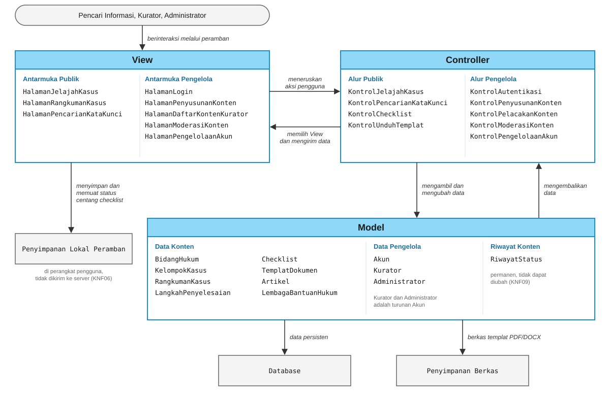
</p>
<p align="center">
<i>Gambar 2.2.1 Arsitektur MVC pada Sistem PahamHukum</i>
</p>

---

## 2.3 Identifikasi Komponen / Modul / Subsistem

Komponen pada PahamHukum diidentifikasi berdasarkan pola *Model-View-Controller* (MVC) yang telah ditetapkan pada subbab 2.2. Setiap komponen dikelompokkan menurut lapisan arsitektur, yaitu *View*, *Controller*, dan *Model*, ditambah komponen *Penyimpanan Data*. Komponen `Database` dan `Penyimpanan Berkas` berasal dari lingkungan operasi pada Tabel 2.1.1, sedangkan `Penyimpanan Lokal Peramban` berasal dari KF14 dan KNF06 pada dokumen SKPL. Kelas *Boundary* pada dokumen SKPL menjadi komponen *View*, kelas *Control* menjadi komponen *Controller*, dan kelas *Entity* menjadi komponen *Model*. Dengan demikian, seluruh 29 kelas pada SKPL tercakup oleh komponen pada Tabel 2.3, dan seluruh *use case* UC01 sampai UC09 dapat dijalankan oleh komponen-komponen tersebut.

Tabel 2.3. Identifikasi Komponen/Modul/Subsistem

| Nama Komponen/Modul/Subsistem | Jenis | Penjelasan |
| :--- | :--- | :--- |
| `HalamanJelajahKasus` | *View* | Menampilkan beranda berisi bidang hukum dan kelompok kasus, serta peringatan prioritas untuk kasus darurat, lalu meneruskan pilihan pengguna ke `KontrolJelajahKasus`. |
| `HalamanRangkumanKasus` | *View* | Menampilkan satu rangkuman kasus lengkap (langkah, *checklist*, templat, artikel, direktori LBH) beserta status centang *checklist*, meneruskan permintaan centang *checklist* ke `KontrolChecklist`, serta meneruskan aksi unduh templat ke `KontrolUnduhTemplat`. |
| `HalamanPencarianKataKunci` | *View* | Menampilkan kolom pencarian, daftar hasil, dan pesan serta saran jika kasus tidak ditemukan, lalu meneruskan kata kunci ke `KontrolPencarianKataKunci`. |
| `HalamanLogin` | *View* | Menampilkan formulir *login* pengelola beserta pesan galat dan meneruskan kredensial ke `KontrolAutentikasi`. |
| `HalamanPenyusunanKonten` | *View* | Menampilkan formulir penyusunan konten satu halaman bagi Kurator dan meneruskan aksi simpan draf, unggah templat, dan ajukan ke `KontrolPenyusunanKonten`. |
| `HalamanDaftarKontenKurator` | *View* | Menampilkan daftar konten milik Kurator beserta status dan catatan revisinya, lalu meneruskan pilihan konten ke `KontrolPelacakanKonten`. |
| `HalamanModerasiKonten` | *View* | Menampilkan antrean dan isi konten untuk Administrator beserta tombol Setujui dan Kembalikan pada layar yang sama, lalu meneruskan keputusan ke `KontrolModerasiKonten`. |
| `HalamanPengelolaanAkun` | *View* | Menampilkan daftar Kurator dan formulir pendaftaran, pembaruan, serta penonaktifan akun bagi Administrator, lalu meneruskan aksinya ke `KontrolPengelolaanAkun`. |
| `KontrolJelajahKasus` | *Controller* | Mengatur alur penampilan bidang hukum, kelompok kasus, rangkuman kasus, dan direktori LBH. |
| `KontrolPencarianKataKunci` | *Controller* | Memproses kata kunci, mengambil hasil yang relevan, dan menyarankan bidang lain jika kasus tidak ditemukan. |
| `KontrolChecklist` | *Controller* | Mengambil *checklist* rangkuman, menghitung kelengkapan dokumen yang dicentang, serta menyimpan dan memuat status centang pada `Penyimpanan Lokal Peramban`. |
| `KontrolUnduhTemplat` | *Controller* | Menyediakan daftar dan berkas templat versi terbaru untuk diunduh. |
| `KontrolAutentikasi` | *Controller* | Memeriksa kredensial akun, mengarahkan pengguna sesuai perannya, serta mengakhiri sesi saat keluar atau kedaluwarsa (30 menit tanpa aktivitas). |
| `KontrolPenyusunanKonten` | *Controller* | Mengatur pembuatan draf, pelampiran templat, validasi isian, dan pengajuan konten (`Draft` menjadi `Diajukan`), serta mencatat riwayat statusnya. |
| `KontrolPelacakanKonten` | *Controller* | Mengambil daftar konten milik Kurator dan catatan revisinya. |
| `KontrolModerasiKonten` | *Controller* | Mengatur persetujuan dan pengembalian konten oleh Administrator, mewajibkan alasan revisi, dan mencatat riwayat status ke `RiwayatStatus`. |
| `KontrolPengelolaanAkun` | *Controller* | Mengatur pendaftaran, pembaruan, dan penonaktifan akun Kurator. |
| `Akun` | *Model* | Merepresentasikan data akun pengelola (email, kata sandi ter-*hash*, peran) serta metode untuk memverifikasi dan mengubahnya. |
| `Kurator` | *Model* | Merepresentasikan akun Kurator (status aktif dan jumlah konten) serta metode untuk mengakses dan mengubahnya, turunan `Akun`. |
| `Administrator` | *Model* | Merepresentasikan akun Administrator beserta daftar Kurator yang dikelolanya, turunan `Akun`. |
| `BidangHukum` | *Model* | Merepresentasikan bidang hukum beserta status aktif dan kelompok kasus di bawahnya serta metode untuk mengakses dan mengubahnya. |
| `KelompokKasus` | *Model* | Merepresentasikan satu jenis kasus (judul sehari-hari, istilah resmi, penanda darurat) serta metode pencocokan kata kunci. |
| `RangkumanKasus` | *Model* | Merepresentasikan isi rangkuman kasus beserta status, penulis, tanggal peninjauan, dan catatan revisi serta metode untuk mengakses dan mengubahnya. |
| `LangkahPenyelesaian` | *Model* | Merepresentasikan langkah bernomor beserta tujuan, dokumen yang diperlukan, dan tenggat. |
| `Checklist` | *Model* | Merepresentasikan daftar dokumen yang perlu disiapkan untuk suatu kasus. |
| `TemplatDokumen` | *Model* | Merepresentasikan berkas templat (format, ukuran, versi, tanggal pembaruan) serta validasi unggahan PDF/DOCX maksimal 5 MB. |
| `Artikel` | *Model* | Merepresentasikan artikel pendukung beserta tautan ke sumber hukum resmi. |
| `LembagaBantuanHukum` | *Model* | Merepresentasikan direktori LBH beserta wilayah layanannya. |
| `RiwayatStatus` | *Model* | Merepresentasikan catatan perubahan status konten (konten, pelaku, status, waktu) yang bersifat permanen dan tidak dapat diubah (KNF09). |
| `Database` | *Penyimpanan Data* | Menyimpan seluruh data *Model* secara persisten pada DBMS relasional (PostgreSQL atau MySQL). |
| `Penyimpanan Berkas` | *Penyimpanan Data* | Menyimpan berkas templat PDF dan DOCX di sisi server. |
| `Penyimpanan Lokal Peramban` | *Penyimpanan Data* | Menyimpan status centang *checklist* di perangkat pengguna dan tidak pernah dikirim ke server (KNF06). |

---

## 2.4 Model Arsitektur Perangkat Lunak

Model arsitektur perangkat lunak PahamHukum disajikan dalam dua *view* yang saling melengkapi, yaitu ***Logical View*** untuk menggambarkan struktur logis dan kolaborasi antarkomponen berdasarkan pola MVC, serta ***Physical View*** untuk menggambarkan penempatan (*deployment*) komponen pada node perangkat keras dan lingkungan eksekusinya.

### 2.4.1 Logical View

Model arsitektur perangkat lunak yang dipilih untuk PahamHukum adalah **Model-View-Controller (MVC)** yang divisualisasikan melalui ***Logical View***. *Logical View* mendeskripsikan abstraksi komponen utama sistem dan hubungannya secara statis untuk mendukung pemenuhan kebutuhan fungsional bisnis. Model arsitektur ini cocok untuk aplikasi PahamHukum karena PahamHukum memiliki antarmuka yang berbeda antara pengguna publik dan panel pengelola. MVC memungkinkan tampilan (*View*) dipisah dari alur dan validasi (*Controller*) serta aturan dan data (*Model*) sehingga perubahan tampilan di masa depan tidak merusak aturan atau status konten. *Logical View* dipilih karena memperlihatkan pembagian tanggung jawab *View*, *Controller*, dan *Model* serta arah panggilan antarkomponen secara menyeluruh.

<p align="center">

</p>
<p align="center">
<i>Gambar 2.4.1 Logical View pada Sistem PahamHukum berbasis Pola MVC</i>
</p>

#### Penjelasan Komponen dan Label Relasi

Diagram pada Gambar 2.4.1 memetakan ke-32 komponen yang terdaftar pada Tabel 2.3 ke dalam tiga lapisan utama MVC beserta subsistem penyimpanannya:

1. **View**  
   Terdiri atas 8 komponen antarmuka yang melayani interaksi langsung dengan pengguna (mulai dari `HalamanJelajahKasus`, `HalamanRangkumanKasus`, `HalamanPencarianKataKunci` untuk pengguna publik anonim, hingga antarmuka pengelolaan konten dan akun untuk Administrator dan Kurator).

2. **Controller**  
   Terdiri atas 9 komponen pengendali yang mengoordinasikan interaksi antara *View* dan *Model*. *Controller* bertanggung jawab memvalidasi setiap *event* dari pengguna (misalnya verifikasi otorisasi pada `KontrolAutentikasi` atau penyetujuan pada `KontrolModerasiKonten`) sebelum mengizinkan pemanggilan operasi ke *Model*.

3. **Model**  
   Terdiri atas 12 komponen entitas yang menyimpan struktur data hukum dan pengguna sistem. Komponen `RiwayatStatus` diisolasi guna memenuhi perlindungan KNF09, yaitu riwayat perubahan status tidak boleh dimanipulasi atau diubah setelah dibuat.

4. **Penyimpanan Data**  
   Terdiri atas `Database` dan `Penyimpanan Berkas` yang berada di server, serta komponen khusus `Penyimpanan Lokal Peramban` (di sisi klien). `Penyimpanan Lokal Peramban` digunakan oleh `KontrolChecklist` dan `HalamanRangkumanKasus` untuk mempertahankan daftar persiapan dokumen pengguna secara anonim. `Sumber Hukum Resmi` digambar sebagai sistem eksternal di luar ruang lingkup komponen Tabel 2.3.

**Keterangan Relasi (Label Panah):**
- **memanggil:** Aksi dari *View* yang meneruskan interaksi pengguna ke *Controller* terkait.
- **akses:** Aksi dari *Controller* untuk menerapkan logika bisnis terhadap *Model* (mengambil, mengubah, atau menghapus data).
- **komposisi / agregasi:** Relasi kepemilikan struktural antar-*Model*. Komponen bagian (misalnya `Checklist`) terikat kuat (komposisi) atau terkait lepas (agregasi) dengan entitas induknya (misalnya `RangkumanKasus`).
- **asosiasi:** Keterkaitan operasional spesifik berarah, dengan peranannya dituliskan langsung di atas garis (contoh: "menulis", "diubah oleh").
- **generalisasi:** Pewarisan atribut dan metode dari *Model* spesifik (`Kurator`, `Administrator`) ke *Model* umum (`Akun`).
- **sistem eksternal:** Entitas di luar ruang lingkup PahamHukum (seperti JDIH/BPK) yang ditautkan melalui URL.

### 2.4.2 Physical View

Selain *Logical View* pada subbab 2.4.1, PahamHukum juga dimodelkan melalui ***Physical View*** (*deployment view*) agar lingkungan eksekusi perangkat lunak terlihat jelas. *Physical View* mendeskripsikan node tempat komponen berjalan atau tersimpan, *artifact* yang dipasang pada node tersebut, serta jalur jaringan antarnode. *View* ini dipilih sebagai pelengkap *Logical View* karena PahamHukum melayani klien yang beragam (lintas perangkat, peramban, dan sistem operasi, dengan koneksi yang bervariasi sesuai batasan pada subbab 2.4 SKPL), sehingga penting menunjukkan secara eksplisit di mana data disimpan: di peramban klien (sementara dan anonim untuk *checklist*) atau di server (persisten untuk seluruh data lain).

Diagram digambar dengan notasi *UML Deployment Diagram*: node berstereotip `«Device»` dengan nama instans `:NamaNode`, lingkungan eksekusi di dalam node (`«Execution Environment»`, `«Database System»`, `«File System»`) digambar abu-abu sebagai perangkat lunak pihak ketiga, sedangkan setiap komponen pada Tabel 2.3 digambar sebagai `«artifact»` putih bergambar ikon komponen di luar node dan dihubungkan dengan panah putus-putus `«deploy»` ke lingkungan eksekusi tujuannya. Pemetaan ini langsung menggunakan lingkungan operasi pada Tabel 2.1.1, sehingga hubungan antara pilihan teknologi dan tempat dijalankannya pola MVC terlihat secara konkret.

<p align="center">
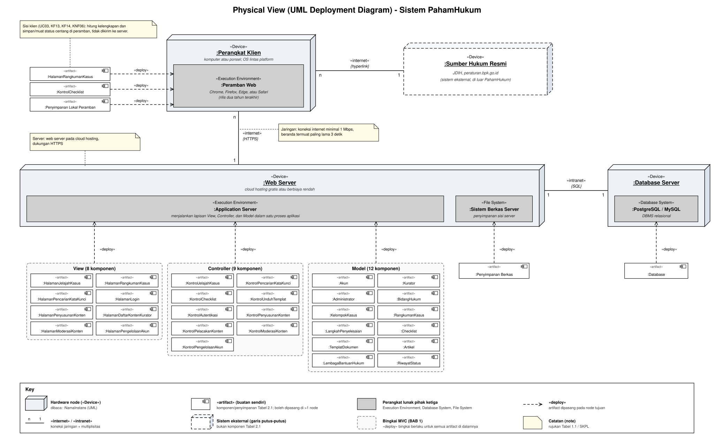
</p>
<p align="center">
<i>Gambar 2.4.2 Physical View pada Sistem PahamHukum</i>
</p>

#### Pemetaan Node dan Artifact ke Lingkungan Operasi dan Komponen

Tabel 2.4.1. Pemetaan Node dan Artifact pada Physical View

| Node | Lingkungan Eksekusi (Pihak Ketiga) | Komponen Lingkungan (Tabel 2.1.1) | Artifact yang Dipasang (Tabel 2.3) |
| :--- | :--- | :--- | :--- |
| `:Perangkat Klien` `«Device»` | `:Peramban Web` `«Execution Environment»` | Client, OS | `:Penyimpanan Lokal Peramban` (status centang *checklist*, tidak dikirim ke server sesuai KNF06), serta instans sisi klien dari `:HalamanRangkumanKasus` dan `:KontrolChecklist` |
| `:Web Server` `«Device»` | `:Application Server` `«Execution Environment»` | Server | 8 *artifact* *View*, 9 *artifact* *Controller*, dan 12 *artifact* *Model* (total 29), dijalankan dalam satu proses aplikasi |
| | `:Sistem Berkas Server` `«File System»` | Penyimpanan Berkas | `:Penyimpanan Berkas` (templat PDF/DOCX) |
| `:Database Server` `«Device»` | `:PostgreSQL / MySQL` `«Database System»` | DBMS | `:Database` |
| `:Sumber Hukum Resmi` (garis putus-putus) | Tidak ada | Tidak ada | Sistem eksternal di luar PahamHukum (JDIH, peraturan.bpk.go.id); bukan komponen Tabel 2.3 |

`:HalamanRangkumanKasus` dan `:KontrolChecklist` dipasang pada **dua node**: instans di `:Web Server` menyusun halaman rangkuman dan mengambil isi *checklist* dari *Model*, sedangkan instans di `:Peramban Web` berjalan pada perangkat pengguna untuk memperbarui tampilan centang, menghitung kelengkapan dokumen, serta menyimpan dan memuat status centang di `:Penyimpanan Lokal Peramban` (UC03, KF13, KF14). Pemasangan ganda ini diperlukan karena KNF06 melarang status centang dikirim ke server.

#### Keterangan Jalur Komunikasi

Tabel 2.4.2. Keterangan Jalur Komunikasi pada Physical View

| Penghubung | Stereotype | Multiplisitas | Keterangan |
| :--- | :--- | :--- | :--- |
| `:Perangkat Klien` - `:Web Server` | `«internet»` `{HTTPS}` | n : 1 | Permintaan halaman dan pengiriman formulir. Terkait baris *Jaringan* Tabel 2.1.1 (minimal 1 Mbps, beranda termuat paling lama 3 detik). |
| `:Web Server` - `:Database Server` | `«intranet»` `{SQL}` | 1 : 1 | Kueri baca/tulis oleh lapisan *Model* ke `:Database`. |
| `:Perangkat Klien` - `:Sumber Hukum Resmi` | `«internet»` `{hyperlink}` | n : 1 | Dibuka langsung oleh peramban pengguna saat mengeklik rujukan pada `Artikel`, bukan panggilan dari Web Server. |

*Catatan:* `:Database Server` digambar sebagai node terpisah dari `:Web Server` karena DBMS pada Tabel 2.1.1 adalah layanan tersendiri. Jika pada implementasi basis data berada pada mesin yang sama dengan aplikasi, kedua node cukup digabung dan jalur `«intranet»` dihilangkan tanpa mengubah pemetaan *artifact*.

<br>

---


# BAB 3: Realisasi Use Case

## 3.1 Use Case Menelusuri dan Membaca Rangkuman Kasus

**ID Use Case:** UC01  
**Nama Use Case:** Menelusuri dan Membaca Rangkuman Kasus

Use case ini merupakan alur utama yang dipakai **Pencari Informasi** untuk menemukan dan membaca isi satu kelompok kasus pada PahamHukum. Alur dimulai dari halaman beranda yang memuat seluruh bidang hukum aktif, dilanjutkan dengan pemilihan bidang hukum, pemilihan kelompok kasus, dan berakhir pada halaman rangkuman kasus yang tersusun berurutan memuat inti masalah, hak, langkah penyelesaian, poin pertimbangan, *checklist* dokumen, templat, artikel pendukung, serta *disclaimer*. Use case ini juga menangani kelompok kasus yang ditandai sebagai **situasi darurat**, yaitu kelompok kasus yang memerlukan peringatan prioritas agar pengguna segera melapor kepada instansi yang berwenang.

### 3.1.1 Identifikasi Kelas

Tabel 3.1. Identifikasi Kelas Use Case UC01

| No | Nama Kelas Perancangan | Nama Kelas Analisis Terkait |
|:--- | :--- | :--- |
| 1 | `HalamanJelajahKasus` | C13 - `HalamanJelajahKasus` |
| 2 | `HalamanRangkumanKasus` | C14 - `HalamanRangkumanKasus` |
| 3 | `KontrolJelajahKasus` | C21 - `KontrolJelajahKasus` |
| 4 | `BidangHukum` | C04 - `BidangHukum` |
| 5 | `KelompokKasus` | C05 - `KelompokKasus` |
| 6 | `RangkumanKasus` | C06 - `RangkumanKasus` |
| 7 | `LangkahPenyelesaian` | C07 - `LangkahPenyelesaian` |
| 8 | `Checklist` | C08 - `Checklist` |
| 9 | `TemplatDokumen` | C09 - `TemplatDokumen` |
| 10 | `Artikel` | C10 - `Artikel` |
| 11 | `LembagaBantuanHukum` | C11 - `LembagaBantuanHukum` |

Sebelas kelas di atas sudah teridentifikasi pada SKPL Subbab 5.2.1. Perubahan pada tahap perancangan hanya berupa atribut dan metode baru pada kelas yang sudah ada, sehingga tidak ada kelas baru yang diperkenalkan pada use case ini.

### 3.1.2 Sequence Diagram

- **Skenario Normal**

<p align="center">
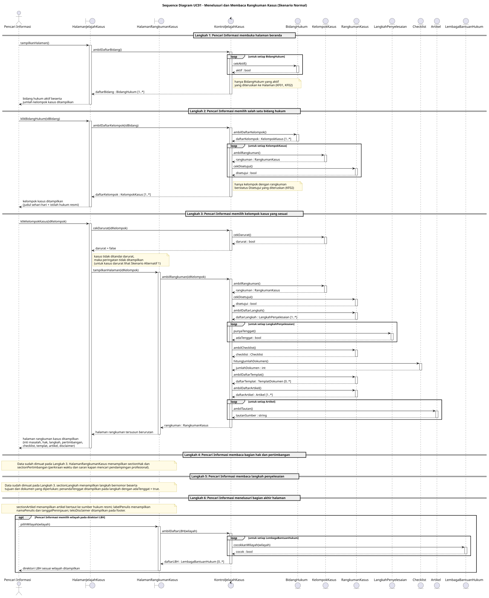
</p>
<p align="center">
<i>Gambar 3.1.1 Sequence Diagram UC01 - Skenario Normal</i>
</p>

- **Skenario Alternatif 1: Kasus Ditandai Situasi Darurat**

<p align="center">

</p>
<p align="center">
<i>Gambar 3.1.2 Sequence Diagram UC01 - Skenario Alternatif 1: Kasus Ditandai Situasi Darurat</i>
</p>

### 3.1.3 Diagram Kelas

<p align="center">
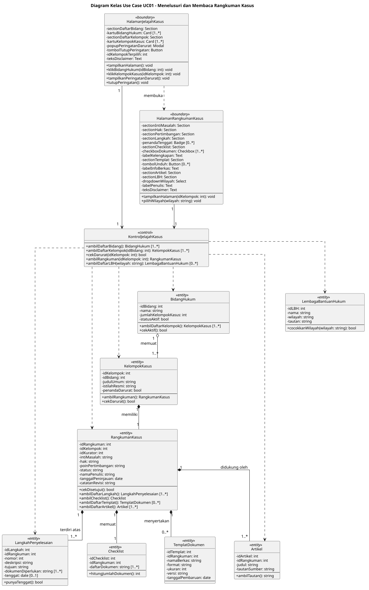
</p>
<p align="center">
<i>Gambar 3.1.3 Diagram Kelas Menelusuri dan Membaca Rangkuman Kasus (UC01)</i>
</p>

Penyesuaian pada tahap perancangan untuk use case ini tercatat pada Daftar Perubahan revisi C, meliputi penambahan atribut `- idKelompokTerpilih: int` dan `- teksDisclaimer: Text` serta operasi `+ tampilkanPeringatanDarurat(): void` pada `HalamanJelajahKasus`, serta penambahan operasi `+ cekDarurat(idKelompok: int): bool` pada `KontrolJelajahKasus`. Kedua operasi tersebut diperlukan untuk dapat menggambar cabang skenario alternatif pada subbab 3.1.2.

## 3.2 Use Case Mencari Kasus

**ID Use Case:** UC02  
**Nama Use Case:** Mencari Kasus

### 3.2.1 Identifikasi Kelas

Tabel 3.2. Identifikasi Kelas Use Case UC02

| No | Nama Kelas Perancangan | Nama Kelas Analisis Terkait |
|:--- | :--- | :--- |
| 1 | `HalamanPencarianKataKunci` | C15 - `HalamanPencarianKataKunci` |
| 2 | `HalamanRangkumanKasus` | C14 - `HalamanRangkumanKasus` |
| 3 | `KontrolPencarianKataKunci` | C22 - `KontrolPencarianKataKunci` |
| 4 | `BidangHukum` | C04 - `BidangHukum` |
| 5 | `KelompokKasus` | C05 - `KelompokKasus` |
| 6 | `RangkumanKasus` | C06 - `RangkumanKasus` |
| 7 | `LembagaBantuanHukum` | C11 - `LembagaBantuanHukum` |

### 3.2.2 Sequence Diagram

- **Skenario Normal**

<p align="center">
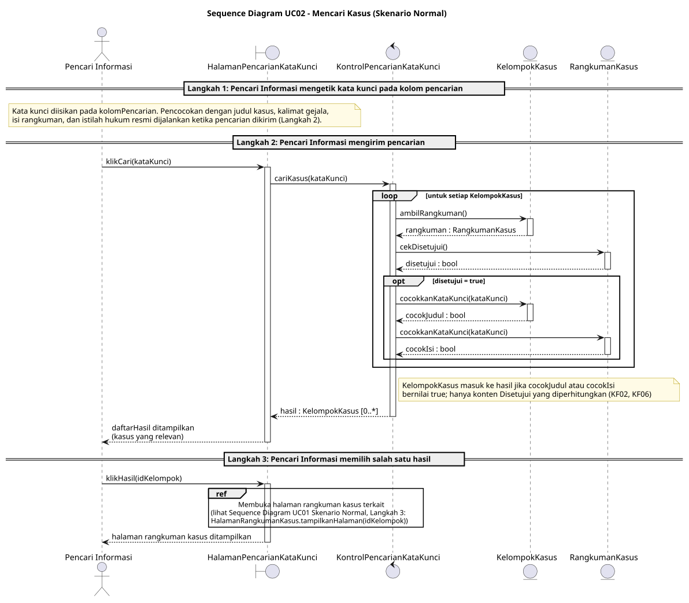
</p>
<p align="center">
<i>Gambar 3.2.1 Sequence Diagram UC02 - Skenario Normal</i>
</p>

- **Skenario Alternatif 1: Pencarian Tidak Menemukan Hasil**

<p align="center">

</p>
<p align="center">
<i>Gambar 3.2.2 Sequence Diagram UC02 - Skenario Alternatif 1: Pencarian Tidak Menemukan Hasil</i>
</p>

### 3.2.3 Diagram Kelas

<p align="center">

</p>
<p align="center">
<i>Gambar 3.2.3 Diagram Kelas Mencari Kasus (UC02)</i>
</p>

Penyesuaian pada tahap perancangan untuk use case ini tercatat pada Daftar Perubahan revisi C, meliputi penambahan atribut `- teksDisclaimer: Text` serta operasi `+ tampilkanHasil(daftarHasil: KelompokKasus [0..*]): void` dan `+ tampilkanTidakDitemukan(saranBidang: BidangHukum [1..*]): void` pada `HalamanPencarianKataKunci`. Kedua operasi tersebut diperlukan untuk dapat menggambar cabang skenario alternatif pada subbab 3.2.2.

## 3.3 Use Case Menyiapkan Dokumen dengan *Checklist*

**ID Use Case:** UC03  
**Nama Use Case:** Menyiapkan Dokumen dengan *Checklist*

### 3.3.1 Identifikasi Kelas

Tabel 3.3. Identifikasi Kelas Use Case UC03

| No | Nama Kelas Perancangan | Nama Kelas Analisis Terkait |
|:--- | :--- | :--- |
| 1 | `HalamanRangkumanKasus` | C14 - `HalamanRangkumanKasus` |
| 2 | `KontrolChecklist` | C23 - `KontrolChecklist` |
| 3 | `RangkumanKasus` | C06 - `RangkumanKasus` |
| 4 | `Checklist` | C08 - `Checklist` |

### 3.3.2 Sequence Diagram

- **Skenario Normal**

<p align="center">

</p>
<p align="center">
<i>Gambar 3.3.1 Sequence Diagram UC03 - Skenario Normal</i>
</p>

- **Skenario Alternatif 1: Pengguna Memuat Ulang atau Membuka Kembali Halaman**

<p align="center">
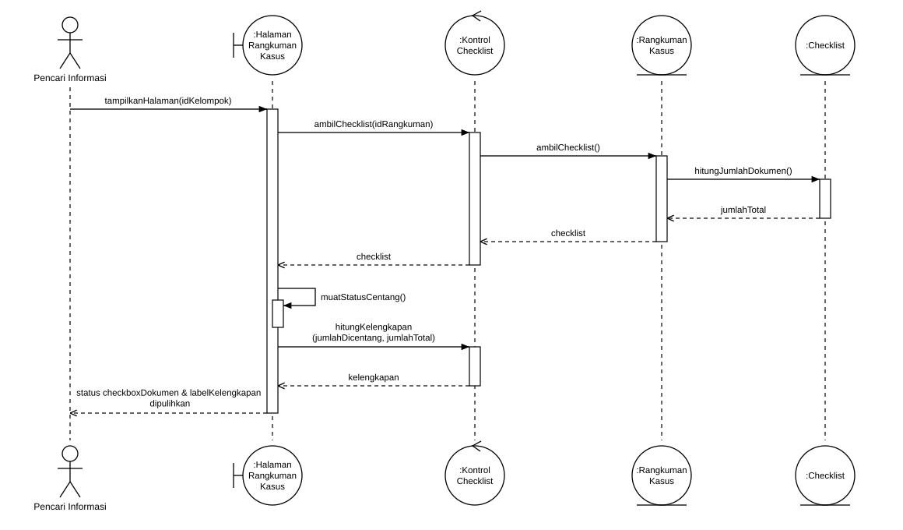
</p>
<p align="center">
<i>Gambar 3.3.2 Sequence Diagram UC03 - Pengguna Memuat Ulang atau Membuka Kembali Halaman</i>
</p>

### 3.3.3 Diagram Kelas

<p align="center">
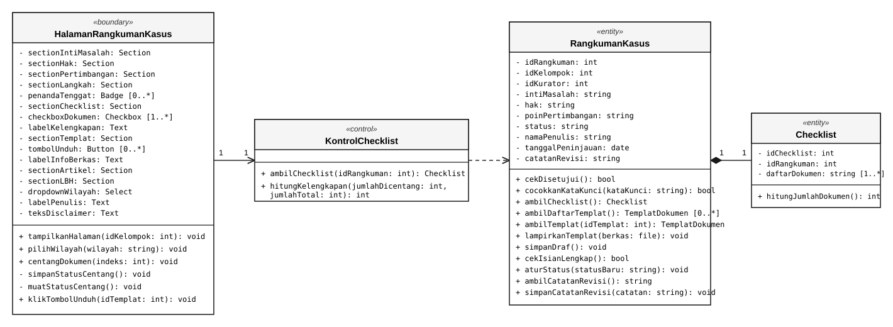
</p>
<p align="center">
<i>Gambar 3.3.3 Diagram Kelas Menyiapkan Dokumen dengan Checklist (UC03)</i>
</p>

<br>

## 3.4 Use Case Mengunduh Templat Dokumen

**ID Use Case:** UC04  
**Nama Use Case:** Mengunduh Templat Dokumen

### 3.4.1 Identifikasi Kelas

Tabel 3.4. Identifikasi Kelas Use Case UC04

| No | Nama Kelas Perancangan | Nama Kelas Analisis Terkait |
|:--- | :--- | :--- |
| 1 | `HalamanRangkumanKasus` | C14 - `HalamanRangkumanKasus` |
| 2 | `KontrolUnduhTemplat` | C24 - `KontrolUnduhTemplat` |
| 3 | `RangkumanKasus` | C06 - `RangkumanKasus` |
| 4 | `TemplatDokumen` | C09 - `TemplatDokumen` |

### 3.4.2 Sequence Diagram

- **Skenario Normal**

<p align="center">
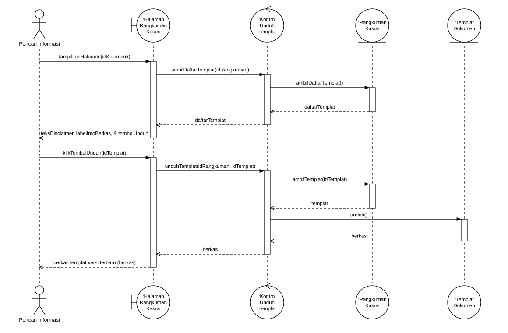
</p>
<p align="center">
<i>Gambar 3.4.1 Sequence Diagram UC04 - Skenario Normal</i>
</p>

- **Skenario Alternatif 1: Kasus Belum Memiliki Templat**

<p align="center">

</p>
<p align="center">
<i>Gambar 3.4.2 Sequence Diagram UC04 - Kasus Belum Memiliki Templat</i>
</p>

### 3.4.3 Diagram Kelas

<p align="center">
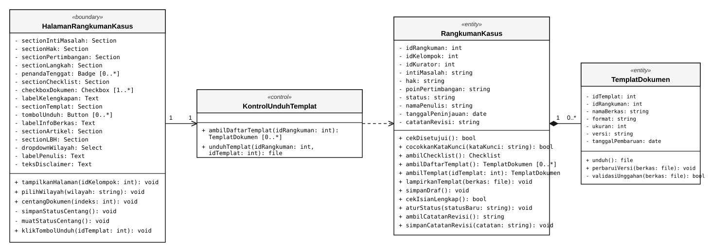
</p>
<p align="center">
<i>Gambar 3.4.3 Diagram Kelas Mengunduh Templat Dokumen (UC04)</i>
</p>

<br>

## 3.5 Use Case Masuk dan Keluar Panel Pengelolaan

**ID Use Case:** UC05
**Nama Use Case:** Masuk dan Keluar Panel Pengelolaan

### 3.5.1 Identifikasi Kelas

Tabel 3.5. Identifikasi Kelas Use Case UC05

| No | Nama Kelas Perancangan | Nama Kelas Analisis Terkait |
|:--- | :--- | :--- |
| 1 | `HalamanLogin` | C16 - `HalamanLogin` |
| 2 | `KontrolAutentikasi` | C25 - `KontrolAutentikasi` |
| 3 | `Akun` | C01 - `Akun` |
| 4 | `Kurator` | C02 - `Kurator` |
| 5 | `Administrator` | C03 - `Administrator` |

### 3.5.2 Sequence Diagram

- **Skenario Normal**

<p align="center">

</p>
<p align="center">
<i>Gambar 3.5.1 Sequence Diagram UC05 - Skenario Normal</i>
</p>

- **Skenario Alternatif 1: Kredensial Salah**

<p align="center">
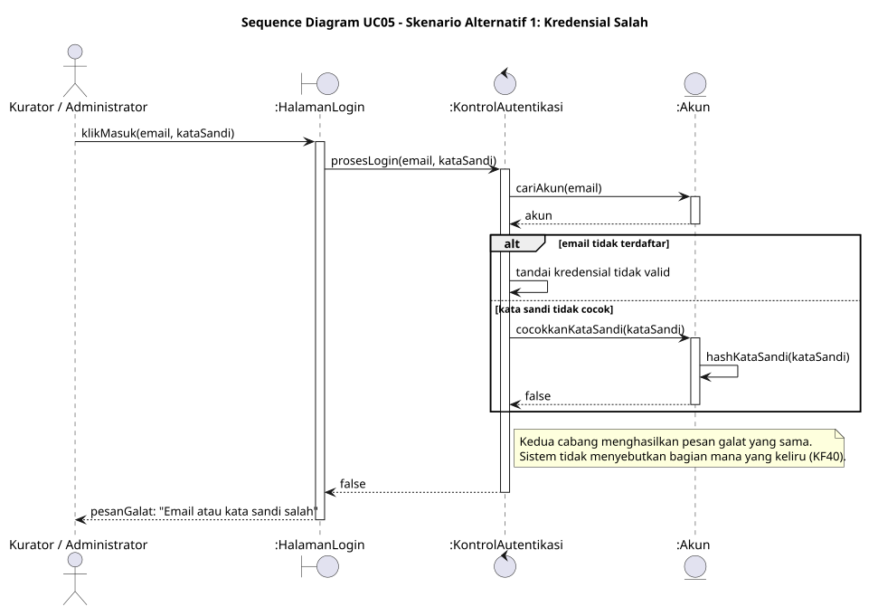
</p>
<p align="center">
<i>Gambar 3.5.2 Sequence Diagram UC05 - Kredensial Salah</i>
</p>

- **Skenario Alternatif 2: Akses Tanpa Sesi yang Sah**

<p align="center">

</p>
<p align="center">
<i>Gambar 3.5.3 Sequence Diagram UC05 - Akses Tanpa Sesi yang Sah</i>
</p>

- **Skenario Alternatif 3: Mengakhiri Sesi Pengelolaan** (keluar atas permintaan pengguna dan sesi yang berakhir otomatis, digambarkan dengan fragmen `alt`)

<p align="center">

</p>
<p align="center">
<i>Gambar 3.5.4 Sequence Diagram UC05 - Mengakhiri Sesi Pengelolaan</i>
</p>

### 3.5.3 Diagram Kelas

<p align="center">

</p>
<p align="center">
<i>Gambar 3.5.5 Diagram Kelas Masuk dan Keluar Panel Pengelolaan (UC05)</i>
</p>

<br>

## 3.6 Use Case Mengelola Konten Rangkuman Kasus

**ID Use Case:** UC06
**Nama Use Case:** Mengelola Konten Rangkuman Kasus

### 3.6.1 Identifikasi Kelas

Tabel 3.6. Identifikasi Kelas Use Case UC06

| No | Nama Kelas Perancangan | Nama Kelas Analisis Terkait |
|:--- | :--- | :--- |
| 1 | `HalamanPenyusunanKonten` | C17 - `HalamanPenyusunanKonten` |
| 2 | `KontrolPenyusunanKonten` | C26 - `KontrolPenyusunanKonten` |
| 3 | `Akun` | C01 - `Akun` |
| 4 | `Kurator` | C02 - `Kurator` |
| 5 | `RangkumanKasus` | C06 - `RangkumanKasus` |
| 6 | `LangkahPenyelesaian` | C07 - `LangkahPenyelesaian` |
| 7 | `Checklist` | C08 - `Checklist` |
| 8 | `TemplatDokumen` | C09 - `TemplatDokumen` |
| 9 | `Artikel` | C10 - `Artikel` |
| 10 | `RiwayatStatus` | C12 - `RiwayatStatus` |

### 3.6.2 Sequence Diagram

- **Skenario Normal** (termasuk Skenario Alternatif 1: Berkas Templat Tidak Valid dan Skenario Alternatif 2: Isian Wajib Belum Lengkap, yang digambarkan dengan fragmen `alt`)

<p align="center">
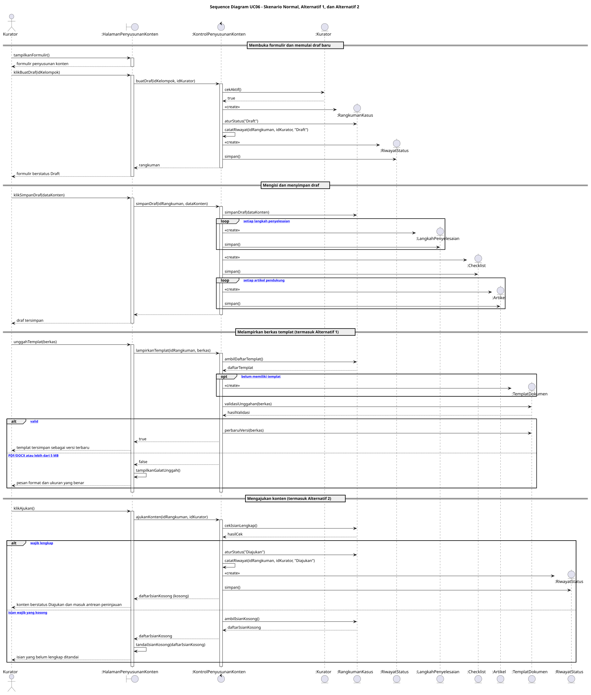
</p>
<p align="center">
<i>Gambar 3.6.1 Sequence Diagram UC06 - Skenario Normal, Alternatif 1, dan Alternatif 2</i>
</p>

- **Skenario Alternatif 3: Kurator Mencoba Menayangkan Sendiri**

<p align="center">

</p>
<p align="center">
<i>Gambar 3.6.2 Sequence Diagram UC06 - Kurator Mencoba Menayangkan Sendiri</i>
</p>

### 3.6.3 Diagram Kelas

<p align="center">
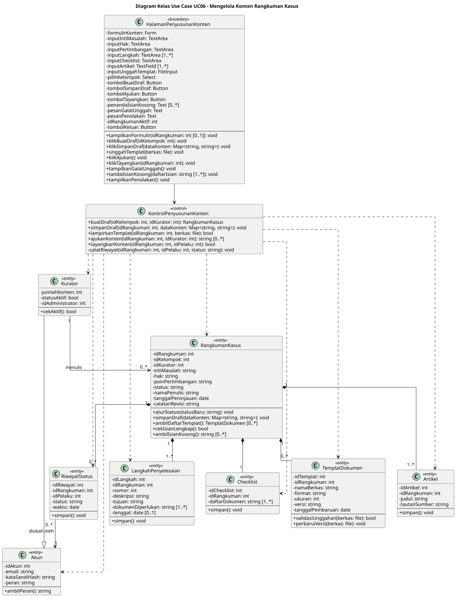
</p>
<p align="center">
<i>Gambar 3.6.3 Diagram Kelas Mengelola Konten Rangkuman Kasus (UC06)</i>
</p>

<br>

## 3.7 Use Case Memantau Status dan Revisi Konten

**ID Use Case:** UC07  
**Nama Use Case:** Memantau Status dan Revisi Konten

### 3.7.1 Identifikasi Kelas

Tabel 3.7. Identifikasi Kelas Use Case UC07

| No | Nama Kelas Perancangan | Nama Kelas Analisis Terkait |
|:--- | :--- | :--- |
| 1 | `HalamanDaftarKontenKurator` | C18 - `HalamanDaftarKontenKurator` |
| 2 | `KontrolPelacakanKonten` | C27 - `KontrolPelacakanKonten` |
| 3 | `Kurator` | C02 - `Kurator` |
| 4 | `RangkumanKasus` | C06 - `RangkumanKasus` |

### 3.7.2 Sequence Diagram

- **Skenario Normal**

<p align="center">

</p>
<p align="center">
<i>Gambar 3.7.1 Sequence Diagram UC07 - Skenario Normal</i>
</p>

- **Skenario Alternatif 1: Konten Berstatus Perlu Revisi**

<p align="center">
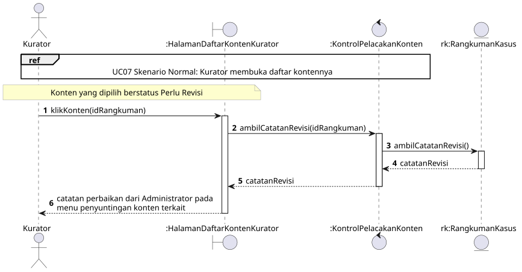
</p>
<p align="center">
<i>Gambar 3.7.2 Sequence Diagram UC07 - Skenario Alternatif 1: Konten Berstatus Perlu Revisi</i>
</p>

### 3.7.3 Diagram Kelas

<p align="center">
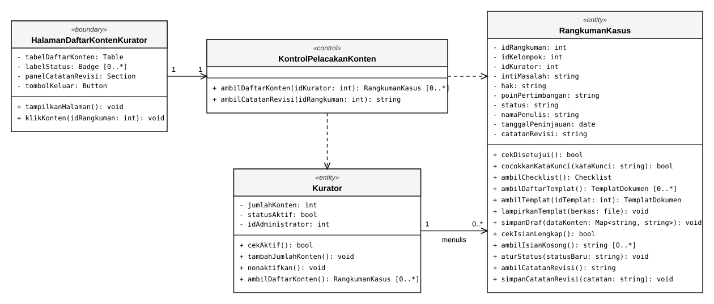
</p>
<p align="center">
<i>Gambar 3.7.3 Diagram Kelas Memantau Status dan Revisi Konten (UC07)</i>
</p>

<br>

## 3.8 Use Case Meninjau dan Memutuskan Konten

**ID Use Case:** UC08  
**Nama Use Case:** Meninjau dan Memutuskan Konten

### 3.8.1 Identifikasi Kelas

Tabel 3.8. Identifikasi Kelas Use Case UC08

| No | Nama Kelas Perancangan | Nama Kelas Analisis Terkait |
|:--- | :--- | :--- |
| 1 | `HalamanModerasiKonten` | C19 - `HalamanModerasiKonten` |
| 2 | `KontrolModerasiKonten` | C28 - `KontrolModerasiKonten` |
| 3 | `Akun` | C01 - `Akun` |
| 4 | `Administrator` | C03 - `Administrator` |
| 5 | `RangkumanKasus` | C06 - `RangkumanKasus` |
| 6 | `RiwayatStatus` | C12 - `RiwayatStatus` |

### 3.8.2 Sequence Diagram

- **Skenario Normal**

<p align="center">
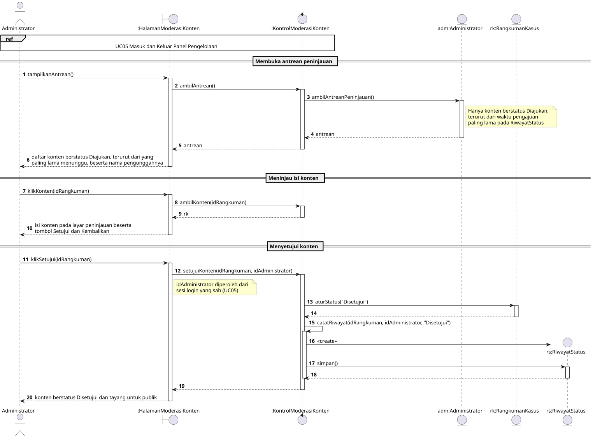
</p>
<p align="center">
<i>Gambar 3.8.1 Sequence Diagram UC08 - Skenario Normal</i>
</p>

- **Skenario Alternatif 1: Konten Dikembalikan dengan Catatan Revisi**

<p align="center">

</p>
<p align="center">
<i>Gambar 3.8.2 Sequence Diagram UC08 - Skenario Alternatif 1: Konten Dikembalikan dengan Catatan Revisi</i>
</p>

- **Skenario Alternatif 2: Alasan Revisi Dikosongkan**

<p align="center">
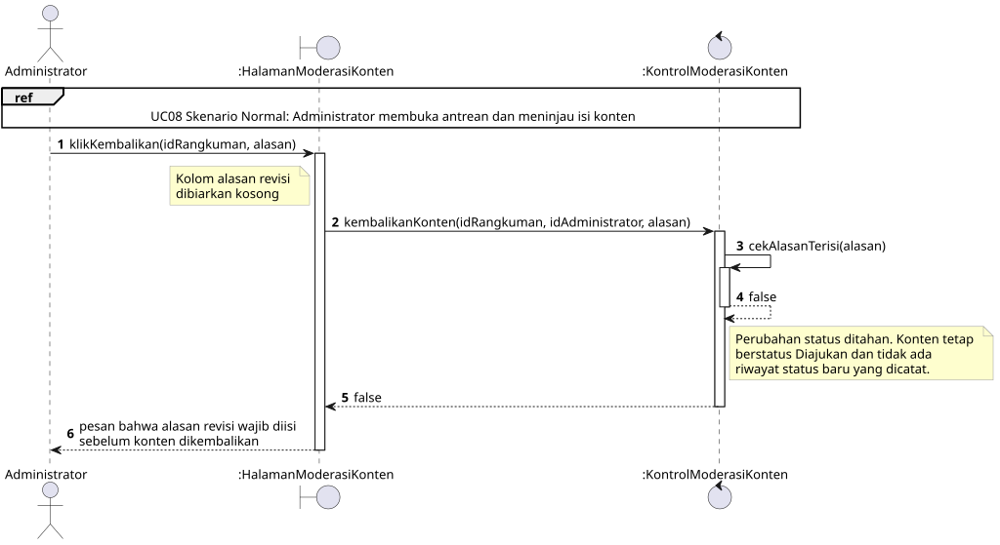
</p>
<p align="center">
<i>Gambar 3.8.3 Sequence Diagram UC08 - Skenario Alternatif 2: Alasan Revisi Dikosongkan</i>
</p>

### 3.8.3 Diagram Kelas

<p align="center">

</p>
<p align="center">
<i>Gambar 3.8.4 Diagram Kelas Meninjau dan Memutuskan Konten (UC08)</i>
</p>

<br>

---

## 3.9 Use Case Mengelola Akun Kurator

**ID Use Case:** UC09
**Nama Use Case:** Mengelola Akun Kurator

### 3.9.1 Identifikasi Kelas

Tabel 3.9. Identifikasi Kelas Use Case UC09

| No | Nama Kelas Perancangan | Nama Kelas Analisis Terkait |
|:--- | :--- | :--- |
| 1 | `HalamanPengelolaanAkun` | C20 - `HalamanPengelolaanAkun` |
| 2 | `KontrolPengelolaanAkun` | C29 - `KontrolPengelolaanAkun` |
| 3 | `KontrolAutentikasi` | C25 - `KontrolAutentikasi` |
| 4 | `Akun` | C01 - `Akun` |
| 5 | `Kurator` | C02 - `Kurator` |
| 6 | `Administrator` | C03 - `Administrator` |

### 3.9.2 Sequence Diagram

- **Skenario Normal**

<p align="center">

</p>
<p align="center">
<i>Gambar 3.9.1 Sequence Diagram UC09 - Skenario Normal</i>
</p>

- **Skenario Alternatif 1: Penonaktifan Akun Kurator**

<p align="center">
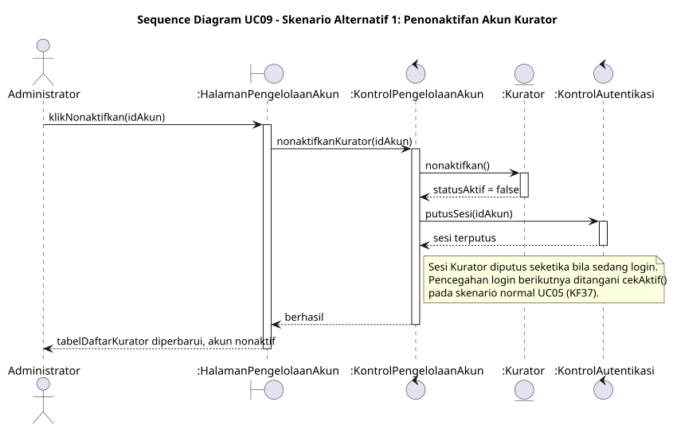
</p>
<p align="center">
<i>Gambar 3.9.2 Sequence Diagram UC09 - Penonaktifan Akun Kurator</i>
</p>

### 3.9.3 Diagram Kelas

<p align="center">

</p>
<p align="center">
<i>Gambar 3.9.3 Diagram Kelas Mengelola Akun Kurator (UC09)</i>
</p>

<br>

---

# BAB 4: Diagram Kelas Keseluruhan

## 4.1 Diagram Kelas

Realisasi sembilan *use case* pada BAB 3 menghasilkan 29 kelas perancangan. Penamaan dan penomoran kelas mengikuti BAB 5 dokumen SKPL, sedangkan atribut, metode, tipe data, dan visibilitasnya dirinci di sini agar siap diimplementasikan. Pemetaan ke lapisan MVC mengikuti ketetapan pada subbab 2.2, yaitu delapan kelas *boundary* menjadi *View*, sembilan kelas *control* menjadi *Controller*, dan dua belas kelas *entity* menjadi *Model*.

Diagram pada Gambar 4.1 menyatukan seluruh kelas tersebut beserta relasinya. Panah asosiasi dari *View* ke *Controller* menunjukkan bahwa setiap halaman hanya memanggil pengendalinya sendiri, sedangkan panah dependensi dari *Controller* ke *Model* menegaskan bahwa data hanya disentuh melalui lapisan *Model*. Tidak ada satu pun relasi langsung dari *View* ke *Model*, sehingga pemisahan tanggung jawab yang dijanjikan pola MVC tetap terjaga pada tingkat rancangan kelas.

<p align="center">
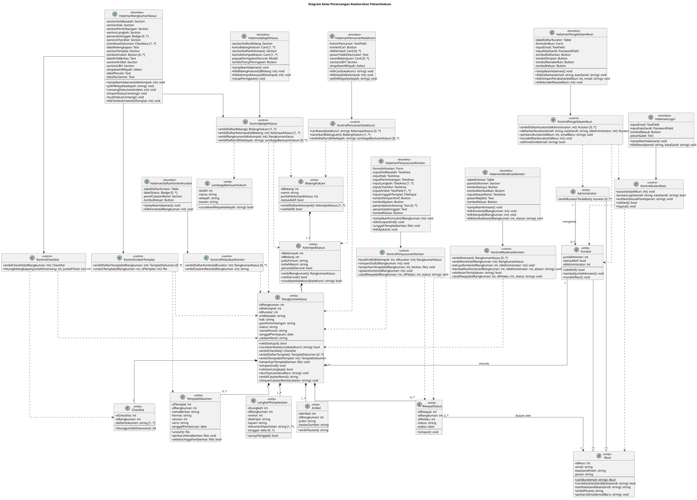
</p>
<p align="center">
<i>Gambar 4.1. Diagram Kelas Perancangan Keseluruhan PahamHukum</i>
</p>

Relasi antarkelas *entity* membentuk satu rantai komposisi yang berpusat pada `RangkumanKasus`. Satu `BidangHukum` menaungi beberapa `KelompokKasus`, dan tiap kelompok memiliki tepat satu `RangkumanKasus`. Rangkuman itulah yang memiliki `LangkahPenyelesaian`, `Checklist`, `TemplatDokumen`, `Artikel`, dan `RiwayatStatus`. Karena relasinya komposisi, penghapusan sebuah rangkuman ikut menghapus seluruh bagian di bawahnya. Di sisi pengelola, `Kurator` dan `Administrator` merupakan turunan `Akun`, sehingga email, kata sandi, dan peran cukup disimpan satu kali pada kelas induk.

Tabel 4.1 merinci atribut dan metode seluruh kelas. Daftar ini menggantikan tabel per kelas pada BAB 3, sebagaimana disebut pada subbab 3.1.3.

Tabel 4.1. Daftar Kelas Perancangan Keseluruhan

| ID Kelas | Nama Kelas | Atribut | Metode/Operasi |
| :--- | :--- | :--- | :--- |
| C01 | `Akun` | - idAkun: int<br>- email: string<br>- kataSandiHash: string<br>- peran: string | + {static} cariAkun(email: string): Akun<br>+ cocokkanKataSandi(kataSandi: string): bool<br>- hashKataSandi(kataSandi: string): string<br>+ ambilPeran(): string<br>+ perbaruiEmail(emailBaru: string): void |
| C02 | `Kurator` | - jumlahKonten: int<br>- statusAktif: bool<br>- idAdministrator: int<br>(serta atribut warisan Akun) | + cekAktif(): bool<br>+ tambahJumlahKonten(): void<br>+ nonaktifkan(): void<br>+ ambilDaftarKonten(): RangkumanKasus [0..\*] |
| C03 | `Administrator` | (mewarisi atribut Akun) | + ambilKuratorTerdaftar(): Kurator [0..\*]<br>+ ambilAntreanPeninjauan(): RangkumanKasus [0..\*] |
| C04 | `BidangHukum` | - idBidang: int<br>- nama: string<br>- jumlahKelompokKasus: int<br>- statusAktif: bool | + ambilDaftarKelompok(): KelompokKasus [1..\*]<br>+ cekAktif(): bool |
| C05 | `KelompokKasus` | - idKelompok: int<br>- idBidang: int<br>- judulUmum: string<br>- istilahResmi: string<br>- penandaDarurat: bool | + ambilRangkuman(): RangkumanKasus<br>+ cekDarurat(): bool<br>+ cocokkanKataKunci(kataKunci: string): bool |
| C06 | `RangkumanKasus` | - idRangkuman: int<br>- idKelompok: int<br>- idKurator: int<br>- intiMasalah: string<br>- hak: string<br>- poinPertimbangan: string<br>- status: string<br>- namaPenulis: string<br>- tanggalPeninjauan: date<br>- catatanRevisi: string | + cekDisetujui(): bool<br>+ cocokkanKataKunci(kataKunci: string): bool<br>+ ambilDaftarLangkah(): LangkahPenyelesaian [1..\*]<br>+ ambilChecklist(): Checklist<br>+ ambilDaftarTemplat(): TemplatDokumen [0..\*]<br>+ ambilTemplat(idTemplat: int): TemplatDokumen<br>+ ambilDaftarArtikel(): Artikel [1..\*]<br>+ lampirkanTemplat(berkas: file): void<br>+ simpanDraf(dataKonten: Map&lt;string, string&gt;): void<br>+ cekIsianLengkap(): bool<br>+ ambilIsianKosong(): string [0..\*]<br>+ aturStatus(statusBaru: string): void<br>+ ambilCatatanRevisi(): string<br>+ simpanCatatanRevisi(catatan: string): void |
| C07 | `LangkahPenyelesaian` | - idLangkah: int<br>- idRangkuman: int<br>- nomor: int<br>- deskripsi: string<br>- tujuan: string<br>- dokumenDiperlukan: string [1..\*]<br>- tenggat: date [0..1] | + punyaTenggat(): bool<br>+ simpan(): void |
| C08 | `Checklist` | - idChecklist: int<br>- idRangkuman: int<br>- daftarDokumen: string [1..\*] | + hitungJumlahDokumen(): int<br>+ simpan(): void |
| C09 | `TemplatDokumen` | - idTemplat: int<br>- idRangkuman: int<br>- namaBerkas: string<br>- format: string<br>- ukuran: int<br>- versi: string<br>- tanggalPembaruan: date | + unduh(): file<br>+ perbaruiVersi(berkas: file): void<br>+ validasiUnggahan(berkas: file): bool |
| C10 | `Artikel` | - idArtikel: int<br>- idRangkuman: int<br>- judul: string<br>- tautanSumber: string | + ambilTautan(): string<br>+ simpan(): void |
| C11 | `LembagaBantuanHukum` | - idLBH: int<br>- nama: string<br>- wilayah: string<br>- tautan: string | + cocokkanWilayah(wilayah: string): bool |
| C12 | `RiwayatStatus` | - idRiwayat: int<br>- idRangkuman: int<br>- idPelaku: int<br>- status: string<br>- waktu: date | + simpan(): void |
| C13 | `HalamanJelajahKasus` | - sectionDaftarBidang: Section<br>- kartuBidangHukum: Card [1..\*]<br>- sectionDaftarKelompok: Section<br>- kartuKelompokKasus: Card [1..\*]<br>- popupPeringatanDarurat: Modal<br>- tombolTutupPeringatan: Button<br>- idKelompokTerpilih: int<br>- teksDisclaimer: Text | + tampilkanHalaman(): void<br>+ klikBidangHukum(idBidang: int): void<br>+ klikKelompokKasus(idKelompok: int): void<br>+ tampilkanPeringatanDarurat(): void<br>+ tutupPeringatan(): void |
| C14 | `HalamanRangkumanKasus` | - sectionIntiMasalah: Section<br>- sectionHak: Section<br>- sectionPertimbangan: Section<br>- sectionLangkah: Section<br>- penandaTenggat: Badge [0..\*]<br>- sectionChecklist: Section<br>- checkboxDokumen: Checkbox [1..\*]<br>- labelKelengkapan: Text<br>- sectionTemplat: Section<br>- tombolUnduh: Button [0..\*]<br>- labelInfoBerkas: Text<br>- sectionArtikel: Section<br>- sectionLBH: Section<br>- dropdownWilayah: Select<br>- labelPenulis: Text<br>- teksDisclaimer: Text | + tampilkanHalaman(idKelompok: int): void<br>+ pilihWilayah(wilayah: string): void<br>+ centangDokumen(indeks: int): void<br>- simpanStatusCentang(): void<br>- muatStatusCentang(): void<br>+ klikTombolUnduh(idTemplat: int): void |
| C15 | `HalamanPencarianKataKunci` | - kolomPencarian: TextField<br>- tombolCari: Button<br>- daftarHasil: Card [0..\*]<br>- pesanTidakDitemukan: Text<br>- saranBidangLain: Card [0..\*]<br>- sectionLBH: Section<br>- dropdownWilayah: Select<br>- teksDisclaimer: Text | + klikCari(kataKunci: string): void<br>+ tampilkanHasil(daftarHasil: KelompokKasus [0..\*]): void<br>+ tampilkanTidakDitemukan(saranBidang: BidangHukum [1..\*]): void<br>+ klikHasil(idKelompok: int): void<br>+ pilihWilayah(wilayah: string): void |
| C16 | `HalamanLogin` | - inputEmail: TextField<br>- inputKataSandi: PasswordField<br>- tombolMasuk: Button<br>- pesanGalat: Text | + tampilkanHalaman(): void<br>+ klikMasuk(email: string, kataSandi: string): void |
| C17 | `HalamanPenyusunanKonten` | - formulirKonten: Form<br>- inputIntiMasalah: TextArea<br>- inputHak: TextArea<br>- inputPertimbangan: TextArea<br>- inputLangkah: TextArea [1..\*]<br>- inputChecklist: TextArea<br>- inputArtikel: TextField [1..\*]<br>- inputUnggahTemplat: FileInput<br>- pilihKelompok: Select<br>- tombolBuatDraf: Button<br>- tombolSimpanDraf: Button<br>- tombolAjukan: Button<br>- tombolTayangkan: Button<br>- penandaIsianKosong: Text [0..\*]<br>- pesanGalatUnggah: Text<br>- pesanPenolakan: Text<br>- idRangkumanAktif: int<br>- tombolKeluar: Button | + tampilkanFormulir(idRangkuman: int [0..1]): void<br>+ klikBuatDraf(idKelompok: int): void<br>+ klikSimpanDraf(dataKonten: Map&lt;string, string&gt;): void<br>+ unggahTemplat(berkas: file): void<br>+ klikAjukan(): void<br>+ klikTayangkan(idRangkuman: int): void<br>+ tampilkanGalatUnggah(): void<br>+ tandaiIsianKosong(daftarIsian: string [1..\*]): void<br>+ tampilkanPenolakan(): void |
| C18 | `HalamanDaftarKontenKurator` | - tabelDaftarKonten: Table<br>- labelStatus: Badge [0..\*]<br>- panelCatatanRevisi: Section<br>- tombolKeluar: Button | + tampilkanHalaman(): void<br>+ klikKonten(idRangkuman: int): void |
| C19 | `HalamanModerasiKonten` | - tabelAntrean: Table<br>- panelIsiKonten: Section<br>- tombolSetujui: Button<br>- tombolKembalikan: Button<br>- inputAlasanRevisi: TextArea<br>- pesanWajibIsi: Text<br>- tombolKeluar: Button | + tampilkanAntrean(): void<br>+ klikKonten(idRangkuman: int): void<br>+ klikSetujui(idRangkuman: int): void<br>+ klikKembalikan(idRangkuman: int, alasan: string): void |
| C20 | `HalamanPengelolaanAkun` | - tabelDaftarKurator: Table<br>- formulirAkun: Form<br>- inputEmail: TextField<br>- inputKataSandi: PasswordField<br>- tombolDaftarkan: Button<br>- tombolSimpan: Button<br>- tombolNonaktifkan: Button<br>- tombolKeluar: Button | + tampilkanHalaman(): void<br>+ klikDaftarkan(email: string, kataSandi: string): void<br>+ klikSimpanPerubahan(idAkun: int, email: string): void<br>+ klikNonaktifkan(idAkun: int): void |
| C21 | `KontrolJelajahKasus` | - | + ambilDaftarBidang(): BidangHukum [1..\*]<br>+ ambilDaftarKelompok(idBidang: int): KelompokKasus [1..\*]<br>+ cekDarurat(idKelompok: int): bool<br>+ ambilRangkuman(idKelompok: int): RangkumanKasus<br>+ ambilDaftarLBH(wilayah: string): LembagaBantuanHukum [0..\*] |
| C22 | `KontrolPencarianKataKunci` | - | + cariKasus(kataKunci: string): KelompokKasus [0..\*]<br>+ sarankanBidangLain(): BidangHukum [1..\*]<br>+ ambilDaftarLBH(wilayah: string): LembagaBantuanHukum [0..\*] |
| C23 | `KontrolChecklist` | - | + ambilChecklist(idRangkuman: int): Checklist<br>+ hitungKelengkapan(jumlahDicentang: int, jumlahTotal: int): int |
| C24 | `KontrolUnduhTemplat` | - | + ambilDaftarTemplat(idRangkuman: int): TemplatDokumen [0..\*]<br>+ unduhTemplat(idRangkuman: int, idTemplat: int): file |
| C25 | `KontrolAutentikasi` | - | + putusSesi(idAkun: int): void<br>+ prosesLogin(email: string, kataSandi: string): bool<br>+ arahkanSesuaiPeran(peran: string): void<br>+ cekSesi(): bool<br>+ logout(): void |
| C26 | `KontrolPenyusunanKonten` | - | + buatDraf(idKelompok: int, idKurator: int): RangkumanKasus<br>+ simpanDraf(idRangkuman: int, dataKonten: Map&lt;string, string&gt;): void<br>+ lampirkanTemplat(idRangkuman: int, berkas: file): bool<br>+ ajukanKonten(idRangkuman: int, idKurator: int): string [0..\*]<br>+ tayangkanKonten(idRangkuman: int, idPelaku: int): bool<br>- catatRiwayat(idRangkuman: int, idPelaku: int, status: string): void |
| C27 | `KontrolPelacakanKonten` | - | + ambilDaftarKonten(idKurator: int): RangkumanKasus [0..\*]<br>+ ambilCatatanRevisi(idRangkuman: int): string |
| C28 | `KontrolModerasiKonten` | - | + ambilAntrean(): RangkumanKasus [0..\*]<br>+ ambilKonten(idRangkuman: int): RangkumanKasus<br>+ setujuiKonten(idRangkuman: int, idAdministrator: int): void<br>+ kembalikanKonten(idRangkuman: int, idAdministrator: int, alasan: string): bool<br>- cekAlasanTerisi(alasan: string): bool<br>- catatRiwayat(idRangkuman: int, idPelaku: int, status: string): void |
| C29 | `KontrolPengelolaanAkun` | - | + ambilDaftarKurator(idAdministrator: int): Kurator [0..\*]<br>+ daftarkanKurator(email: string, kataSandi: string, idAdministrator: int): Kurator<br>+ perbaruiKurator(idAkun: int, emailBaru: string): void<br>+ nonaktifkanKurator(idAkun: int): void<br>- cekEmailUnik(email: string): bool |

Seluruh penambahan dan penyesuaian atribut maupun metode/operasi pada Tabel 4.1 di atas dibandingkan dengan BAB 5 dokumen SKPL telah dicatat pada tabel Daftar Perubahan. Adapun pada use case pengelolaan akun dan autentikasi (UC05 dan UC09), terdapat tiga metode baru yang ditambahkan pada tahap perancangan:

1. `cariAkun(email)` pada `Akun`. Metode `prosesLogin()` menerima email, tetapi SKPL tidak menyediakan cara mencari akun berdasarkan email, sehingga `cocokkanKataSandi()` tidak memiliki objek sasaran. Metode ini bersifat statis karena dipanggil sebelum objek `Akun` terbentuk.
2. `putusSesi(idAkun)` pada `KontrolAutentikasi`. KF37 menuntut sesi Kurator terputus seketika saat akunnya dinonaktifkan, sedangkan pemegang sesi adalah `KontrolAutentikasi`.
3. `ambilDaftarKurator(idAdministrator)` pada `KontrolPengelolaanAkun`. Tanpa metode ini, `HalamanPengelolaanAkun` harus memanggil `Administrator` secara langsung dan melangkahi lapisan *Controller*.

Selain ketiganya, alur login UC05 kini memanggil `cekAktif()` milik `Kurator`. Metode tersebut sudah ada pada SKPL, tetapi belum pernah ditempatkan dalam alur mana pun, sehingga KF37 mengenai pencegahan login bagi Kurator nonaktif belum terealisasi.

<br>

---

# BAB 5: Perancangan Rinci Kelas

Bab ini merinci 29 kelas perancangan PahamHukum yang telah digambarkan pada BAB 4. Setiap kelas dilengkapi tabel operasi dan tabel atribut beserta *visibility*-nya. Operasi yang memuat percabangan, validasi, atau perubahan data juga dilengkapi algoritma dalam bentuk *pseudocode* dan *query* SQL yang dijalankannya.

Beberapa ketentuan berlaku untuk seluruh bab ini. Pertama, tipe data mengikuti notasi pada Tabel 4.1 agar konsisten dengan diagram kelas, misalnya `string`, `int`, `bool`, `date`, dan `file`. Kedua, *query* ditulis dalam SQL standar dengan parameter `?` sehingga dapat dijalankan pada PostgreSQL maupun MySQL sesuai Tabel 2.1.2, sekaligus mencegah *SQL injection*. Ketiga, nama tabel basis data memakai bentuk *snake_case* dari nama kelas *entity*, misalnya `RangkumanKasus` disimpan pada tabel `rangkuman_kasus`.

Tabel 5.1. Daftar Kelas Perancangan dan Kelas Analisis Terkait

| No | Nama Kelas Perancangan | Nama Kelas Analisis Terkait |
| :--- | :--- | :--- |
| 1 | `Akun` | C01 - `Akun` |
| 2 | `Kurator` | C02 - `Kurator` |
| 3 | `Administrator` | C03 - `Administrator` |
| 4 | `BidangHukum` | C04 - `BidangHukum` |
| 5 | `KelompokKasus` | C05 - `KelompokKasus` |
| 6 | `RangkumanKasus` | C06 - `RangkumanKasus` |
| 7 | `LangkahPenyelesaian` | C07 - `LangkahPenyelesaian` |
| 8 | `Checklist` | C08 - `Checklist` |
| 9 | `TemplatDokumen` | C09 - `TemplatDokumen` |
| 10 | `Artikel` | C10 - `Artikel` |
| 11 | `LembagaBantuanHukum` | C11 - `LembagaBantuanHukum` |
| 12 | `RiwayatStatus` | C12 - `RiwayatStatus` |
| 13 | `HalamanJelajahKasus` | C13 - `HalamanJelajahKasus` |
| 14 | `HalamanRangkumanKasus` | C14 - `HalamanRangkumanKasus` |
| 15 | `HalamanPencarianKataKunci` | C15 - `HalamanPencarianKataKunci` |
| 16 | `HalamanLogin` | C16 - `HalamanLogin` |
| 17 | `HalamanPenyusunanKonten` | C17 - `HalamanPenyusunanKonten` |
| 18 | `HalamanDaftarKontenKurator` | C18 - `HalamanDaftarKontenKurator` |
| 19 | `HalamanModerasiKonten` | C19 - `HalamanModerasiKonten` |
| 20 | `HalamanPengelolaanAkun` | C20 - `HalamanPengelolaanAkun` |
| 21 | `KontrolJelajahKasus` | C21 - `KontrolJelajahKasus` |
| 22 | `KontrolPencarianKataKunci` | C22 - `KontrolPencarianKataKunci` |
| 23 | `KontrolChecklist` | C23 - `KontrolChecklist` |
| 24 | `KontrolUnduhTemplat` | C24 - `KontrolUnduhTemplat` |
| 25 | `KontrolAutentikasi` | C25 - `KontrolAutentikasi` |
| 26 | `KontrolPenyusunanKonten` | C26 - `KontrolPenyusunanKonten` |
| 27 | `KontrolPelacakanKonten` | C27 - `KontrolPelacakanKonten` |
| 28 | `KontrolModerasiKonten` | C28 - `KontrolModerasiKonten` |
| 29 | `KontrolPengelolaanAkun` | C29 - `KontrolPengelolaanAkun` |

## 5.1 Kelas Akun

**Nama Kelas:** `Akun`  
**ID Kelas:** C01

Tabel 5.1.1. Operasi Kelas Akun

| Nama Operasi | Visibility (private, public) | Keterangan |
| :--- | :--- | :--- |
| `cariAkun(email: string): Akun` | public (static) | Mencari akun berdasarkan email. Mengembalikan objek `Akun`, atau null jika email tidak terdaftar. Bersifat statis karena dipanggil sebelum objek `Akun` terbentuk. |
| `cocokkanKataSandi(kataSandi: string): bool` | public | Mencocokkan kata sandi masukan dengan `kataSandiHash` menggunakan bcrypt (KNF10). |
| `hashKataSandi(kataSandi: string): string` | private | Menghasilkan *hash* bcrypt dengan *cost factor* minimal 10 sebelum kata sandi disimpan (KNF10). |
| `ambilPeran(): string` | public | Mengembalikan peran akun, yaitu Kurator atau Administrator, sebagai dasar pengalihan ke panel yang sesuai (KF39). |
| `perbaruiEmail(emailBaru: string): void` | public | Mengganti email akun lalu menyimpannya ke basis data (KF43). |

Tabel 5.1.2. Atribut Kelas Akun

| Nama Atribut | Visibility (private, public) | Tipe |
| :--- | :--- | :--- |
| `idAkun` | private | `int` |
| `email` | private | `string` |
| `kataSandiHash` | private | `string` |
| `peran` | private | `string` |

### 5.1.1 Algoritma/Query

**Nama Kelas:** `Akun`  
**Nama Operasi:** `cariAkun(email: string): Akun`  
**ID Algoritma:** Algo-001

```text
FUNGSI cariAkun(email)
    baris ← jalankan Q-001 dengan email
    JIKA baris kosong MAKA
        KEMBALIKAN null
    AKHIR JIKA
    KEMBALIKAN objek Akun baru dari baris
```

Tabel 5.1.3. Query Operasi cariAkun

| No Query | Query | Keterangan |
| :--- | :--- | :--- |
| Q-001 | `SELECT id_akun, email, kata_sandi_hash, peran FROM akun WHERE email = ?;` | Mengambil data akun berdasarkan email |

### 5.1.2 Algoritma/Query

**Nama Kelas:** `Akun`  
**Nama Operasi:** `cocokkanKataSandi(kataSandi: string): bool`  
**ID Algoritma:** Algo-002

```text
FUNGSI cocokkanKataSandi(kataSandi)
    KEMBALIKAN bcrypt.bandingkan(kataSandi, kataSandiHash)
    // kata sandi mentah tidak pernah disimpan maupun dibandingkan langsung (KNF10)
```

### 5.1.3 Algoritma/Query

**Nama Kelas:** `Akun`  
**Nama Operasi:** `hashKataSandi(kataSandi: string): string`  
**ID Algoritma:** Algo-003

```text
FUNGSI hashKataSandi(kataSandi)
    KEMBALIKAN bcrypt.hash(kataSandi, costFactor ← 10)
```

### 5.1.4 Algoritma/Query

**Nama Kelas:** `Akun`  
**Nama Operasi:** `perbaruiEmail(emailBaru: string): void`  
**ID Algoritma:** Algo-004

```text
PROSEDUR perbaruiEmail(emailBaru)
    email ← emailBaru
    jalankan Q-002 dengan email, idAkun
```

Tabel 5.1.4. Query Operasi perbaruiEmail

| No Query | Query | Keterangan |
| :--- | :--- | :--- |
| Q-002 | `UPDATE akun SET email = ? WHERE id_akun = ?;` | Menyimpan email baru akun |

## 5.2 Kelas Kurator

**Nama Kelas:** `Kurator`  
**ID Kelas:** C02

Tabel 5.2.1. Operasi Kelas Kurator

| Nama Operasi | Visibility (private, public) | Keterangan |
| :--- | :--- | :--- |
| `cekAktif(): bool` | public | Mengembalikan status aktif Kurator. Kurator nonaktif tidak dapat masuk ke panel pengelolaan (KF37). |
| `tambahJumlahKonten(): void` | public | Menambah satu pada `jumlahKonten` setiap kali Kurator membuat draf baru. |
| `nonaktifkan(): void` | public | Mengubah `statusAktif` menjadi false lalu menyimpannya ke basis data (KF37). |
| `ambilDaftarKonten(): RangkumanKasus [0..*]` | public | Mengembalikan seluruh rangkuman kasus milik Kurator beserta statusnya (KF29). |

Tabel 5.2.2. Atribut Kelas Kurator

| Nama Atribut | Visibility (private, public) | Tipe |
| :--- | :--- | :--- |
| `jumlahKonten` | private | `int` |
| `statusAktif` | private | `bool` |
| `idAdministrator` | private | `int` |

Selain atribut di atas, `Kurator` mewarisi seluruh atribut kelas `Akun` (`idAkun`, `email`, `kataSandiHash`, dan `peran`).

### 5.2.1 Algoritma/Query

**Nama Kelas:** `Kurator`  
**Nama Operasi:** `tambahJumlahKonten(): void`  
**ID Algoritma:** Algo-005

```text
PROSEDUR tambahJumlahKonten()
    jumlahKonten ← jumlahKonten + 1
    jalankan Q-003 dengan idAkun
```

Tabel 5.2.3. Query Operasi tambahJumlahKonten

| No Query | Query | Keterangan |
| :--- | :--- | :--- |
| Q-003 | `UPDATE kurator SET jumlah_konten = jumlah_konten + 1 WHERE id_akun = ?;` | Menambah jumlah konten milik Kurator |

### 5.2.2 Algoritma/Query

**Nama Kelas:** `Kurator`  
**Nama Operasi:** `nonaktifkan(): void`  
**ID Algoritma:** Algo-006

```text
PROSEDUR nonaktifkan()
    statusAktif ← false
    jalankan Q-004 dengan idAkun
```

Tabel 5.2.4. Query Operasi nonaktifkan

| No Query | Query | Keterangan |
| :--- | :--- | :--- |
| Q-004 | `UPDATE kurator SET status_aktif = FALSE WHERE id_akun = ?;` | Menonaktifkan akun Kurator |

### 5.2.3 Algoritma/Query

**Nama Kelas:** `Kurator`  
**Nama Operasi:** `ambilDaftarKonten(): RangkumanKasus [0..*]`  
**ID Algoritma:** Algo-007

```text
FUNGSI ambilDaftarKonten()
    daftarBaris ← jalankan Q-005 dengan idAkun
    KEMBALIKAN daftar objek RangkumanKasus dari daftarBaris
```

Tabel 5.2.5. Query Operasi ambilDaftarKonten

| No Query | Query | Keterangan |
| :--- | :--- | :--- |
| Q-005 | `SELECT id_rangkuman, id_kelompok, status, catatan_revisi FROM rangkuman_kasus WHERE id_kurator = ? ORDER BY id_rangkuman DESC;` | Mengambil seluruh konten milik Kurator, dimulai dari yang terbaru |

## 5.3 Kelas Administrator

**Nama Kelas:** `Administrator`  
**ID Kelas:** C03

Tabel 5.3.1. Operasi Kelas Administrator

| Nama Operasi | Visibility (private, public) | Keterangan |
| :--- | :--- | :--- |
| `ambilKuratorTerdaftar(): Kurator [0..*]` | public | Mengembalikan daftar Kurator yang didaftarkan oleh Administrator ini. |
| `ambilAntreanPeninjauan(): RangkumanKasus [0..*]` | public | Mengembalikan rangkuman berstatus Diajukan, diurutkan dari waktu pengajuan paling lama (KF31). |

Tabel 5.3.2. Atribut Kelas Administrator

`Administrator` tidak memiliki atribut sendiri. Seluruh atributnya diwarisi dari kelas `Akun`, yaitu `idAkun`, `email`, `kataSandiHash`, dan `peran`.

### 5.3.1 Algoritma/Query

**Nama Kelas:** `Administrator`  
**Nama Operasi:** `ambilKuratorTerdaftar(): Kurator [0..*]`  
**ID Algoritma:** Algo-008

```text
FUNGSI ambilKuratorTerdaftar()
    daftarBaris ← jalankan Q-006 dengan idAkun
    KEMBALIKAN daftar objek Kurator dari daftarBaris
```

Tabel 5.3.3. Query Operasi ambilKuratorTerdaftar

| No Query | Query | Keterangan |
| :--- | :--- | :--- |
| Q-006 | `SELECT a.id_akun, a.email, k.status_aktif, k.jumlah_konten FROM kurator k JOIN akun a ON a.id_akun = k.id_akun WHERE k.id_administrator = ? ORDER BY a.email;` | Mengambil Kurator yang didaftarkan Administrator |

### 5.3.2 Algoritma/Query

**Nama Kelas:** `Administrator`  
**Nama Operasi:** `ambilAntreanPeninjauan(): RangkumanKasus [0..*]`  
**ID Algoritma:** Algo-009

```text
FUNGSI ambilAntreanPeninjauan()
    daftarBaris ← jalankan Q-007
    KEMBALIKAN daftar objek RangkumanKasus dari daftarBaris
    // urutan sudah ditentukan query: pengajuan paling lama berada di atas (KF31)
```

Tabel 5.3.4. Query Operasi ambilAntreanPeninjauan

| No Query | Query | Keterangan |
| :--- | :--- | :--- |
| Q-007 | `SELECT r.id_rangkuman, r.nama_penulis, MAX(rs.waktu) AS waktu_pengajuan FROM rangkuman_kasus r JOIN riwayat_status rs ON rs.id_rangkuman = r.id_rangkuman AND rs.status = 'Diajukan' WHERE r.status = 'Diajukan' GROUP BY r.id_rangkuman, r.nama_penulis ORDER BY waktu_pengajuan ASC;` | Mengambil konten berstatus Diajukan beserta waktu pengajuan terakhirnya |

## 5.4 Kelas BidangHukum

**Nama Kelas:** `BidangHukum`  
**ID Kelas:** C04

Tabel 5.4.1. Operasi Kelas BidangHukum

| Nama Operasi | Visibility (private, public) | Keterangan |
| :--- | :--- | :--- |
| `ambilDaftarKelompok(): KelompokKasus [1..*]` | public | Mengembalikan seluruh kelompok kasus di bawah bidang hukum ini (KF03). |
| `cekAktif(): bool` | public | Mengembalikan status aktif bidang hukum. Bidang nonaktif disembunyikan dari antarmuka publik (KF02). |

Tabel 5.4.2. Atribut Kelas BidangHukum

| Nama Atribut | Visibility (private, public) | Tipe |
| :--- | :--- | :--- |
| `idBidang` | private | `int` |
| `nama` | private | `string` |
| `jumlahKelompokKasus` | private | `int` |
| `statusAktif` | private | `bool` |

### 5.4.1 Algoritma/Query

**Nama Kelas:** `BidangHukum`  
**Nama Operasi:** `ambilDaftarKelompok(): KelompokKasus [1..*]`  
**ID Algoritma:** Algo-010

```text
FUNGSI ambilDaftarKelompok()
    daftarBaris ← jalankan Q-008 dengan idBidang
    KEMBALIKAN daftar objek KelompokKasus dari daftarBaris
```

Tabel 5.4.3. Query Operasi ambilDaftarKelompok

| No Query | Query | Keterangan |
| :--- | :--- | :--- |
| Q-008 | `SELECT id_kelompok, id_bidang, judul_umum, istilah_resmi, penanda_darurat FROM kelompok_kasus WHERE id_bidang = ?;` | Mengambil kelompok kasus pada satu bidang hukum |

## 5.5 Kelas KelompokKasus

**Nama Kelas:** `KelompokKasus`  
**ID Kelas:** C05

Tabel 5.5.1. Operasi Kelas KelompokKasus

| Nama Operasi | Visibility (private, public) | Keterangan |
| :--- | :--- | :--- |
| `ambilRangkuman(): RangkumanKasus` | public | Mengembalikan rangkuman kasus milik kelompok ini (KF05). |
| `cekDarurat(): bool` | public | Mengembalikan true jika kelompok kasus ditandai sebagai situasi darurat (KF21). |
| `cocokkanKataKunci(kataKunci: string): bool` | public | Mencocokkan kata kunci dengan `judulUmum` dan `istilahResmi` tanpa membedakan huruf besar dan kecil (KF06). |

Tabel 5.5.2. Atribut Kelas KelompokKasus

| Nama Atribut | Visibility (private, public) | Tipe |
| :--- | :--- | :--- |
| `idKelompok` | private | `int` |
| `idBidang` | private | `int` |
| `judulUmum` | private | `string` |
| `istilahResmi` | private | `string` |
| `penandaDarurat` | private | `bool` |

### 5.5.1 Algoritma/Query

**Nama Kelas:** `KelompokKasus`  
**Nama Operasi:** `ambilRangkuman(): RangkumanKasus`  
**ID Algoritma:** Algo-011

```text
FUNGSI ambilRangkuman()
    baris ← jalankan Q-009 dengan idKelompok
    JIKA baris kosong MAKA
        KEMBALIKAN null
    AKHIR JIKA
    KEMBALIKAN objek RangkumanKasus dari baris
```

Tabel 5.5.3. Query Operasi ambilRangkuman

| No Query | Query | Keterangan |
| :--- | :--- | :--- |
| Q-009 | `SELECT id_rangkuman, id_kelompok, id_kurator, inti_masalah, hak, poin_pertimbangan, status, nama_penulis, tanggal_peninjauan, catatan_revisi FROM rangkuman_kasus WHERE id_kelompok = ?;` | Mengambil rangkuman milik kelompok kasus |

### 5.5.2 Algoritma/Query

**Nama Kelas:** `KelompokKasus`  
**Nama Operasi:** `cocokkanKataKunci(kataKunci: string): bool`  
**ID Algoritma:** Algo-012

```text
FUNGSI cocokkanKataKunci(kataKunci)
    kunci ← hurufKecil(hapusSpasiTepi(kataKunci))
    JIKA kunci kosong MAKA
        KEMBALIKAN false
    AKHIR JIKA
    KEMBALIKAN hurufKecil(judulUmum) memuat kunci
        ATAU hurufKecil(istilahResmi) memuat kunci
```

## 5.6 Kelas RangkumanKasus

**Nama Kelas:** `RangkumanKasus`  
**ID Kelas:** C06

Tabel 5.6.1. Operasi Kelas RangkumanKasus

| Nama Operasi | Visibility (private, public) | Keterangan |
| :--- | :--- | :--- |
| `cekDisetujui(): bool` | public | Mengembalikan true jika status rangkuman adalah Disetujui. Hanya rangkuman berstatus ini yang boleh tampil ke publik (KF02). |
| `cocokkanKataKunci(kataKunci: string): bool` | public | Mencocokkan kata kunci dengan isi rangkuman, yaitu `intiMasalah`, `hak`, dan `poinPertimbangan` (KF06). |
| `ambilDaftarLangkah(): LangkahPenyelesaian [1..*]` | public | Mengembalikan langkah penyelesaian sesuai urutan nomornya (KF11). |
| `ambilChecklist(): Checklist` | public | Mengembalikan *checklist* dokumen milik rangkuman (KF13). |
| `ambilDaftarTemplat(): TemplatDokumen [0..*]` | public | Mengembalikan seluruh templat dokumen yang terlampir pada rangkuman (KF15). |
| `ambilTemplat(idTemplat: int): TemplatDokumen` | public | Mengembalikan satu templat berdasarkan `idTemplat`, atau null jika tidak ditemukan. |
| `ambilDaftarArtikel(): Artikel [1..*]` | public | Mengembalikan artikel pendukung beserta tautan sumber hukumnya (KF18). |
| `lampirkanTemplat(berkas: file): void` | public | Mengaitkan berkas templat dengan rangkuman ini (KF25). |
| `simpanDraf(dataKonten: Map<string, string>): void` | public | Menyimpan isian formulir ke atribut rangkuman tanpa mengubah statusnya. |
| `cekIsianLengkap(): bool` | public | Mengembalikan true jika seluruh isian wajib sudah terisi (KF28). |
| `ambilIsianKosong(): string [0..*]` | public | Mengembalikan nama isian wajib yang masih kosong untuk ditandai pada formulir (KF28). |
| `aturStatus(statusBaru: string): void` | public | Mengubah status rangkuman. Saat status menjadi Disetujui, `tanggalPeninjauan` diisi tanggal hari itu (KF10, KF32). |
| `ambilCatatanRevisi(): string` | public | Mengembalikan catatan revisi dari Administrator (KF30). |
| `simpanCatatanRevisi(catatan: string): void` | public | Menyimpan catatan revisi dari Administrator (KF33). |

Tabel 5.6.2. Atribut Kelas RangkumanKasus

| Nama Atribut | Visibility (private, public) | Tipe |
| :--- | :--- | :--- |
| `idRangkuman` | private | `int` |
| `idKelompok` | private | `int` |
| `idKurator` | private | `int` |
| `intiMasalah` | private | `string` |
| `hak` | private | `string` |
| `poinPertimbangan` | private | `string` |
| `status` | private | `string` |
| `namaPenulis` | private | `string` |
| `tanggalPeninjauan` | private | `date` |
| `catatanRevisi` | private | `string` |

### 5.6.1 Algoritma/Query

**Nama Kelas:** `RangkumanKasus`  
**Nama Operasi:** `cocokkanKataKunci(kataKunci: string): bool`  
**ID Algoritma:** Algo-013

```text
FUNGSI cocokkanKataKunci(kataKunci)
    kunci ← hurufKecil(hapusSpasiTepi(kataKunci))
    JIKA kunci kosong MAKA
        KEMBALIKAN false
    AKHIR JIKA
    UNTUK SETIAP isi DALAM [intiMasalah, hak, poinPertimbangan] LAKUKAN
        JIKA hurufKecil(isi) memuat kunci MAKA
            KEMBALIKAN true
        AKHIR JIKA
    AKHIR UNTUK
    KEMBALIKAN false
```

### 5.6.2 Algoritma/Query

**Nama Kelas:** `RangkumanKasus`  
**Nama Operasi:** `ambilDaftarLangkah(): LangkahPenyelesaian [1..*]`  
**ID Algoritma:** Algo-014

```text
FUNGSI ambilDaftarLangkah()
    daftarBaris ← jalankan Q-010 dengan idRangkuman
    KEMBALIKAN daftar objek LangkahPenyelesaian dari daftarBaris
```

Tabel 5.6.3. Query Operasi ambilDaftarLangkah

| No Query | Query | Keterangan |
| :--- | :--- | :--- |
| Q-010 | `SELECT id_langkah, id_rangkuman, nomor, deskripsi, tujuan, dokumen_diperlukan, tenggat FROM langkah_penyelesaian WHERE id_rangkuman = ? ORDER BY nomor ASC;` | Mengambil langkah penyelesaian sesuai urutan nomor |

### 5.6.3 Algoritma/Query

**Nama Kelas:** `RangkumanKasus`  
**Nama Operasi:** `simpanDraf(dataKonten: Map<string, string>): void`  
**ID Algoritma:** Algo-015

```text
PROSEDUR simpanDraf(dataKonten)
    intiMasalah ← dataKonten["intiMasalah"]
    hak ← dataKonten["hak"]
    poinPertimbangan ← dataKonten["poinPertimbangan"]
    jalankan Q-011 dengan intiMasalah, hak, poinPertimbangan, idRangkuman
    // status tidak berubah; perubahan status hanya melalui aturStatus()
```

Tabel 5.6.4. Query Operasi simpanDraf

| No Query | Query | Keterangan |
| :--- | :--- | :--- |
| Q-011 | `UPDATE rangkuman_kasus SET inti_masalah = ?, hak = ?, poin_pertimbangan = ? WHERE id_rangkuman = ?;` | Menyimpan isian utama rangkuman |

### 5.6.4 Algoritma/Query

**Nama Kelas:** `RangkumanKasus`  
**Nama Operasi:** `ambilIsianKosong(): string [0..*]`  
**ID Algoritma:** Algo-016

```text
FUNGSI ambilIsianKosong()
    daftarKosong ← []
    JIKA intiMasalah kosong MAKA tambahkan "Inti Masalah" ke daftarKosong
    JIKA hak kosong MAKA tambahkan "Hak" ke daftarKosong
    JIKA poinPertimbangan kosong MAKA tambahkan "Poin Pertimbangan" ke daftarKosong
    JIKA ambilDaftarLangkah() kosong MAKA tambahkan "Langkah Penyelesaian" ke daftarKosong
    JIKA ambilChecklist() = null MAKA tambahkan "Checklist Dokumen" ke daftarKosong
    JIKA ambilDaftarArtikel() kosong MAKA tambahkan "Artikel Pendukung" ke daftarKosong
    KEMBALIKAN daftarKosong

FUNGSI cekIsianLengkap()
    KEMBALIKAN ambilIsianKosong() kosong
```

### 5.6.5 Algoritma/Query

**Nama Kelas:** `RangkumanKasus`  
**Nama Operasi:** `aturStatus(statusBaru: string): void`  
**ID Algoritma:** Algo-017

```text
PROSEDUR aturStatus(statusBaru)
    status ← statusBaru
    JIKA statusBaru = "Disetujui" MAKA
        tanggalPeninjauan ← tanggal hari ini
        jalankan Q-013 dengan status, tanggalPeninjauan, idRangkuman
    SELAIN ITU
        jalankan Q-012 dengan status, idRangkuman
    AKHIR JIKA
```

Tabel 5.6.5. Query Operasi aturStatus

| No Query | Query | Keterangan |
| :--- | :--- | :--- |
| Q-012 | `UPDATE rangkuman_kasus SET status = ? WHERE id_rangkuman = ?;` | Mengubah status rangkuman |
| Q-013 | `UPDATE rangkuman_kasus SET status = ?, tanggal_peninjauan = ? WHERE id_rangkuman = ?;` | Mengubah status menjadi Disetujui sekaligus mencatat tanggal peninjauan (KF10) |

### 5.6.6 Algoritma/Query

**Nama Kelas:** `RangkumanKasus`  
**Nama Operasi:** `simpanCatatanRevisi(catatan: string): void`  
**ID Algoritma:** Algo-018

```text
PROSEDUR simpanCatatanRevisi(catatan)
    catatanRevisi ← catatan
    jalankan Q-014 dengan catatanRevisi, idRangkuman
```

Tabel 5.6.6. Query Operasi simpanCatatanRevisi

| No Query | Query | Keterangan |
| :--- | :--- | :--- |
| Q-014 | `UPDATE rangkuman_kasus SET catatan_revisi = ? WHERE id_rangkuman = ?;` | Menyimpan catatan revisi dari Administrator |

## 5.7 Kelas LangkahPenyelesaian

**Nama Kelas:** `LangkahPenyelesaian`  
**ID Kelas:** C07

Tabel 5.7.1. Operasi Kelas LangkahPenyelesaian

| Nama Operasi | Visibility (private, public) | Keterangan |
| :--- | :--- | :--- |
| `punyaTenggat(): bool` | public | Mengembalikan true jika langkah memiliki tenggat waktu administratif (KF12). |
| `simpan(): void` | public | Menyimpan data langkah penyelesaian ke basis data. |

Tabel 5.7.2. Atribut Kelas LangkahPenyelesaian

| Nama Atribut | Visibility (private, public) | Tipe |
| :--- | :--- | :--- |
| `idLangkah` | private | `int` |
| `idRangkuman` | private | `int` |
| `nomor` | private | `int` |
| `deskripsi` | private | `string` |
| `tujuan` | private | `string` |
| `dokumenDiperlukan` | private | `string [1..*]` |
| `tenggat` | private | `date [0..1]` |

### 5.7.1 Algoritma/Query

**Nama Kelas:** `LangkahPenyelesaian`  
**Nama Operasi:** `simpan(): void`  
**ID Algoritma:** Algo-019

```text
PROSEDUR simpan()
    jalankan Q-015 dengan idRangkuman, nomor, deskripsi, tujuan, dokumenDiperlukan, tenggat
    // dokumenDiperlukan disimpan sebagai teks JSON; tenggat boleh null
```

Tabel 5.7.3. Query Operasi simpan

| No Query | Query | Keterangan |
| :--- | :--- | :--- |
| Q-015 | `INSERT INTO langkah_penyelesaian (id_rangkuman, nomor, deskripsi, tujuan, dokumen_diperlukan, tenggat) VALUES (?, ?, ?, ?, ?, ?);` | Menyimpan satu langkah penyelesaian |

## 5.8 Kelas Checklist

**Nama Kelas:** `Checklist`  
**ID Kelas:** C08

Tabel 5.8.1. Operasi Kelas Checklist

| Nama Operasi | Visibility (private, public) | Keterangan |
| :--- | :--- | :--- |
| `hitungJumlahDokumen(): int` | public | Mengembalikan jumlah dokumen pada `daftarDokumen`, dipakai sebagai penyebut perhitungan kelengkapan (KF13). |
| `simpan(): void` | public | Menyimpan data *checklist* ke basis data. |

Tabel 5.8.2. Atribut Kelas Checklist

| Nama Atribut | Visibility (private, public) | Tipe |
| :--- | :--- | :--- |
| `idChecklist` | private | `int` |
| `idRangkuman` | private | `int` |
| `daftarDokumen` | private | `string [1..*]` |

### 5.8.1 Algoritma/Query

**Nama Kelas:** `Checklist`  
**Nama Operasi:** `simpan(): void`  
**ID Algoritma:** Algo-020

```text
PROSEDUR simpan()
    jalankan Q-016 dengan idRangkuman, daftarDokumen
    // daftarDokumen disimpan sebagai teks JSON
```

Tabel 5.8.3. Query Operasi simpan

| No Query | Query | Keterangan |
| :--- | :--- | :--- |
| Q-016 | `INSERT INTO checklist (id_rangkuman, daftar_dokumen) VALUES (?, ?);` | Menyimpan checklist dokumen |

## 5.9 Kelas TemplatDokumen

**Nama Kelas:** `TemplatDokumen`  
**ID Kelas:** C09

Tabel 5.9.1. Operasi Kelas TemplatDokumen

| Nama Operasi | Visibility (private, public) | Keterangan |
| :--- | :--- | :--- |
| `unduh(): file` | public | Mengembalikan berkas templat versi terbaru dari Penyimpanan Berkas (KF16). |
| `perbaruiVersi(berkas: file): void` | public | Menyimpan berkas sebagai versi terbaru beserta tanggal pembaruannya. Jika penyimpanan gagal, versi sebelumnya dipulihkan (KF25, KNF08). |
| `validasiUnggahan(berkas: file): bool` | public | Memeriksa bahwa berkas berformat PDF atau DOCX dan berukuran paling besar 5 MB (KF26). |

Tabel 5.9.2. Atribut Kelas TemplatDokumen

| Nama Atribut | Visibility (private, public) | Tipe |
| :--- | :--- | :--- |
| `idTemplat` | private | `int` |
| `idRangkuman` | private | `int` |
| `namaBerkas` | private | `string` |
| `format` | private | `string` |
| `ukuran` | private | `int` |
| `versi` | private | `string` |
| `tanggalPembaruan` | private | `date` |

### 5.9.1 Algoritma/Query

**Nama Kelas:** `TemplatDokumen`  
**Nama Operasi:** `validasiUnggahan(berkas: file): bool`  
**ID Algoritma:** Algo-021

```text
FUNGSI validasiUnggahan(berkas)
    ekstensi ← hurufKecil(ekstensi nama berkas)
    JIKA ekstensi BUKAN "pdf" DAN ekstensi BUKAN "docx" MAKA
        KEMBALIKAN false
    AKHIR JIKA
    JIKA ukuran berkas > 5 × 1024 × 1024 byte MAKA
        KEMBALIKAN false
    AKHIR JIKA
    KEMBALIKAN true
```

### 5.9.2 Algoritma/Query

**Nama Kelas:** `TemplatDokumen`  
**Nama Operasi:** `perbaruiVersi(berkas: file): void`  
**ID Algoritma:** Algo-022

```text
PROSEDUR perbaruiVersi(berkas)
    lokasiBaru ← simpan berkas ke Penyimpanan Berkas dengan nama unik
    MULAI TRANSAKSI
    COBA
        namaBerkas ← lokasiBaru
        format ← ekstensi berkas
        ukuran ← ukuran berkas dalam byte
        versi ← versi berikutnya
        tanggalPembaruan ← tanggal hari ini
        JIKA idTemplat = null MAKA
            jalankan Q-017
        SELAIN ITU
            jalankan Q-018
        AKHIR JIKA
        SAHKAN TRANSAKSI
        hapus berkas versi lama dari Penyimpanan Berkas
    TANGKAP galat
        BATALKAN TRANSAKSI
        hapus lokasiBaru dari Penyimpanan Berkas
        // berkas versi lama tetap dipakai sehingga pengguna tidak menerima berkas rusak (KNF08)
        LEMPARKAN galat
    AKHIR COBA
```

Tabel 5.9.3. Query Operasi perbaruiVersi

| No Query | Query | Keterangan |
| :--- | :--- | :--- |
| Q-017 | `INSERT INTO templat_dokumen (id_rangkuman, nama_berkas, format, ukuran, versi, tanggal_pembaruan) VALUES (?, ?, ?, ?, ?, ?);` | Menyimpan templat pertama pada rangkuman |
| Q-018 | `UPDATE templat_dokumen SET nama_berkas = ?, format = ?, ukuran = ?, versi = ?, tanggal_pembaruan = ? WHERE id_templat = ?;` | Mengganti templat dengan versi terbaru |

### 5.9.3 Algoritma/Query

**Nama Kelas:** `TemplatDokumen`  
**Nama Operasi:** `unduh(): file`  
**ID Algoritma:** Algo-023

```text
FUNGSI unduh()
    berkas ← baca namaBerkas dari Penyimpanan Berkas
    JIKA berkas tidak ditemukan MAKA
        LEMPARKAN galat "Berkas templat tidak tersedia"
    AKHIR JIKA
    KEMBALIKAN berkas
```

## 5.10 Kelas Artikel

**Nama Kelas:** `Artikel`  
**ID Kelas:** C10

Tabel 5.10.1. Operasi Kelas Artikel

| Nama Operasi | Visibility (private, public) | Keterangan |
| :--- | :--- | :--- |
| `ambilTautan(): string` | public | Mengembalikan tautan ke sumber hukum resmi (KF18). |
| `simpan(): void` | public | Menyimpan data artikel ke basis data. |

Tabel 5.10.2. Atribut Kelas Artikel

| Nama Atribut | Visibility (private, public) | Tipe |
| :--- | :--- | :--- |
| `idArtikel` | private | `int` |
| `idRangkuman` | private | `int` |
| `judul` | private | `string` |
| `tautanSumber` | private | `string` |

### 5.10.1 Algoritma/Query

**Nama Kelas:** `Artikel`  
**Nama Operasi:** `simpan(): void`  
**ID Algoritma:** Algo-024

```text
PROSEDUR simpan()
    jalankan Q-019 dengan idRangkuman, judul, tautanSumber
```

Tabel 5.10.3. Query Operasi simpan

| No Query | Query | Keterangan |
| :--- | :--- | :--- |
| Q-019 | `INSERT INTO artikel (id_rangkuman, judul, tautan_sumber) VALUES (?, ?, ?);` | Menyimpan satu artikel pendukung |

## 5.11 Kelas LembagaBantuanHukum

**Nama Kelas:** `LembagaBantuanHukum`  
**ID Kelas:** C11

Tabel 5.11.1. Operasi Kelas LembagaBantuanHukum

| Nama Operasi | Visibility (private, public) | Keterangan |
| :--- | :--- | :--- |
| `cocokkanWilayah(wilayah: string): bool` | public | Mengembalikan true jika wilayah layanan LBH sama dengan wilayah yang dipilih pengguna (KF20). |

Tabel 5.11.2. Atribut Kelas LembagaBantuanHukum

| Nama Atribut | Visibility (private, public) | Tipe |
| :--- | :--- | :--- |
| `idLBH` | private | `int` |
| `nama` | private | `string` |
| `wilayah` | private | `string` |
| `tautan` | private | `string` |

`LembagaBantuanHukum` tidak memerlukan algoritma khusus karena operasinya hanya mengembalikan nilai atribut atau hasil pemeriksaan sederhana.

## 5.12 Kelas RiwayatStatus

**Nama Kelas:** `RiwayatStatus`  
**ID Kelas:** C12

Tabel 5.12.1. Operasi Kelas RiwayatStatus

| Nama Operasi | Visibility (private, public) | Keterangan |
| :--- | :--- | :--- |
| `simpan(): void` | public | Menambahkan satu catatan riwayat baru. Catatan yang sudah tersimpan tidak dapat diubah atau dihapus (KF36, KNF09). |

Tabel 5.12.2. Atribut Kelas RiwayatStatus

| Nama Atribut | Visibility (private, public) | Tipe |
| :--- | :--- | :--- |
| `idRiwayat` | private | `int` |
| `idRangkuman` | private | `int` |
| `idPelaku` | private | `int` |
| `status` | private | `string` |
| `waktu` | private | `date` |

### 5.12.1 Algoritma/Query

**Nama Kelas:** `RiwayatStatus`  
**Nama Operasi:** `simpan(): void`  
**ID Algoritma:** Algo-025

```text
PROSEDUR simpan()
    waktu ← waktu saat ini
    jalankan Q-020 dengan idRangkuman, idPelaku, status, waktu
    // tidak ada operasi UPDATE maupun DELETE untuk tabel riwayat_status (KNF09)
```

Tabel 5.12.3. Query Operasi simpan

| No Query | Query | Keterangan |
| :--- | :--- | :--- |
| Q-020 | `INSERT INTO riwayat_status (id_rangkuman, id_pelaku, status, waktu) VALUES (?, ?, ?, ?);` | Menambahkan catatan riwayat status |

## 5.13 Kelas HalamanJelajahKasus

**Nama Kelas:** `HalamanJelajahKasus`  
**ID Kelas:** C13

Tabel 5.13.1. Operasi Kelas HalamanJelajahKasus

| Nama Operasi | Visibility (private, public) | Keterangan |
| :--- | :--- | :--- |
| `tampilkanHalaman(): void` | public | Menampilkan beranda berisi bidang hukum aktif beserta jumlah kelompok kasusnya (KF01). |
| `klikBidangHukum(idBidang: int): void` | public | Menampilkan kelompok kasus dari bidang hukum yang dipilih (KF03). |
| `klikKelompokKasus(idKelompok: int): void` | public | Membuka halaman rangkuman kelompok kasus yang dipilih. Jika kasus ditandai darurat, peringatan ditampilkan lebih dulu (KF05, KF21). |
| `tampilkanPeringatanDarurat(): void` | public | Menampilkan *popup* peringatan untuk segera melapor ke kepolisian atau unit perlindungan terkait (KF21). |
| `tutupPeringatan(): void` | public | Menutup *popup* peringatan lalu melanjutkan ke halaman rangkuman. |

Tabel 5.13.2. Atribut Kelas HalamanJelajahKasus

| Nama Atribut | Visibility (private, public) | Tipe |
| :--- | :--- | :--- |
| `sectionDaftarBidang` | private | `Section` |
| `kartuBidangHukum` | private | `Card [1..*]` |
| `sectionDaftarKelompok` | private | `Section` |
| `kartuKelompokKasus` | private | `Card [1..*]` |
| `popupPeringatanDarurat` | private | `Modal` |
| `tombolTutupPeringatan` | private | `Button` |
| `idKelompokTerpilih` | private | `int` |
| `teksDisclaimer` | private | `Text` |

`HalamanJelajahKasus` tidak memerlukan algoritma khusus karena operasinya hanya menampilkan data dan meneruskan aksi pengguna ke *Controller*.

## 5.14 Kelas HalamanRangkumanKasus

**Nama Kelas:** `HalamanRangkumanKasus`  
**ID Kelas:** C14

Tabel 5.14.1. Operasi Kelas HalamanRangkumanKasus

| Nama Operasi | Visibility (private, public) | Keterangan |
| :--- | :--- | :--- |
| `tampilkanHalaman(idKelompok: int): void` | public | Menampilkan rangkuman kasus secara berurutan, mulai dari inti masalah sampai *disclaimer* (KF08). |
| `pilihWilayah(wilayah: string): void` | public | Menampilkan direktori LBH sesuai wilayah yang dipilih (KF20). |
| `centangDokumen(indeks: int): void` | public | Mengubah status centang satu dokumen, memperbarui label kelengkapan, lalu menyimpan statusnya (KF13). |
| `simpanStatusCentang(): void` | private | Menyimpan status centang ke penyimpanan lokal peramban. Data ini tidak dikirim ke server (KF14, KNF06). |
| `muatStatusCentang(): void` | private | Memuat status centang dari penyimpanan lokal peramban saat halaman dibuka atau dimuat ulang (KF14). |
| `klikTombolUnduh(idTemplat: int): void` | public | Meminta berkas templat versi terbaru untuk diunduh (KF16). |

Tabel 5.14.2. Atribut Kelas HalamanRangkumanKasus

| Nama Atribut | Visibility (private, public) | Tipe |
| :--- | :--- | :--- |
| `sectionIntiMasalah` | private | `Section` |
| `sectionHak` | private | `Section` |
| `sectionPertimbangan` | private | `Section` |
| `sectionLangkah` | private | `Section` |
| `penandaTenggat` | private | `Badge [0..*]` |
| `sectionChecklist` | private | `Section` |
| `checkboxDokumen` | private | `Checkbox [1..*]` |
| `labelKelengkapan` | private | `Text` |
| `sectionTemplat` | private | `Section` |
| `tombolUnduh` | private | `Button [0..*]` |
| `labelInfoBerkas` | private | `Text` |
| `sectionArtikel` | private | `Section` |
| `sectionLBH` | private | `Section` |
| `dropdownWilayah` | private | `Select` |
| `labelPenulis` | private | `Text` |
| `teksDisclaimer` | private | `Text` |

### 5.14.1 Algoritma/Query

**Nama Kelas:** `HalamanRangkumanKasus`  
**Nama Operasi:** `simpanStatusCentang(): void`  
**ID Algoritma:** Algo-026

```text
PROSEDUR simpanStatusCentang()
    kunci ← "checklist-" + idRangkuman
    statusCentang ← daftar nilai tercentang dari checkboxDokumen
    localStorage.simpan(kunci, ubahKeJSON(statusCentang))
    // tidak ada permintaan ke server (KNF06)
```

### 5.14.2 Algoritma/Query

**Nama Kelas:** `HalamanRangkumanKasus`  
**Nama Operasi:** `muatStatusCentang(): void`  
**ID Algoritma:** Algo-027

```text
PROSEDUR muatStatusCentang()
    kunci ← "checklist-" + idRangkuman
    data ← localStorage.ambil(kunci)
    JIKA data = null ATAU jumlah item data ≠ jumlah checkboxDokumen MAKA
        semua checkboxDokumen ← tidak tercentang
        // belum ada data, atau daftar dokumen sudah berubah sejak terakhir disimpan
    SELAIN ITU
        UNTUK SETIAP indeks i DALAM checkboxDokumen LAKUKAN
            checkboxDokumen[i] ← data[i]
        AKHIR UNTUK
    AKHIR JIKA
    perbarui labelKelengkapan
```

## 5.15 Kelas HalamanPencarianKataKunci

**Nama Kelas:** `HalamanPencarianKataKunci`  
**ID Kelas:** C15

Tabel 5.15.1. Operasi Kelas HalamanPencarianKataKunci

| Nama Operasi | Visibility (private, public) | Keterangan |
| :--- | :--- | :--- |
| `klikCari(kataKunci: string): void` | public | Mengirim kata kunci ke `KontrolPencarianKataKunci` (KF06). |
| `tampilkanHasil(daftarHasil: KelompokKasus [0..*]): void` | public | Menampilkan daftar kelompok kasus yang cocok dengan kata kunci. |
| `tampilkanTidakDitemukan(saranBidang: BidangHukum [1..*]): void` | public | Menampilkan pesan bahwa kasus belum tersedia, saran bidang hukum lain, dan tautan LBH (KF07). |
| `klikHasil(idKelompok: int): void` | public | Membuka halaman rangkuman dari hasil pencarian yang dipilih. |
| `pilihWilayah(wilayah: string): void` | public | Menampilkan direktori LBH sesuai wilayah yang dipilih (KF07, KF20). |

Tabel 5.15.2. Atribut Kelas HalamanPencarianKataKunci

| Nama Atribut | Visibility (private, public) | Tipe |
| :--- | :--- | :--- |
| `kolomPencarian` | private | `TextField` |
| `tombolCari` | private | `Button` |
| `daftarHasil` | private | `Card [0..*]` |
| `pesanTidakDitemukan` | private | `Text` |
| `saranBidangLain` | private | `Card [0..*]` |
| `sectionLBH` | private | `Section` |
| `dropdownWilayah` | private | `Select` |
| `teksDisclaimer` | private | `Text` |

`HalamanPencarianKataKunci` tidak memerlukan algoritma khusus karena operasinya hanya menampilkan data dan meneruskan aksi pengguna ke *Controller*.

## 5.16 Kelas HalamanLogin

**Nama Kelas:** `HalamanLogin`  
**ID Kelas:** C16

Tabel 5.16.1. Operasi Kelas HalamanLogin

| Nama Operasi | Visibility (private, public) | Keterangan |
| :--- | :--- | :--- |
| `tampilkanHalaman(): void` | public | Menampilkan formulir masuk berisi kolom email dan kata sandi. |
| `klikMasuk(email: string, kataSandi: string): void` | public | Mengirim email dan kata sandi ke `KontrolAutentikasi`. Jika gagal, pesan galat umum ditampilkan (KF39, KF40). |

Tabel 5.16.2. Atribut Kelas HalamanLogin

| Nama Atribut | Visibility (private, public) | Tipe |
| :--- | :--- | :--- |
| `inputEmail` | private | `TextField` |
| `inputKataSandi` | private | `PasswordField` |
| `tombolMasuk` | private | `Button` |
| `pesanGalat` | private | `Text` |

`HalamanLogin` tidak memerlukan algoritma khusus karena operasinya hanya menampilkan data dan meneruskan aksi pengguna ke *Controller*.

## 5.17 Kelas HalamanPenyusunanKonten

**Nama Kelas:** `HalamanPenyusunanKonten`  
**ID Kelas:** C17

Tabel 5.17.1. Operasi Kelas HalamanPenyusunanKonten

| Nama Operasi | Visibility (private, public) | Keterangan |
| :--- | :--- | :--- |
| `tampilkanFormulir(idRangkuman: int [0..1]): void` | public | Menampilkan formulir satu halaman. Jika `idRangkuman` diisi, formulir memuat isi draf tersebut (KF22, KNF12). |
| `klikBuatDraf(idKelompok: int): void` | public | Meminta pembuatan draf baru untuk kelompok kasus yang dipilih (KF23). |
| `klikSimpanDraf(dataKonten: Map<string, string>): void` | public | Mengirim isian formulir untuk disimpan sebagai draf. |
| `unggahTemplat(berkas: file): void` | public | Mengirim berkas templat untuk dilampirkan ke rangkuman (KF25). |
| `klikAjukan(): void` | public | Mengajukan rangkuman untuk ditinjau Administrator (KF27). |
| `klikTayangkan(idRangkuman: int): void` | public | Meneruskan permintaan tayang ke `KontrolPenyusunanKonten`. Permintaan dari Kurator selalu ditolak (KF35). |
| `tampilkanGalatUnggah(): void` | public | Menampilkan pesan bahwa berkas harus berformat PDF atau DOCX dan berukuran paling besar 5 MB (KF26). |
| `tandaiIsianKosong(daftarIsian: string [1..*]): void` | public | Menandai isian wajib yang masih kosong pada formulir (KF28). |
| `tampilkanPenolakan(): void` | public | Menampilkan pesan bahwa penayangan hanya dapat dilakukan melalui persetujuan Administrator (KF35). |

Tabel 5.17.2. Atribut Kelas HalamanPenyusunanKonten

| Nama Atribut | Visibility (private, public) | Tipe |
| :--- | :--- | :--- |
| `formulirKonten` | private | `Form` |
| `inputIntiMasalah` | private | `TextArea` |
| `inputHak` | private | `TextArea` |
| `inputPertimbangan` | private | `TextArea` |
| `inputLangkah` | private | `TextArea [1..*]` |
| `inputChecklist` | private | `TextArea` |
| `inputArtikel` | private | `TextField [1..*]` |
| `inputUnggahTemplat` | private | `FileInput` |
| `pilihKelompok` | private | `Select` |
| `tombolBuatDraf` | private | `Button` |
| `tombolSimpanDraf` | private | `Button` |
| `tombolAjukan` | private | `Button` |
| `tombolTayangkan` | private | `Button` |
| `penandaIsianKosong` | private | `Text [0..*]` |
| `pesanGalatUnggah` | private | `Text` |
| `pesanPenolakan` | private | `Text` |
| `idRangkumanAktif` | private | `int` |
| `tombolKeluar` | private | `Button` |

`HalamanPenyusunanKonten` tidak memerlukan algoritma khusus karena operasinya hanya menampilkan data dan meneruskan aksi pengguna ke *Controller*.

## 5.18 Kelas HalamanDaftarKontenKurator

**Nama Kelas:** `HalamanDaftarKontenKurator`  
**ID Kelas:** C18

Tabel 5.18.1. Operasi Kelas HalamanDaftarKontenKurator

| Nama Operasi | Visibility (private, public) | Keterangan |
| :--- | :--- | :--- |
| `tampilkanHalaman(): void` | public | Menampilkan tabel konten milik Kurator beserta statusnya (KF29). |
| `klikKonten(idRangkuman: int): void` | public | Menampilkan catatan revisi konten yang dipilih jika statusnya Perlu Revisi (KF30). |

Tabel 5.18.2. Atribut Kelas HalamanDaftarKontenKurator

| Nama Atribut | Visibility (private, public) | Tipe |
| :--- | :--- | :--- |
| `tabelDaftarKonten` | private | `Table` |
| `labelStatus` | private | `Badge [0..*]` |
| `panelCatatanRevisi` | private | `Section` |
| `tombolKeluar` | private | `Button` |

`HalamanDaftarKontenKurator` tidak memerlukan algoritma khusus karena operasinya hanya menampilkan data dan meneruskan aksi pengguna ke *Controller*.

## 5.19 Kelas HalamanModerasiKonten

**Nama Kelas:** `HalamanModerasiKonten`  
**ID Kelas:** C19

Tabel 5.19.1. Operasi Kelas HalamanModerasiKonten

| Nama Operasi | Visibility (private, public) | Keterangan |
| :--- | :--- | :--- |
| `tampilkanAntrean(): void` | public | Menampilkan antrean konten berstatus Diajukan beserta nama pengunggahnya (KF31). |
| `klikKonten(idRangkuman: int): void` | public | Menampilkan isi konten beserta tombol Setujui dan Kembalikan pada layar yang sama (KNF13). |
| `klikSetujui(idRangkuman: int): void` | public | Meneruskan keputusan Setujui ke `KontrolModerasiKonten` (KF32). |
| `klikKembalikan(idRangkuman: int, alasan: string): void` | public | Meneruskan keputusan Kembalikan beserta alasan revisi. Jika alasan kosong, pesan wajib isi ditampilkan (KF33, KF34). |

Tabel 5.19.2. Atribut Kelas HalamanModerasiKonten

| Nama Atribut | Visibility (private, public) | Tipe |
| :--- | :--- | :--- |
| `tabelAntrean` | private | `Table` |
| `panelIsiKonten` | private | `Section` |
| `tombolSetujui` | private | `Button` |
| `tombolKembalikan` | private | `Button` |
| `inputAlasanRevisi` | private | `TextArea` |
| `pesanWajibIsi` | private | `Text` |
| `tombolKeluar` | private | `Button` |

`HalamanModerasiKonten` tidak memerlukan algoritma khusus karena operasinya hanya menampilkan data dan meneruskan aksi pengguna ke *Controller*.

## 5.20 Kelas HalamanPengelolaanAkun

**Nama Kelas:** `HalamanPengelolaanAkun`  
**ID Kelas:** C20

Tabel 5.20.1. Operasi Kelas HalamanPengelolaanAkun

| Nama Operasi | Visibility (private, public) | Keterangan |
| :--- | :--- | :--- |
| `tampilkanHalaman(): void` | public | Menampilkan tabel Kurator yang terdaftar beserta formulir akun. |
| `klikDaftarkan(email: string, kataSandi: string): void` | public | Mengirim email dan kata sandi untuk mendaftarkan Kurator baru (KF38). |
| `klikSimpanPerubahan(idAkun: int, email: string): void` | public | Mengirim perubahan email akun Kurator (KF43). |
| `klikNonaktifkan(idAkun: int): void` | public | Meminta penonaktifan akun Kurator yang dipilih (KF37). |

Tabel 5.20.2. Atribut Kelas HalamanPengelolaanAkun

| Nama Atribut | Visibility (private, public) | Tipe |
| :--- | :--- | :--- |
| `tabelDaftarKurator` | private | `Table` |
| `formulirAkun` | private | `Form` |
| `inputEmail` | private | `TextField` |
| `inputKataSandi` | private | `PasswordField` |
| `tombolDaftarkan` | private | `Button` |
| `tombolSimpan` | private | `Button` |
| `tombolNonaktifkan` | private | `Button` |
| `tombolKeluar` | private | `Button` |

`HalamanPengelolaanAkun` tidak memerlukan algoritma khusus karena operasinya hanya menampilkan data dan meneruskan aksi pengguna ke *Controller*.

## 5.21 Kelas KontrolJelajahKasus

**Nama Kelas:** `KontrolJelajahKasus`  
**ID Kelas:** C21

Tabel 5.21.1. Operasi Kelas KontrolJelajahKasus

| Nama Operasi | Visibility (private, public) | Keterangan |
| :--- | :--- | :--- |
| `ambilDaftarBidang(): BidangHukum [1..*]` | public | Mengembalikan bidang hukum yang aktif saja (KF01, KF02). |
| `ambilDaftarKelompok(idBidang: int): KelompokKasus [1..*]` | public | Mengembalikan kelompok kasus pada bidang terpilih yang rangkumannya berstatus Disetujui (KF02, KF03). |
| `cekDarurat(idKelompok: int): bool` | public | Memeriksa apakah kelompok kasus ditandai darurat sebelum rangkuman dibuka (KF21). |
| `ambilRangkuman(idKelompok: int): RangkumanKasus` | public | Mengembalikan rangkuman lengkap milik kelompok kasus, hanya jika berstatus Disetujui (KF02, KF05). |
| `ambilDaftarLBH(wilayah: string): LembagaBantuanHukum [0..*]` | public | Mengembalikan LBH yang melayani wilayah yang dipilih (KF20). |

Tabel 5.21.2. Atribut Kelas KontrolJelajahKasus

`KontrolJelajahKasus` tidak memiliki atribut. Kelas ini hanya mengatur alur antara *View* dan *Model*, sedangkan data yang dibutuhkan diterima melalui parameter operasi.

### 5.21.1 Algoritma/Query

**Nama Kelas:** `KontrolJelajahKasus`  
**Nama Operasi:** `ambilDaftarBidang(): BidangHukum [1..*]`  
**ID Algoritma:** Algo-028

```text
FUNGSI ambilDaftarBidang()
    daftarBidang ← daftar objek BidangHukum dari Q-021
    hasil ← []
    UNTUK SETIAP bidang DALAM daftarBidang LAKUKAN
        JIKA bidang.cekAktif() MAKA
            tambahkan bidang ke hasil
        AKHIR JIKA
    AKHIR UNTUK
    KEMBALIKAN hasil
```

Tabel 5.21.3. Query Operasi ambilDaftarBidang

| No Query | Query | Keterangan |
| :--- | :--- | :--- |
| Q-021 | `SELECT b.id_bidang, b.nama, b.status_aktif, COUNT(k.id_kelompok) AS jumlah_kelompok_kasus FROM bidang_hukum b LEFT JOIN kelompok_kasus k ON k.id_bidang = b.id_bidang GROUP BY b.id_bidang, b.nama, b.status_aktif;` | Mengambil seluruh bidang hukum beserta jumlah kelompok kasusnya |

### 5.21.2 Algoritma/Query

**Nama Kelas:** `KontrolJelajahKasus`  
**Nama Operasi:** `ambilDaftarKelompok(idBidang: int): KelompokKasus [1..*]`  
**ID Algoritma:** Algo-029

```text
FUNGSI ambilDaftarKelompok(idBidang)
    bidang ← BidangHukum dengan idBidang
    hasil ← []
    UNTUK SETIAP kelompok DALAM bidang.ambilDaftarKelompok() LAKUKAN
        rangkuman ← kelompok.ambilRangkuman()
        JIKA rangkuman ≠ null DAN rangkuman.cekDisetujui() MAKA
            tambahkan kelompok ke hasil
        AKHIR JIKA
    AKHIR UNTUK
    KEMBALIKAN hasil
```

### 5.21.3 Algoritma/Query

**Nama Kelas:** `KontrolJelajahKasus`  
**Nama Operasi:** `ambilRangkuman(idKelompok: int): RangkumanKasus`  
**ID Algoritma:** Algo-030

```text
FUNGSI ambilRangkuman(idKelompok)
    kelompok ← KelompokKasus dengan idKelompok
    rangkuman ← kelompok.ambilRangkuman()
    JIKA rangkuman = null ATAU BUKAN rangkuman.cekDisetujui() MAKA
        KEMBALIKAN null        // konten yang belum disetujui tidak boleh tampil (KF02)
    AKHIR JIKA
    KEMBALIKAN rangkuman
```

### 5.21.4 Algoritma/Query

**Nama Kelas:** `KontrolJelajahKasus`  
**Nama Operasi:** `ambilDaftarLBH(wilayah: string): LembagaBantuanHukum [0..*]`  
**ID Algoritma:** Algo-031

```text
FUNGSI ambilDaftarLBH(wilayah)
    daftarLBH ← daftar objek LembagaBantuanHukum dari Q-022
    hasil ← []
    UNTUK SETIAP lbh DALAM daftarLBH LAKUKAN
        JIKA lbh.cocokkanWilayah(wilayah) MAKA
            tambahkan lbh ke hasil
        AKHIR JIKA
    AKHIR UNTUK
    KEMBALIKAN hasil
```

Tabel 5.21.4. Query Operasi ambilDaftarLBH

| No Query | Query | Keterangan |
| :--- | :--- | :--- |
| Q-022 | `SELECT id_lbh, nama, wilayah, tautan FROM lembaga_bantuan_hukum ORDER BY nama;` | Mengambil seluruh direktori LBH |

## 5.22 Kelas KontrolPencarianKataKunci

**Nama Kelas:** `KontrolPencarianKataKunci`  
**ID Kelas:** C22

Tabel 5.22.1. Operasi Kelas KontrolPencarianKataKunci

| Nama Operasi | Visibility (private, public) | Keterangan |
| :--- | :--- | :--- |
| `cariKasus(kataKunci: string): KelompokKasus [0..*]` | public | Mengembalikan kelompok kasus yang cocok dengan kata kunci dan rangkumannya berstatus Disetujui (KF02, KF06). |
| `sarankanBidangLain(): BidangHukum [1..*]` | public | Mengembalikan bidang hukum aktif sebagai saran ketika pencarian tidak menemukan hasil (KF07). |
| `ambilDaftarLBH(wilayah: string): LembagaBantuanHukum [0..*]` | public | Mengembalikan LBH yang melayani wilayah yang dipilih (KF07, KF20). |

Tabel 5.22.2. Atribut Kelas KontrolPencarianKataKunci

`KontrolPencarianKataKunci` tidak memiliki atribut. Kelas ini hanya mengatur alur antara *View* dan *Model*, sedangkan data yang dibutuhkan diterima melalui parameter operasi.

### 5.22.1 Algoritma/Query

**Nama Kelas:** `KontrolPencarianKataKunci`  
**Nama Operasi:** `cariKasus(kataKunci: string): KelompokKasus [0..*]`  
**ID Algoritma:** Algo-032

```text
FUNGSI cariKasus(kataKunci)
    hasil ← []
    daftarKelompok ← daftar objek KelompokKasus dari Q-023
    UNTUK SETIAP kelompok DALAM daftarKelompok LAKUKAN
        rangkuman ← kelompok.ambilRangkuman()
        JIKA rangkuman ≠ null DAN rangkuman.cekDisetujui() MAKA
            JIKA kelompok.cocokkanKataKunci(kataKunci)
                 ATAU rangkuman.cocokkanKataKunci(kataKunci) MAKA
                tambahkan kelompok ke hasil
            AKHIR JIKA
        AKHIR JIKA
    AKHIR UNTUK
    KEMBALIKAN hasil
```

Tabel 5.22.3. Query Operasi cariKasus

| No Query | Query | Keterangan |
| :--- | :--- | :--- |
| Q-023 | `SELECT id_kelompok, id_bidang, judul_umum, istilah_resmi, penanda_darurat FROM kelompok_kasus;` | Mengambil seluruh kelompok kasus sebagai bahan pencocokan |

### 5.22.2 Algoritma/Query

**Nama Kelas:** `KontrolPencarianKataKunci`  
**Nama Operasi:** `sarankanBidangLain(): BidangHukum [1..*]`  
**ID Algoritma:** Algo-033

```text
FUNGSI sarankanBidangLain()
    hasil ← []
    UNTUK SETIAP bidang DALAM daftar seluruh BidangHukum LAKUKAN
        JIKA bidang.cekAktif() MAKA
            tambahkan bidang ke hasil
        AKHIR JIKA
    AKHIR UNTUK
    KEMBALIKAN hasil
```

## 5.23 Kelas KontrolChecklist

**Nama Kelas:** `KontrolChecklist`  
**ID Kelas:** C23

Tabel 5.23.1. Operasi Kelas KontrolChecklist

| Nama Operasi | Visibility (private, public) | Keterangan |
| :--- | :--- | :--- |
| `ambilChecklist(idRangkuman: int): Checklist` | public | Mengembalikan *checklist* dokumen milik rangkuman (KF13). |
| `hitungKelengkapan(jumlahDicentang: int, jumlahTotal: int): int` | public | Menghitung persentase dokumen yang sudah dicentang (KF13). |

Tabel 5.23.2. Atribut Kelas KontrolChecklist

`KontrolChecklist` tidak memiliki atribut. Kelas ini hanya mengatur alur antara *View* dan *Model*, sedangkan data yang dibutuhkan diterima melalui parameter operasi.

### 5.23.1 Algoritma/Query

**Nama Kelas:** `KontrolChecklist`  
**Nama Operasi:** `hitungKelengkapan(jumlahDicentang: int, jumlahTotal: int): int`  
**ID Algoritma:** Algo-034

```text
FUNGSI hitungKelengkapan(jumlahDicentang, jumlahTotal)
    JIKA jumlahTotal = 0 MAKA
        KEMBALIKAN 0
    AKHIR JIKA
    KEMBALIKAN bulatkanKeBawah(jumlahDicentang × 100 / jumlahTotal)
```

## 5.24 Kelas KontrolUnduhTemplat

**Nama Kelas:** `KontrolUnduhTemplat`  
**ID Kelas:** C24

Tabel 5.24.1. Operasi Kelas KontrolUnduhTemplat

| Nama Operasi | Visibility (private, public) | Keterangan |
| :--- | :--- | :--- |
| `ambilDaftarTemplat(idRangkuman: int): TemplatDokumen [0..*]` | public | Mengembalikan daftar templat beserta ukuran berkas dan tanggal pembaruannya (KF15). |
| `unduhTemplat(idRangkuman: int, idTemplat: int): file` | public | Mengirim berkas templat versi terbaru tanpa meminta pengguna mendaftar (KF16). |

Tabel 5.24.2. Atribut Kelas KontrolUnduhTemplat

`KontrolUnduhTemplat` tidak memiliki atribut. Kelas ini hanya mengatur alur antara *View* dan *Model*, sedangkan data yang dibutuhkan diterima melalui parameter operasi.

### 5.24.1 Algoritma/Query

**Nama Kelas:** `KontrolUnduhTemplat`  
**Nama Operasi:** `unduhTemplat(idRangkuman: int, idTemplat: int): file`  
**ID Algoritma:** Algo-035

```text
FUNGSI unduhTemplat(idRangkuman, idTemplat)
    rangkuman ← RangkumanKasus dengan idRangkuman
    JIKA rangkuman = null ATAU BUKAN rangkuman.cekDisetujui() MAKA
        LEMPARKAN galat "Templat tidak tersedia"
    AKHIR JIKA
    templat ← rangkuman.ambilTemplat(idTemplat)
    JIKA templat = null MAKA
        LEMPARKAN galat "Templat tidak tersedia"
    AKHIR JIKA
    KEMBALIKAN templat.unduh()      // tanpa pendaftaran akun (KF16)
```

## 5.25 Kelas KontrolAutentikasi

**Nama Kelas:** `KontrolAutentikasi`  
**ID Kelas:** C25

Tabel 5.25.1. Operasi Kelas KontrolAutentikasi

| Nama Operasi | Visibility (private, public) | Keterangan |
| :--- | :--- | :--- |
| `putusSesi(idAkun: int): void` | public | Menghapus sesi aktif milik akun tertentu. Dipanggil saat akun Kurator dinonaktifkan (KF37). |
| `prosesLogin(email: string, kataSandi: string): bool` | public | Memverifikasi email, kata sandi, dan status aktif, lalu membuat sesi baru jika semuanya valid (KF39, KF40). |
| `arahkanSesuaiPeran(peran: string): void` | public | Mengalihkan pengguna ke panel Kurator atau panel Administrator sesuai perannya (KF39). |
| `cekSesi(): bool` | public | Memeriksa sesi pada setiap akses panel. Sesi yang tidak ada atau tidak aktif selama 30 menit dianggap tidak sah (KF41, KNF14). |
| `logout(): void` | public | Mengakhiri sesi pengelolaan lalu mengalihkan pengguna ke halaman login. |

Tabel 5.25.2. Atribut Kelas KontrolAutentikasi

`KontrolAutentikasi` tidak memiliki atribut. Kelas ini hanya mengatur alur antara *View* dan *Model*, sedangkan data yang dibutuhkan diterima melalui parameter operasi.

### 5.25.1 Algoritma/Query

**Nama Kelas:** `KontrolAutentikasi`  
**Nama Operasi:** `prosesLogin(email: string, kataSandi: string): bool`  
**ID Algoritma:** Algo-036

```text
FUNGSI prosesLogin(email, kataSandi)
    akun ← Akun.cariAkun(email)
    JIKA akun = null ATAU BUKAN akun.cocokkanKataSandi(kataSandi) MAKA
        KEMBALIKAN false      // pesan galat tidak menyebut bagian yang salah (KF40)
    AKHIR JIKA
    peran ← akun.ambilPeran()
    JIKA peran = "Kurator" DAN BUKAN (akun sebagai Kurator).cekAktif() MAKA
        KEMBALIKAN false      // Kurator nonaktif tidak dapat masuk kembali (KF37)
    AKHIR JIKA
    buat sesi baru berisi idAkun, peran, dan waktuAktivitasTerakhir ← waktu saat ini
    arahkanSesuaiPeran(peran)
    KEMBALIKAN true
```

### 5.25.2 Algoritma/Query

**Nama Kelas:** `KontrolAutentikasi`  
**Nama Operasi:** `cekSesi(): bool`  
**ID Algoritma:** Algo-037

```text
FUNGSI cekSesi()
    sesi ← sesi milik permintaan saat ini
    JIKA sesi = null MAKA
        KEMBALIKAN false      // akses tanpa sesi yang sah (KF41)
    AKHIR JIKA
    JIKA waktu saat ini − sesi.waktuAktivitasTerakhir > 30 menit MAKA
        logout()
        KEMBALIKAN false      // sesi berakhir otomatis (KNF14)
    AKHIR JIKA
    sesi.waktuAktivitasTerakhir ← waktu saat ini
    KEMBALIKAN true
```

### 5.25.3 Algoritma/Query

**Nama Kelas:** `KontrolAutentikasi`  
**Nama Operasi:** `logout(): void`  
**ID Algoritma:** Algo-038

```text
PROSEDUR logout()
    hapus sesi milik permintaan saat ini
    alihkan pengguna ke HalamanLogin
```

### 5.25.4 Algoritma/Query

**Nama Kelas:** `KontrolAutentikasi`  
**Nama Operasi:** `putusSesi(idAkun: int): void`  
**ID Algoritma:** Algo-039

```text
PROSEDUR putusSesi(idAkun)
    UNTUK SETIAP sesi DALAM daftar sesi aktif LAKUKAN
        JIKA sesi.idAkun = idAkun MAKA
            hapus sesi
        AKHIR JIKA
    AKHIR UNTUK
    // permintaan berikutnya dari Kurator tersebut gagal pada cekSesi() (KF37)
```

## 5.26 Kelas KontrolPenyusunanKonten

**Nama Kelas:** `KontrolPenyusunanKonten`  
**ID Kelas:** C26

Tabel 5.26.1. Operasi Kelas KontrolPenyusunanKonten

| Nama Operasi | Visibility (private, public) | Keterangan |
| :--- | :--- | :--- |
| `buatDraf(idKelompok: int, idKurator: int): RangkumanKasus` | public | Membuat rangkuman baru berstatus Draft untuk kelompok kasus terpilih dan mencatat riwayatnya (KF23). |
| `simpanDraf(idRangkuman: int, dataKonten: Map<string, string>): void` | public | Menyimpan isian rangkuman beserta langkah, *checklist*, dan artikelnya dalam satu transaksi. |
| `lampirkanTemplat(idRangkuman: int, berkas: file): bool` | public | Memvalidasi berkas lalu menyimpannya sebagai versi terbaru. Mengembalikan false jika berkas tidak valid (KF25, KF26). |
| `ajukanKonten(idRangkuman: int, idKurator: int): string [0..*]` | public | Mengubah status menjadi Diajukan jika isian lengkap. Jika belum, mengembalikan daftar isian yang masih kosong (KF27, KF28). |
| `tayangkanKonten(idRangkuman: int, idPelaku: int): bool` | public | Menolak permintaan tayang dari Kurator dan mengembalikan false (KF35). |
| `catatRiwayat(idRangkuman: int, idPelaku: int, status: string): void` | private | Membuat dan menyimpan objek `RiwayatStatus` untuk setiap perubahan status (KF36). |

Tabel 5.26.2. Atribut Kelas KontrolPenyusunanKonten

`KontrolPenyusunanKonten` tidak memiliki atribut. Kelas ini hanya mengatur alur antara *View* dan *Model*, sedangkan data yang dibutuhkan diterima melalui parameter operasi.

### 5.26.1 Algoritma/Query

**Nama Kelas:** `KontrolPenyusunanKonten`  
**Nama Operasi:** `buatDraf(idKelompok: int, idKurator: int): RangkumanKasus`  
**ID Algoritma:** Algo-040

```text
FUNGSI buatDraf(idKelompok, idKurator)
    kurator ← Kurator dengan idKurator
    JIKA BUKAN kurator.cekAktif() MAKA
        LEMPARKAN galat "Akun tidak aktif"
    AKHIR JIKA
    idRangkumanBaru ← jalankan Q-024 dengan idKelompok, idKurator
    rangkuman ← RangkumanKasus dengan idRangkumanBaru
    rangkuman.aturStatus("Draft")
    kurator.tambahJumlahKonten()
    catatRiwayat(idRangkumanBaru, idKurator, "Draft")
    KEMBALIKAN rangkuman
```

Tabel 5.26.3. Query Operasi buatDraf

| No Query | Query | Keterangan |
| :--- | :--- | :--- |
| Q-024 | `INSERT INTO rangkuman_kasus (id_kelompok, id_kurator) VALUES (?, ?);` | Membuat baris rangkuman baru dan menghasilkan idRangkuman |

### 5.26.2 Algoritma/Query

**Nama Kelas:** `KontrolPenyusunanKonten`  
**Nama Operasi:** `simpanDraf(idRangkuman: int, dataKonten: Map<string, string>): void`  
**ID Algoritma:** Algo-041

```text
PROSEDUR simpanDraf(idRangkuman, dataKonten)
    rangkuman ← RangkumanKasus dengan idRangkuman
    MULAI TRANSAKSI
    rangkuman.simpanDraf(dataKonten)
    jalankan Q-025, Q-026, dan Q-027 dengan idRangkuman
    // isi lama dihapus agar penyimpanan ulang tidak menggandakan data
    // nilai "langkah", "checklist", dan "artikel" pada dataKonten berupa teks JSON
    UNTUK SETIAP dataLangkah DALAM bacaJSON(dataKonten["langkah"]) LAKUKAN
        langkah ← LangkahPenyelesaian baru dari dataLangkah
        langkah.simpan()
    AKHIR UNTUK
    checklist ← Checklist baru dari bacaJSON(dataKonten["checklist"])
    checklist.simpan()
    UNTUK SETIAP dataArtikel DALAM bacaJSON(dataKonten["artikel"]) LAKUKAN
        artikel ← Artikel baru dari dataArtikel
        artikel.simpan()
    AKHIR UNTUK
    SAHKAN TRANSAKSI
```

Tabel 5.26.4. Query Operasi simpanDraf

| No Query | Query | Keterangan |
| :--- | :--- | :--- |
| Q-025 | `DELETE FROM langkah_penyelesaian WHERE id_rangkuman = ?;` | Menghapus langkah lama sebelum disimpan ulang |
| Q-026 | `DELETE FROM checklist WHERE id_rangkuman = ?;` | Menghapus checklist lama sebelum disimpan ulang |
| Q-027 | `DELETE FROM artikel WHERE id_rangkuman = ?;` | Menghapus artikel lama sebelum disimpan ulang |

### 5.26.3 Algoritma/Query

**Nama Kelas:** `KontrolPenyusunanKonten`  
**Nama Operasi:** `lampirkanTemplat(idRangkuman: int, berkas: file): bool`  
**ID Algoritma:** Algo-042

```text
FUNGSI lampirkanTemplat(idRangkuman, berkas)
    rangkuman ← RangkumanKasus dengan idRangkuman
    templat ← templat pada rangkuman.ambilDaftarTemplat() yang nama berkasnya sama
    JIKA templat = null MAKA
        templat ← TemplatDokumen baru dengan idRangkuman
    AKHIR JIKA
    JIKA BUKAN templat.validasiUnggahan(berkas) MAKA
        KEMBALIKAN false      // HalamanPenyusunanKonten menampilkan galat unggah (KF26)
    AKHIR JIKA
    templat.perbaruiVersi(berkas)
    KEMBALIKAN true
```

### 5.26.4 Algoritma/Query

**Nama Kelas:** `KontrolPenyusunanKonten`  
**Nama Operasi:** `ajukanKonten(idRangkuman: int, idKurator: int): string [0..*]`  
**ID Algoritma:** Algo-043

```text
FUNGSI ajukanKonten(idRangkuman, idKurator)
    rangkuman ← RangkumanKasus dengan idRangkuman
    JIKA rangkuman.cekIsianLengkap() MAKA
        rangkuman.aturStatus("Diajukan")
        catatRiwayat(idRangkuman, idKurator, "Diajukan")
        KEMBALIKAN []          // daftar kosong menandakan pengajuan berhasil (KF27)
    AKHIR JIKA
    KEMBALIKAN rangkuman.ambilIsianKosong()     // isian yang perlu ditandai (KF28)
```

### 5.26.5 Algoritma/Query

**Nama Kelas:** `KontrolPenyusunanKonten`  
**Nama Operasi:** `tayangkanKonten(idRangkuman: int, idPelaku: int): bool`  
**ID Algoritma:** Algo-044

```text
FUNGSI tayangkanKonten(idRangkuman, idPelaku)
    pelaku ← Akun dengan idPelaku
    peran ← pelaku.ambilPeran()
    JIKA peran = "Kurator" MAKA
        KEMBALIKAN false      // Kurator tidak berwenang menayangkan konten (KF35)
    AKHIR JIKA
    KEMBALIKAN true          // Administrator menayangkan melalui setujuiKonten() pada UC08
```

### 5.26.6 Algoritma/Query

**Nama Kelas:** `KontrolPenyusunanKonten`  
**Nama Operasi:** `catatRiwayat(idRangkuman: int, idPelaku: int, status: string): void`  
**ID Algoritma:** Algo-045

```text
PROSEDUR catatRiwayat(idRangkuman, idPelaku, status)
    riwayat ← RiwayatStatus baru dengan idRangkuman, idPelaku, status
    riwayat.simpan()
```

## 5.27 Kelas KontrolPelacakanKonten

**Nama Kelas:** `KontrolPelacakanKonten`  
**ID Kelas:** C27

Tabel 5.27.1. Operasi Kelas KontrolPelacakanKonten

| Nama Operasi | Visibility (private, public) | Keterangan |
| :--- | :--- | :--- |
| `ambilDaftarKonten(idKurator: int): RangkumanKasus [0..*]` | public | Mengembalikan seluruh konten milik Kurator yang sedang masuk (KF29). |
| `ambilCatatanRevisi(idRangkuman: int): string` | public | Mengembalikan catatan revisi dari Administrator untuk konten berstatus Perlu Revisi (KF30). |

Tabel 5.27.2. Atribut Kelas KontrolPelacakanKonten

`KontrolPelacakanKonten` tidak memiliki atribut. Kelas ini hanya mengatur alur antara *View* dan *Model*, sedangkan data yang dibutuhkan diterima melalui parameter operasi.

### 5.27.1 Algoritma/Query

**Nama Kelas:** `KontrolPelacakanKonten`  
**Nama Operasi:** `ambilCatatanRevisi(idRangkuman: int): string`  
**ID Algoritma:** Algo-046

```text
FUNGSI ambilCatatanRevisi(idRangkuman)
    rangkuman ← RangkumanKasus dengan idRangkuman
    KEMBALIKAN rangkuman.ambilCatatanRevisi()
    // catatan hanya terisi setelah Administrator mengembalikan konten (UC08)
```

## 5.28 Kelas KontrolModerasiKonten

**Nama Kelas:** `KontrolModerasiKonten`  
**ID Kelas:** C28

Tabel 5.28.1. Operasi Kelas KontrolModerasiKonten

| Nama Operasi | Visibility (private, public) | Keterangan |
| :--- | :--- | :--- |
| `ambilAntrean(): RangkumanKasus [0..*]` | public | Mengembalikan antrean konten berstatus Diajukan, dimulai dari yang paling lama menunggu (KF31). |
| `ambilKonten(idRangkuman: int): RangkumanKasus` | public | Mengembalikan isi lengkap satu konten untuk ditinjau. |
| `setujuiKonten(idRangkuman: int, idAdministrator: int): void` | public | Mengubah status menjadi Disetujui sehingga konten langsung tayang tanpa *deploy* ulang, lalu mencatat riwayatnya (KF24, KF32, KF36). |
| `kembalikanKonten(idRangkuman: int, idAdministrator: int, alasan: string): bool` | public | Menyimpan catatan revisi dan mengubah status menjadi Perlu Revisi. Jika alasan kosong, perubahan ditahan dan operasi mengembalikan false (KF33, KF34). |
| `cekAlasanTerisi(alasan: string): bool` | private | Mengembalikan true jika alasan revisi berisi teks selain spasi (KF34). |
| `catatRiwayat(idRangkuman: int, idPelaku: int, status: string): void` | private | Membuat dan menyimpan objek `RiwayatStatus` untuk setiap perubahan status (KF36). |

Tabel 5.28.2. Atribut Kelas KontrolModerasiKonten

`KontrolModerasiKonten` tidak memiliki atribut. Kelas ini hanya mengatur alur antara *View* dan *Model*, sedangkan data yang dibutuhkan diterima melalui parameter operasi.

### 5.28.1 Algoritma/Query

**Nama Kelas:** `KontrolModerasiKonten`  
**Nama Operasi:** `setujuiKonten(idRangkuman: int, idAdministrator: int): void`  
**ID Algoritma:** Algo-047

```text
PROSEDUR setujuiKonten(idRangkuman, idAdministrator)
    rangkuman ← RangkumanKasus dengan idRangkuman
    MULAI TRANSAKSI
    rangkuman.aturStatus("Disetujui")
    catatRiwayat(idRangkuman, idAdministrator, "Disetujui")
    SAHKAN TRANSAKSI
    // halaman publik membaca basis data secara langsung,
    // sehingga konten tayang tanpa deploy ulang (KF24, KNF07)
```

### 5.28.2 Algoritma/Query

**Nama Kelas:** `KontrolModerasiKonten`  
**Nama Operasi:** `kembalikanKonten(idRangkuman: int, idAdministrator: int, alasan: string): bool`  
**ID Algoritma:** Algo-048

```text
FUNGSI kembalikanKonten(idRangkuman, idAdministrator, alasan)
    JIKA BUKAN cekAlasanTerisi(alasan) MAKA
        KEMBALIKAN false      // status tetap Diajukan dan tidak ada riwayat baru (KF34)
    AKHIR JIKA
    rangkuman ← RangkumanKasus dengan idRangkuman
    MULAI TRANSAKSI
    rangkuman.simpanCatatanRevisi(alasan)
    rangkuman.aturStatus("Perlu Revisi")
    catatRiwayat(idRangkuman, idAdministrator, "Perlu Revisi")
    SAHKAN TRANSAKSI
    KEMBALIKAN true
```

### 5.28.3 Algoritma/Query

**Nama Kelas:** `KontrolModerasiKonten`  
**Nama Operasi:** `cekAlasanTerisi(alasan: string): bool`  
**ID Algoritma:** Algo-049

```text
FUNGSI cekAlasanTerisi(alasan)
    KEMBALIKAN alasan ≠ null DAN hapusSpasiTepi(alasan) tidak kosong
```

## 5.29 Kelas KontrolPengelolaanAkun

**Nama Kelas:** `KontrolPengelolaanAkun`  
**ID Kelas:** C29

Tabel 5.29.1. Operasi Kelas KontrolPengelolaanAkun

| Nama Operasi | Visibility (private, public) | Keterangan |
| :--- | :--- | :--- |
| `ambilDaftarKurator(idAdministrator: int): Kurator [0..*]` | public | Mengembalikan daftar Kurator untuk ditampilkan pada panel Administrator. |
| `daftarkanKurator(email: string, kataSandi: string, idAdministrator: int): Kurator` | public | Mendaftarkan akun Kurator baru setelah memeriksa bahwa email belum dipakai (KF38). |
| `perbaruiKurator(idAkun: int, emailBaru: string): void` | public | Mengganti email Kurator. Perubahan berlaku pada sesi login berikutnya (KF43). |
| `nonaktifkanKurator(idAkun: int): void` | public | Menonaktifkan akun Kurator dan memutus sesinya jika sedang masuk (KF37). |
| `cekEmailUnik(email: string): bool` | private | Mengembalikan true jika email belum dipakai akun lain. |

Tabel 5.29.2. Atribut Kelas KontrolPengelolaanAkun

`KontrolPengelolaanAkun` tidak memiliki atribut. Kelas ini hanya mengatur alur antara *View* dan *Model*, sedangkan data yang dibutuhkan diterima melalui parameter operasi.

### 5.29.1 Algoritma/Query

**Nama Kelas:** `KontrolPengelolaanAkun`  
**Nama Operasi:** `cekEmailUnik(email: string): bool`  
**ID Algoritma:** Algo-050

```text
FUNGSI cekEmailUnik(email)
    jumlah ← jalankan Q-028 dengan hurufKecil(email)
    KEMBALIKAN jumlah = 0
```

Tabel 5.29.3. Query Operasi cekEmailUnik

| No Query | Query | Keterangan |
| :--- | :--- | :--- |
| Q-028 | `SELECT COUNT(*) FROM akun WHERE LOWER(email) = ?;` | Menghitung akun yang sudah memakai email tersebut |

### 5.29.2 Algoritma/Query

**Nama Kelas:** `KontrolPengelolaanAkun`  
**Nama Operasi:** `daftarkanKurator(email: string, kataSandi: string, idAdministrator: int): Kurator`  
**ID Algoritma:** Algo-051

```text
FUNGSI daftarkanKurator(email, kataSandi, idAdministrator)
    JIKA BUKAN cekEmailUnik(email) MAKA
        LEMPARKAN galat "Email sudah terdaftar"
    AKHIR JIKA
    kurator ← Kurator baru dengan email, kataSandi, idAdministrator
    // konstruktor mengisi peran ← "Kurator", statusAktif ← true, jumlahKonten ← 0,
    // dan kataSandiHash ← hashKataSandi(kataSandi) secara internal (KNF10)
    MULAI TRANSAKSI
    idAkunBaru ← jalankan Q-029      // menyimpan email, kataSandiHash, dan peran milik kurator
    jalankan Q-030 dengan idAkunBaru, idAdministrator
    SAHKAN TRANSAKSI
    KEMBALIKAN kurator
```

Tabel 5.29.4. Query Operasi daftarkanKurator

| No Query | Query | Keterangan |
| :--- | :--- | :--- |
| Q-029 | `INSERT INTO akun (email, kata_sandi_hash, peran) VALUES (?, ?, 'Kurator');` | Menyimpan data akun Kurator baru |
| Q-030 | `INSERT INTO kurator (id_akun, status_aktif, jumlah_konten, id_administrator) VALUES (?, TRUE, 0, ?);` | Menyimpan data khusus Kurator |

### 5.29.3 Algoritma/Query

**Nama Kelas:** `KontrolPengelolaanAkun`  
**Nama Operasi:** `perbaruiKurator(idAkun: int, emailBaru: string): void`  
**ID Algoritma:** Algo-052

```text
PROSEDUR perbaruiKurator(idAkun, emailBaru)
    JIKA BUKAN cekEmailUnik(emailBaru) MAKA
        LEMPARKAN galat "Email sudah terdaftar"
    AKHIR JIKA
    kurator ← Kurator dengan idAkun
    kurator.perbaruiEmail(emailBaru)
    // sesi yang sedang berjalan tidak diubah; email baru berlaku pada login berikutnya (KF43)
```

### 5.29.4 Algoritma/Query

**Nama Kelas:** `KontrolPengelolaanAkun`  
**Nama Operasi:** `nonaktifkanKurator(idAkun: int): void`  
**ID Algoritma:** Algo-053

```text
PROSEDUR nonaktifkanKurator(idAkun)
    kurator ← Kurator dengan idAkun
    kurator.nonaktifkan()
    KontrolAutentikasi.putusSesi(idAkun)      // sesi diputus seketika (KF37)
```

<br>

---


# BAB 6: Perancangan Antarmuka

## 6.1 Rancangan Antarmuka [ID Layar 1]

Masukkan versi awal prototipe antarmuka, dimana untuk setiap antarmuka/layar, tuliskan spesifikasi rinci objek yang ditampilkan dan reaksi sistem terhadap interaksi pengguna.

**Antarmuka:** *[ID layar]*  
**Nama Layar:** *[Nama layar]*

<p align="center">

</p>
<p align="center">
<i>Gambar 6.1. Rancangan Antarmuka [ID Layar] - [Nama Layar]</i>
</p>

Tabel 6.1. Spesifikasi Objek Antarmuka [ID Layar]

| Id_Objek | Jenis | Konten | Keterangan |
| :--- | :--- | :--- | :--- |
| *[ID objek]* | *[Jenis objek, misalnya Button, RTF Box, dll]* | *[String yang tampil pada layar]* | *[Reaksi sistem, layar tujuan, tautan, atau ID algoritma yang dijalankan]* |
| *[ID objek]* | *[Jenis objek]* | *[Konten yang ditampilkan]* | *[Reaksi sistem atau nama file terkait beserta deskripsi ringkasnya]* |
| *...* | *...* | *...* | *...* |


## 6.X Rancangan Antarmuka [ID Layar X]

*[Ulangi pola 6.1 untuk layar berikutnya sampai semua layar teridentifikasi]*

## 6.Y Rancangan Antarmuka Keseluruhan

Tuliskan daftar gambar seluruh antarmuka. Berikan ID unik untuk setiap tampilan dan gunakan ID yang sama pada subbab perancangan antarmuka masing-masing.

Tabel 6.Y. Rancangan Antarmuka Keseluruhan

| No | Tampilan Antarmuka |
| :--- | :--- |
| *[I-01]* |  |
| *[I-02]* | *[Sisipkan gambar antarmuka I-02]* |
| *[I-XX]* | *[Sisipkan gambar antarmuka berikutnya]* |

<br>

---

# BAB 7: Matriks Kerunutan

Petakan kelas perancangan dengan use case yang terkait. Gunakan **BAB 6 Traceability pada dokumen SKPL** sebagai acuan keterkaitan kelas analisis dan use case, lalu sesuaikan dengan realisasi use case dan kelas perancangan pada BAB 3–BAB 5 DPPL.

Tabel 7.1. Matriks Kerunutan Kelas terhadap Use Case

| Kelas | Use Case Terkait |
| :--- | :--- |
| *[ID kelas - Nama kelas]* | *[ID UC - Nama use case; tuliskan seluruh use case terkait]* |
| *[ID kelas - Nama kelas]* | *[ID UC - Nama use case]* |
| *...* | *...* |
