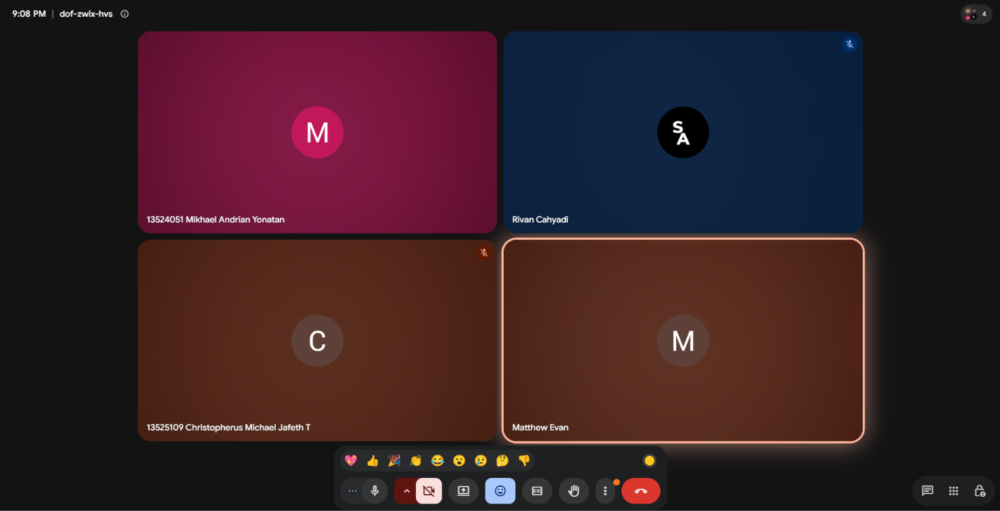

# Form Asistensi

## Tugas Besar IF2150 - Rekayasa Perangkat Lunak

| Informasi | Keterangan |
| --- | --- |
| **Hari** | Selasa |
| **Tanggal** | 27 Oktober 2026 |
| **Kelas** | K01 |
| **Nomor Kelompok** | G07 |
| **Nama Kelompok** | #PenjagaNilai |
| **Nama Perangkat Lunak** | PahamHukum |
| **Dokumen** | K01_G07_DPPL2.md |

### Anggota Kelompok

| NIM | Nama |
| --- | --- |
| 13525007 | Rivan Cahyadi |
| 13525019 | Raditya Wibian Sastaka |
| 13525064 | Matthew Evan Kurniawan |
| 13525100 | Wesley Lianto |
| 13525109 | Christopherus Michael Jafeth Tobing |

### Catatan

| Catatan |
| --- |
| 1. File yang dimasukkan ke BAB 6 bukan cuma gambar dari interface, tapi juga bukti yaitu file Figma yang editable. Link Figma terkait dimasukkan di bagian lampiran di paling akhir MS8 |
| 2. Untuk gambar per interface, sebenarnya disesuaikan dengan kebutuhan masing-masing baik website atau app. Untuk PahamHukum yang merupakan website, seharusnya responsive jadi ada dua tampilan yaitu Desktop dan Mobile. 1 Tampilan juga tidak masalah, tapi memudahkan di tahap selanjutnya |
| 3. Untuk BAB 6, dibutuhkan Tabel 6.1. Spesifikasi Objek Antarmuka [ID Layar], nah untuk objects yang dimasukkan adalah yang interaktif, baik yang bisa di klik atau melakukan aksi tertentu bagi user. Kalo sekedar text saja tidak usah dimasukkan |
| 4. Tentukan jenis objek sesuai standar UI component (button, input field, dll.), lalu isi konten (string-nya) dan keterangannya. Objek yang jenis dan fungsinya sama bisa digabung jadi satu, misalnya input field di halaman login meskipun data yang diinput berbeda. |
| 5. Jangan menulis query SQL di pseudocode. Cukup tulis {menjalankan query id-xxx}, karena query SQL sudah punya tabel tersendiri. |

**Notes for this section:**  
*Catatan dapat dituliskan dalam bentuk paragraf atau poin-poin, disesuaikan saja.* 

## Dokumentasi

<!--  -->

  

  <i>Gambar 1. Dokumentasi kegiatan asistensi.</i>

