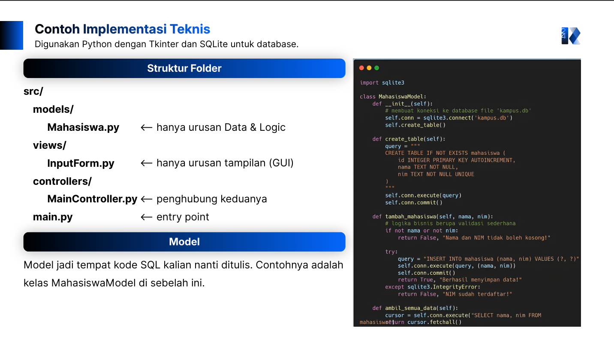

# Form Asistensi

## Tugas Besar IF2150 - Rekayasa Perangkat Lunak

| Informasi | Keterangan |
| --- | --- |
| **Hari** | Senin |
| **Tanggal** | 2 November 2026 |
| **Kelas** | K01 |
| **Nomor Kelompok** | G07 |
| **Nama Kelompok** | #PenjagaNilai |
| **Nama Perangkat Lunak** | PahamHukum |
| **Dokumen** | K01_G07_Implementasi.md |

### Anggota Kelompok

| NIM | Nama |
| --- | --- |
| 13525007 | Rivan Cahyadi |
| 13525019 | Raditya Wibian Sastaka |
| 13525064 | Matthew Evan Kurniawan |
| 13525100 | Wesley Lianto |
| 13525109 | Christopherus Michael Jafeth Tobing |

### Catatan

| Catatan |
| --- |
| 1. Pengumpulan Milestone 9 dilakukan melalui *Release Tag* pada repositori Github publik selambat-lambatnya pada Rabu, 11 November 2026, pukul 21.50 WIB. Pastikan seluruh struktur *source code* di dalam *folder* `src/` dan *file* `README.md` terlampir dengan lengkap sesuai persyaratan minimal. |
| 2. Laporan harus mencatat setiap perbedaan antara perancangan awal di DPPL dengan implementasi akhir beserta alasannya yang jelas. Selain itu, setiap kelas perancangan wajib dipetakan ke bentuk implementasinya untuk memperlihatkan perwujudan atribut, operasi, dan lokasi *file*-nya. |
| 3. Terapkan manajemen kode yang baik menggunakan alur kerja Gitflow dengan memisahkan *branch* utama dan *branch* fitur. Anda juga harus menggunakan pesan *commit* semantik serta menautkan setiap *Pull Request* pada *issue tracking* agar progres pengerjaan tim tercatat secara transparan. |
| 4. Pastikan pola arsitektur yang sebelumnya dirancang pada DPPL, seperti konsep MVC, tercermin dengan jelas pada struktur *folder* atau pembagian tugas komponen. Kelola semua dependensi menggunakan *file* konfigurasi standar dan hindari mengunggah *folder* lokal seperti `node_modules/` atau `venv/` ke dalam repositori. |
| 5. Pemilihan basis data dibebaskan, namun disarankan menggunakan basis data lokal seperti SQLite atau lingkungan Docker Compose agar mudah diuji. Saat melakukan *code review*, utamakan pemeriksaan logika kode dan pemenuhan spesifikasi fitur daripada memperdebatkan preferensi gaya penulisan yang sifatnya personal. |
| 6. Setiap kelompok diwajibkan menyertakan bukti *profiling* pada minimal satu fitur berat untuk menunjukkan perbandingan hasil kinerja sebelum dan sesudah optimasi. Selanjutnya, jabarkan setiap kendala teknis maupun *known issues* yang belum terselesaikan di dalam laporan sebagai bahan evaluasi asisten. |

## Dokumentasi

  

  <i>Gambar 1. Dokumentasi kegiatan asistensi.</i>

